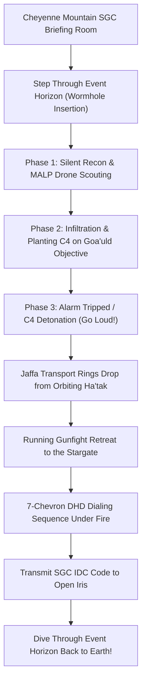

# GAME DESIGN DOCUMENT (GDD)
## Project SGC: Stargate SG-1 / SG-3 Tactical Extraction Shooter
> Team Discovery Channel Collaborative Initiative
> Stack-Ranked Consensus Outcome

---

### 1. Executive Summary & Core Hook
* **Tagline**: Step through the puddle. Sneak in. Plant the C4. Dial home under fire.
* **Genre**: Co-op Tactical Extraction Shooter & Wave Survival
* **Inspirations**: *Stargate SG-1*, *Helldivers 1*, *Door Kickers 2*, *Alien Swarm*, *GTFO*
* **Platform**: Desktop via Godot 4.x (GDScript) + Low-Poly Asset Packs (Synty FBX/glTF)
* **Camera Perspective**: Isometric / Top-Down 3D Tactical (Helldivers 1, Alien Swarm, Synthetik)
* **Target Delivery Window**: The 2-Week SGC Vertical Slice (Recommended)

---

### 2. The Grounding Pact & Anti-Scope Creep Rules
> **To ensure this game is completed within our sprint window**:
1. **Rule of Low-Poly Assets**: Zero custom high-poly modeling or 4K PBR texture baking. We use clean stylized low-poly meshes (Synty style) and invest our visual budget into shaders (Stargate kawoosh, staff plasma glow, transport ring beams).
2. **Rule of Shared Prefabs**: Every mission mode reuses the exact same Stargate, DHD, Jaffa AI, and weapon mechanics.
3. **The 2-Week Vertical Slice Gate**: No expanded lore or galaxy map before 2 players can connect, shoot Jaffa, dial the DHD, and extract through the puddle.

---

### 3. The Stealth-to-Loud Extraction Loop

---

### 4. SGC Squad Classes (Stack-Ranked)
* **#1 Heavy Support Marine (SG-3 Marine)** (3 pts • Ranked by: flaxos (#1)): M249 SAW light machine gun, claymore anti-personnel mines, deployable Browning .50 cal tripod, shoulder-fired rocket launcher for turret busting.
* **#2 Tech Specialist & Archaeologist (The Carter / Daniel)** (2 pts • Ranked by: flaxos (#2)): Armed with MP5. Fast DHD chevron dialer (cuts dial time in half), carries GDO transmitter for Iris override, deploys MALP/UAV scout drones, hacks Ancient terminals.
* **#3 Pointman / Recon Leader (The O'Neill / Mitchell)** (1 pts • Ranked by: flaxos (#3)): Suppressed P90, tactical C4 satchel, flashbangs, sprint dodge. Can tag enemies through walls and set remote detonators.
* **#4 Allied Jaffa / Tok'ra Infiltrator (The Teal'c / Bra'tac)** (1 pts • Ranked by: flaxos (#4)): Ma'Tok Staff weapon (heavy plasma blasts and melee parry), Zat'nik'tel (silent 1-shot stun / 2-shot kill), healing ribbon device, symbiote regeneration.

---

### 5. Signature Stargate Mechanics (Stack-Ranked)
* **#1 Remote C4 & Beacon Distractions** (3 pts • Ranked by: flaxos (#1)): Plant C4 on a fuel depot on a far ridge. Trigger detonation to pull Jaffa patrols away from the central temple entrance, opening a silent infiltration window.
* **#2 Transport Rings (Enemy Spawns & Tactical Flanking)** (2 pts • Ranked by: flaxos (#2)): Five glowing metallic rings slam down with iconic audio. Enemies arrive in drop waves, but clever players can throw grenades into descending rings or step inside to teleport across the compound.
* **#3 The 7-Chevron DHD Dialing Mini-Game Under Fire** (1 pts • Ranked by: flaxos (#4)): Dialing isn't a simple button press! One player must punch the 7 glyph chevrons on the DHD (or hold a sequence like a Helldivers Stratagem) while teammates form a defensive firing arc. Transmit the IDC code before diving into the event horizon!
* **#4 Authentic Zat'nik'tel Rules (1-Shot Stun, 2-Shot Kill/Disintegrate)** (1 pts • Ranked by: flaxos (#3)): 1st shot silently incapacitates Jaffa guards for 20 seconds. 2nd shot kills and vaporizes the body completely, preventing patrols from discovering corpses and triggering alarms!
* **#5 MALP / UAV Scout Drone Recon** (1 pts • Ranked by: flaxos (#5)): Pilot a wheeled MALP probe or miniature UAV drone through the Stargate first to map out Jaffa sentries, alarm horns, and Naquadah deposits on the squad's HUD.

---

### 6. Priority Mission Archetypes (Stack-Ranked)
* **#1 SGC Gate Room Foothold / Iris Defense (Horde Mode)** (3 pts • Ranked by: flaxos (#1)): A foothold situation in Cheyenne Mountain! The Iris is breached. Defend the Gate Room from waves of incoming Jaffa, seal blast doors, set up Browning .50 cals, and hold until techs force-dial out.
* **#2 Goa'uld Outpost Sabotage & Extraction** (2 pts • Ranked by: flaxos (#2)): Infiltrate a planetary fortress, plant C4 on a Naquadah power core or Tel'tak cargo ship, trigger a distraction, and fight back to the Stargate.
* **#3 Alpha Site / Village Evacuation Defense** (1 pts • Ranked by: flaxos (#3)): Protect a human settlement or off-world Alpha Site from swarms of Jaffa landing via transport rings while civilians escape through the dialed Stargate.
* **#4 Ha'tak Mothership Infiltration (via Transport Rings)** (1 pts • Ranked by: flaxos (#4)): Locate hidden transport rings on a planet surface, beam up into an orbiting Goa'uld Ha'tak, plant C4 on the hyperdrive crystal room, and ring back down before detonation.

---

### 7. Engine & Visual Polish
* **Engine**: Godot 4.x (GDScript) + Low-Poly Asset Packs (Synty FBX/glTF)
* **Visual Direction**: Stylized Low-Poly 3D + Next-Gen Dynamic Lighting (Synty × Deep Rock Galactic)
