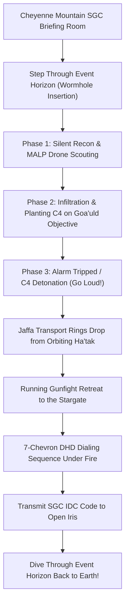

# GAME DESIGN DOCUMENT (GDD)
## Project SGC: Stargate SG-1 / SG-3 Tactical Extraction Shooter
> Team Discovery Channel Collaborative Initiative

---

### 1. Executive Summary & Core Hook
* **Tagline**: Step through the puddle. Sneak in. Plant the C4. Dial home under fire.
* **Genre**: Co-op Tactical Extraction Shooter & Wave Survival
* **Inspirations**: *Stargate SG-1*, *Helldivers 1*, *Door Kickers 2*, *Alien Swarm*, *GTFO*
* **Platform**: Desktop (Windows/Linux/Mac) via Godot 4.x (GDScript) + Low-Poly Asset Packs (Synty FBX/glTF)
* **Camera Perspective**: Isometric / Top-Down 3D Tactical (Helldivers 1, Alien Swarm, Synthetik)
* **Target Delivery Window**: The 2-Week SGC Vertical Slice (Recommended)

---

### 2. The Grounding Pact & Anti-Scope Creep Rules
> **To ensure this game is completed within our sprint window**:
1. **Rule of Low-Poly Assets**: Zero custom high-poly modeling or 4K PBR texture baking. We use clean stylized low-poly meshes (Synty style) and invest our visual budget into shaders (Stargate kawoosh, staff plasma glow, transport ring beams).
2. **Rule of Shared Prefabs**: Every mission mode (Outpost Sabotage, Iris Wave Defense, Ha'tak Infiltration) reuses the exact same Stargate, DHD, Jaffa AI, and weapon mechanics.
3. **The 2-Week Vertical Slice Gate**: No expanded lore or galaxy map before 2 players can connect, shoot Jaffa, dial the DHD, and extract through the puddle.

---

### 3. The Stealth-to-Loud Extraction Loop

1. **Insertion**: Squad emerges from the off-world Stargate onto an alien planetary outpost.
2. **Silent Recon**: Use suppressed P90s, MP5s, and 1-shot Zat stuns to clear sentries without sounding alarms.
3. **The Sabotage**: Plant remote C4 on Naquadah generators or weapons stockpiles; plant distraction beacons.
4. **The Alarm & Ring Drops**: Once C4 detonates, alarm klaxons sound. Transport rings slam down from orbiting Ha'taks, deploying Horus and Serpent guard strike teams.
5. **The DHD Holdout**: The squad retreats to the Stargate. One player must punch the 7 chevrons on the DHD under heavy fire, transmit the IDC code, and the squad extracts!

---

### 4. SGC Squad Classes

* **Pointman / Recon Leader (O'Neill archetype)**: Suppressed P90, tactical C4, flashbangs, sprint dodge.
* **Tech Specialist & Archaeologist (Carter/Daniel archetype)**: Fast DHD chevron dialer, GDO override, MALP/UAV scout drone.
* **Heavy Marine (SG-3 archetype)**: M249 SAW, claymore mines, deployable .50 cal tripod, rocket launcher.
* **Allied Jaffa / Tok'ra Infiltrator (Teal'c archetype)**: Ma'Tok Staff weapon, Zat'nik'tel (1-shot stun / 2-shot kill), symbiote resilience.

---

### 5. Signature Stargate Mechanics

* **The 7-Chevron DHD Dialing**: Physically dialing under enemy fire; transmitting GDO IDC code to open SGC iris.
* **Authentic Zat Rules**: 1 shot stuns silently; 2nd shot vaporizes the corpse to prevent patrol detection.
* **Transport Rings**: Volumetric ring drops for enemy reinforcements and tactical player repositioning.
* **Remote C4 Distraction**: Luring Jaffa patrols away from objectives with remote detonators.

---

### 6. Priority Mission Archetypes

* **Goa'uld Outpost Sabotage**: Infiltrate fortress, C4 Naquadah reactor, extract.
* **SGC Iris Foothold Defense**: Wave defense inside Cheyenne Mountain Gate Room against Jaffa breach.
* **Alpha Site Evacuation**: Hold defensive perimeter while civilians escape through the gate.

---

### 7. Engine & Visual Polish
* **Engine**: Godot 4.x (GDScript) + Low-Poly Asset Packs (Synty FBX/glTF)
* **Visual Direction**: Stylized Low-Poly 3D + Next-Gen Dynamic Lighting (Synty × Deep Rock Galactic)
* **Key Shaders**:
  - Event horizon water ripple & Kawoosh vortex.
  - Ma'Tok staff weapon glowing orange/blue plasma bolts.
  - Zat'nik'tel electrical arc particles with disintegration dissolve.
  - Transport ring cylindrical volumetric beam.
