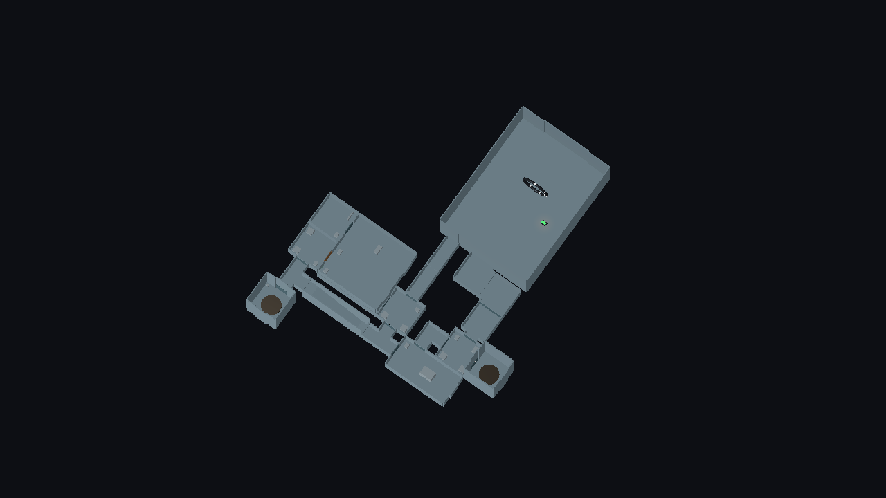

# Goa'uld Infiltration — greybox mission

Roadmap milestones **GI-0** (layout) and **GI-1** (mission). A fourth selectable mission on a purpose-planned two-deck compound, built to be finished quietly or loudly. It is the shared testbed for the next stealth, event, cover and art work. Everything renders in the neutral placeholder style: the layout's theme is `goauld`, which falls back to neutral because no Goa'uld art exists yet.

**Deploy through the Stargate → sabotage the generator → download the command records upstairs → return to the Stargate.**



## Play it

Godot **4.4.1**, from a checkout containing this mission:

```sh
godot --path client -- --mission goauld_infiltration
```

Or pick **Goa'uld Infiltration — Greybox** in the lobby and press **Launch Infiltration**. Difficulty is not used. Dedicated servers and second players work as for the [modular extraction mission](modular-extraction-mission.md#play-it), which shares the same mission host.

| Step | HUD text | Completes when |
|---|---|---|
| 1 | Sabotage the generator controls | An operative within 3.5 m uses the generator room's console |
| 2 | Download the command records on the upper deck | An operative uses the command room's main console |
| 3 | Return to the Stargate — all standing operatives | Every standing operative is within 4 m of the gate room's entry marker |

Extraction and result rules are the same as the extraction mission's: downed operatives neither block extraction nor are required, nobody standing is a failure, and the first result is final.

## The compound

`client/resources/levels/goauld_infiltration_01.tres`, 20 rooms on two decks, authored only through `python3 tools/level_authoring.py plan`. No coordinates were written by hand. The brief and its route requirements are in [`briefs/goauld_infiltration_01.requirements.json`](briefs/goauld_infiltration_01.requirements.json); `topology` reports all eight passing.

| Area | Rooms | Notes |
|---|---|---|
| Insertion | `gate` | `stargate_dhd` preset in the large hangar shell. Its narrow and wide exits start the two routes. The gate and DHD are present but inert |
| Guarded route | `approach`, `approach2`, `checkpoint`, `inner` | Narrow corridors to the security checkpoint, then the inner junction |
| Garrison | `barracks`, `armoury` | Off the checkpoint |
| Quiet route | `service`, `service2`, `svc_adapter`, `stores`, `maint` | Wide service corridor, width adapter, cargo stores, maintenance corridor |
| Objective 1 | `generator` | Two doors: reached from the inner junction or from maintenance |
| Upper deck | `ramp`, `up_hall`, `cmd_antechamber`, `cmd_command`, `cmd_observation` | Ramp from the inner junction; command section behind a guarded antechamber |
| Rings | `ring_lower` (off stores), `ring_upper` | Paired, idle. Rings are not a walking route and nothing triggers them yet |

Checked requirements: two room-disjoint routes from the gate to the generator; a route to the generator that avoids the checkpoint; command reachable only by the ramp; the objective order gate → generator → command → gate is walkable; the required room roles; four declared dead ends; connected.

### Planning notes

The first plans failed in ways worth knowing for the next layout:

- The barracks wing composite would not fit on the inner junction or the checkpoint. Clusters are placed after the main graph, and the loop left no free doorway facing open space. Barracks and armoury became ordinary planned rooms instead.
- With single corridors on each route, the loop came out as a 3 × 3 block with the checkpoint walled in on all four sides. One extra corridor on each route spread it out, left the checkpoint a free side for the barracks, and made both routes longer.

## Patrols

Six Jaffa in five groups, all using the [sentry perception](modular-extraction-mission.md#jaffa-combat-on-modular-levels) from ST-1:

| Group | Rooms (patrol markers) | Size | Role |
|---|---|---|---|
| Checkpoint | `barracks`, `checkpoint`, `approach2` | 2 | Guards the loud route |
| Generator watch | `inner`, `generator` | 1 | Both routes meet here |
| Stores | `stores`, `ring_lower` | 1 | The quiet route needs timing past it |
| Upper hall | `up_hall`, `cmd_antechamber` | 1 | Ramp head |
| Command | `cmd_command`, `cmd_observation` | 1 | Objective 2 |

An earlier version patrolled `stores` ↔ `svc_adapter`, along the quiet route itself. In those narrow rooms the sentry always faced an operative on its path, so the automated quiet-route check could not pass. Patrolling into the side ring room instead makes the route a matter of timing.

## Automated coverage

```sh
python3 tools/run_godot_tests.py test_goauld_infiltration_mission test_mission_selection_uat --timeout 300
```

`test_goauld_infiltration_mission` runs the production lobby, mission host and sentries:

- `--mission` preselection, the fourth lobby entry and its button; layout, definition and HUD banner; six sentries patrolling.
- For six seconds after spawn no sentry can see any spawn point, and nobody is aware.
- Standing at the checkpoint gets the operative alerted within 20 s.
- After a retry, the operative moves room by room along the quiet route. It steps only into spots no sentry can currently see and falls back a room when its own spot comes into view. It reaches the generator console without any sentry becoming alerted, and completes objective 1.
- Objectives 2 and 3 complete in order; the result is a success and the sentries stand down. After another retry, a downed lone operative fails the mission.

The quiet-route case teleports between room centres. It shows the route can be done unseen under the current patrols; it does not show how it feels to walk. Late joining, dedicated servers and replicated awareness are covered by the shared host's suites (`test_modular_extraction_multiplayer`, `test_modular_extraction_dedicated`), not repeated here.

## Human UAT checklist (pending)

Record commit, peer roles, route taken, time to finish, where you were seen, and anything that felt unfair or empty.

1. Launch from the lobby. Confirm the HUD shows objective 1, six hostiles and the mission title.
2. Take the quiet route (wide exit, service corridor, stores, maintenance) and reach the generator unseen. Note how long you waited for the stores sentry.
3. Retry and take the checkpoint route. Confirm the checkpoint guards notice you and the generator watch joins.
4. Climb the ramp, deal with the antechamber and command sentries, and use the main console.
5. Return to the gate. Confirm extraction and the debrief.
6. With two players: one quiet, one loud. Note whether the alert spreading to nearby sentries feels fair.
7. Watch for the **?** and **!** tells: can you read them in time from the third-person camera?

## Known limitations

- **Greybox:** neutral placeholder art; no Goa'uld visuals.
- **No consequences beyond the local alert:** no alarm console, no reinforcements, no locked doors (EV-1, EV-2).
- **No hearing:** gunfire does not draw sentries that cannot see it (ST-2).
- **Cover is still the room `cover` marker**, not the checkpoint's sandbag props (TA-1).
- **The Stargate does nothing:** insertion is a spawn in the gate room and extraction is walking back to it. Gate travel is GT-2.
- **Rings are idle** and are not a walking link for players or AI.
- **Patrol timings are untuned.** The quiet route was checked automatically, not played.
