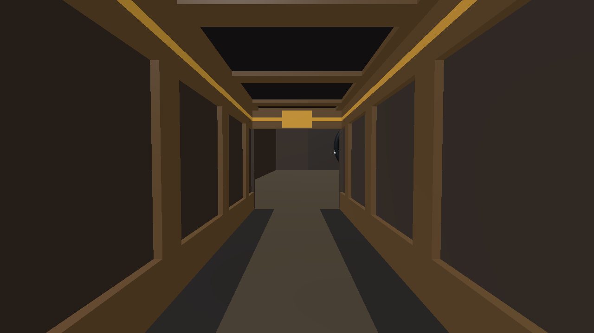
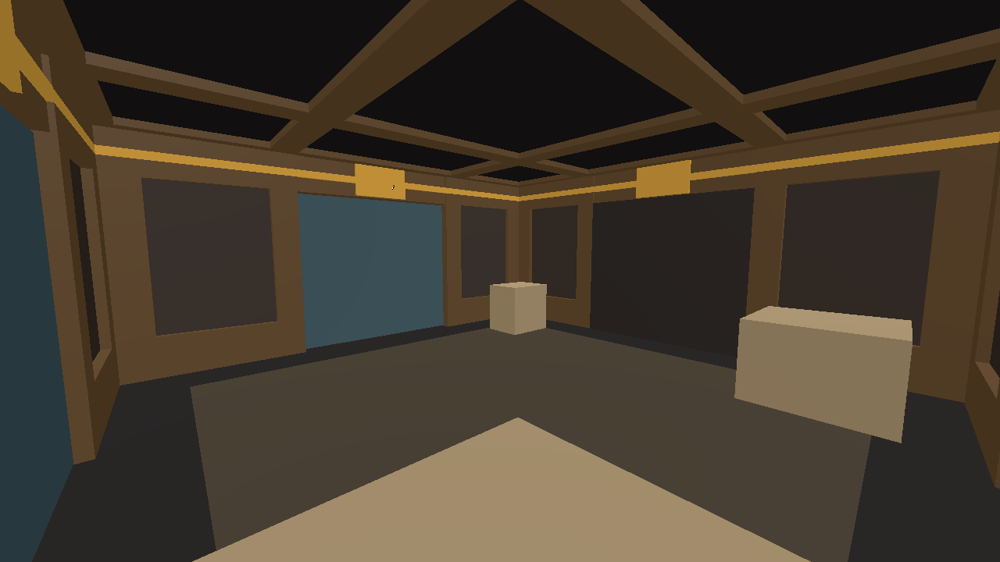
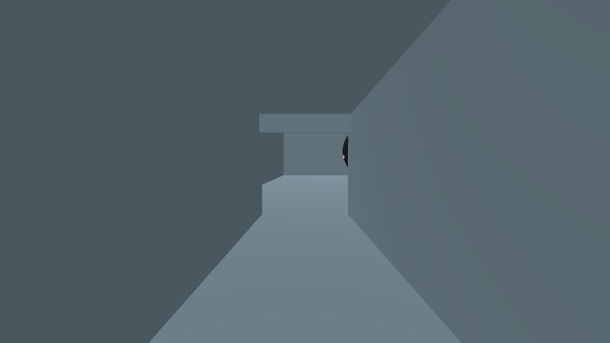
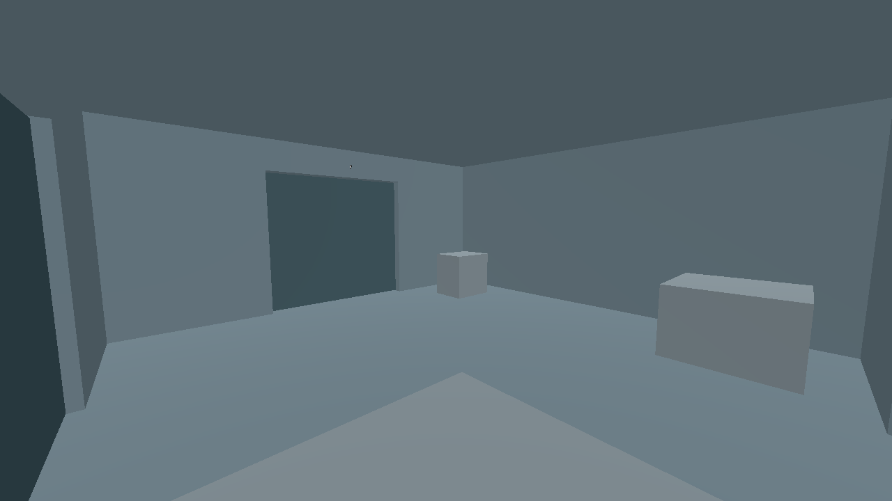
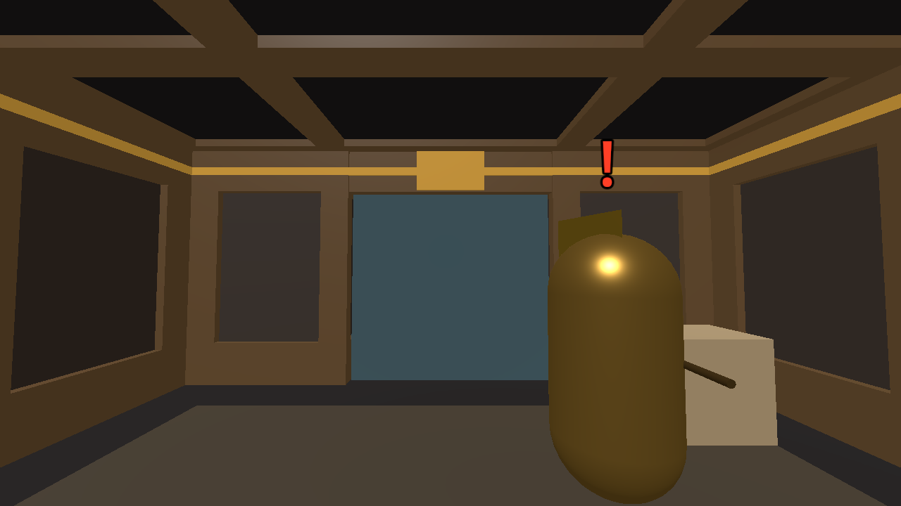
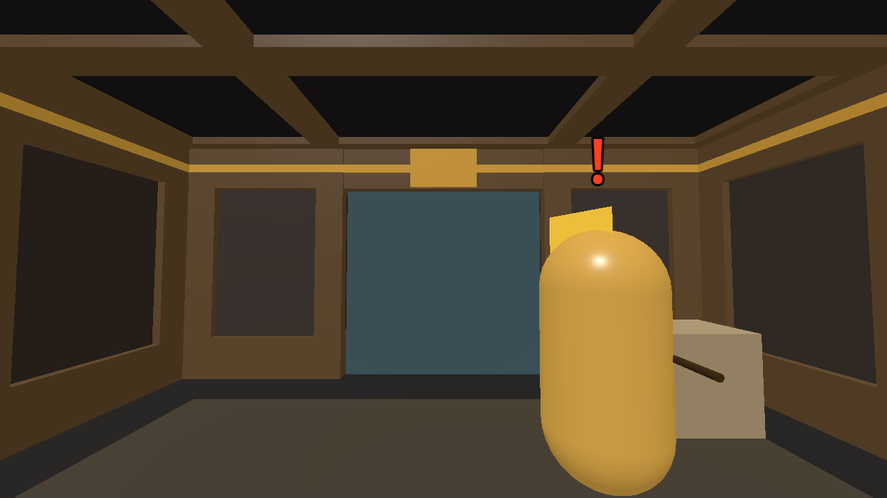

# Goa'uld theme kit (GA-1)

The first faction art in the game: a palette that reaches every room of a `goauld` layout, and built pieces for the narrow corridor and the compact chamber. It is the design in the [Goa'uld visual brief](goauld-visual-brief.md), made in the engine by a generator ([D-012](../DECISIONS.md)).

Nothing here changes collision, sockets, positions or navigation ([D-010](../DECISIONS.md)). An automated suite proves that on the infiltration compound. **A person has not yet reviewed the look**: that is this milestone's open gate.

## What a player sees

| | Rooms in the infiltration compound | What changes |
|---|---|---|
| **Pieces** | 8 of 20: both approach corridors (`Room01Straight`) and the checkpoint, stores, barracks, armoury, antechamber and observation room (`Room04Chamber`) | Ribbed walls, a plinth, a frieze with a gold band, door lintels with a gold block, a floor runner and margin, a coffered ceiling |
| **Palette only** | The other 12 | The same slabs in dark stone, with bronze lintels and sandstone props |

Captures, taken under the mission's own lighting, are in [`docs/reviews/ga1-captures/`](../reviews/ga1-captures/):

| Corridor | Chamber |
|---|---|
|  |  |
| Neutral, same shot:  | Neutral, same shot:  |

Others in the folder: `chamber_door` (a lintel and door leaf), `chamber_corner` (a corner pier and a sealed opening), `corridor_wall`, `corridor_lintel`, `cover` (props in the stores) and `palette_only` (a room without pieces).

## How it is built

```sh
python3 tools/theme_kit.py            # regenerate the kit
python3 tools/theme_kit.py --check    # fail if the committed kit is stale
```

`tools/theme_kit.py` reads the two module scenes, and for every structural slab writes a piece that fills exactly that slab's box:

| Output | Contents |
|---|---|
| `client/resources/level_themes/goauld.tres` | The theme: one material per resolver slot, and 20 variants (one per slab of the two modules, each with its rotation) |
| `client/resources/level_themes/goauld/*.tres` | Eight materials, one per palette role. Change a colour here by changing `PALETTE` in the generator |
| `client/scenes/level/themes/goauld/*.tscn` | Eight piece scenes: box meshes only, no scripts, no collision |

**Do not edit the generated files by hand.** A unit test fails when they differ from the generator's output.

The rules the generator applies, each from the brief:

- **Walls.** The slab is split into a back half and a front half. The front carries a plinth to 0.6 m, ribs between 0.6 m and 2.8 m, and a frieze above 2.8 m with a gold band at 3.04 to 3.16 m. The gaps between ribs are the panels, recessed 0.10 m.
- **Where ribs go.** A wall end beside a door opening gets a 0.4 m jamb. A wall end in a corner gets a pier 0.6 m long, of which 0.2 m is inside the other wall. Elsewhere ribs sit on a 2 m grid from the module's centre (±1 m, ±3 m), wherever a rib fits with at least 0.3 m of panel either side. The corridor gets four grid ribs; a chamber segment gets a jamb and a pier.
- **Lintels.** A bronze header, recessed 0.04 m, with the gold band and a gold block 1.0 m wide.
- **Floors.** Colour only: a 1.6 m runner in a corridor, a 0.7 m margin round a room. Every box is the full slab thickness, so the walking surface does not move.
- **Ceilings.** Beams flush with the slab's lower face and bays recessed 0.10 m upward, inside a flush border. Corridor beams follow the wall ribs; chamber beams spring from the door jambs.

### Three things found by looking at it

1. **Nothing is metallic.** A mission has no sky and no reflection probe. A metallic surface there loses its albedo, and gold rendered the same dull brown as bronze. All eight materials have `metallic = 0`; sheen is roughness only.
2. **A ceiling needs a flush border.** Walls and lintels stop at the ceiling slab's lower face. Bays that reached the slab's edge left a 0.10 m slit above them, open to the void outside the level.
3. **A lintel's gold stands 5 mm proud.** Ten modules (`Room05` to `Room13`, `Room15`, `Room16`) place their north and south headers 0.2 m outside their own cell, in the slab the adjoining room's lintel occupies. With one material that overlap is invisible; against a built lintel it flickered. The gold block and band now stand 5 mm in front of the slab, inside the resolver's 1 cm tolerance, so they are drawn in front of such a header. Moving those headers is a structural change to ten modules and is left for a separate task (risk R21).

## Status reporting

`LevelThemeResolver.describe` now reports how much of a room a theme reaches:

| Field | Values |
|---|---|
| `visual_source` | The first theme in the fallback chain with art of its own. `goauld` for every room of a `goauld` layout |
| `coverage` | `pieces` when that theme has built scenes for the room's module, `palette` when it only recolours the slabs, `generic` when no theme applies |

`python3 tools/level_authoring.py validate --layout … --summary` counts rooms by both. The infiltration compound reports `goauld -> goauld (pieces)`: 8 and `goauld -> goauld (palette)`: 12.

A theme's `materials` must be keyed by the resolver's slot names: `floor`, `ceiling`, `door_frame`, `portal`, `wall`, `detail`, `prop`. `validate_theme` now rejects any other key, where it used to ignore it silently. The five other themes still declare the older descriptive names in `decoration_slots`; that list is catalogue text and nothing reads it.

## Readability, measured

Contrast ratios sampled from captures of the same chamber shot, under the mission's lighting. Higher is easier to see; 1.0 is invisible by brightness alone.

| What | Against | Neutral before | Goa'uld, armour as it was | Goa'uld, as merged |
|---|---|---|---|---|
| Alerted marker **!** | wall panel | 1.4 | 3.6 | **3.6** |
| Alerted marker **!** | bronze rib | 1.4 | 2.6 | **2.6** |
| Cover prop | floor | 1.0 | 2.6 | **2.6** |
| Cover prop | wall panel | 1.2 | 3.3 | **3.3** |
| Jaffa armour | wall panel | 1.9 | 1.3 | **5.0** |
| Jaffa armour | bronze rib | 1.9 | 1.1 | **3.6** |
| Door leaf | bronze jamb beside it | 1.7 | 1.0 | **1.0** |
| Door leaf | wall panel | 1.7 | 1.5 | **1.5** |

Sources: [`chamber_door_neutral_jaffa_before.png`](../reviews/ga1-captures/chamber_door_neutral_jaffa_before.png), [`chamber_door_jaffa_before.png`](../reviews/ga1-captures/chamber_door_jaffa_before.png), [`chamber_door_jaffa.png`](../reviews/ga1-captures/chamber_door_jaffa.png).

**Jaffa armour is now matte ([D-015](../DECISIONS.md)).** The brief predicted that Jaffa would stand out from dark walls, from the armour's stated gold. They did not: the armour was metallic (0.85 to 0.95), and for the reason in point 1 above it rendered as a dark olive in every mission. Against bronze that measured 1.1 : 1, worse than against the old grey walls. The owners chose to remove the metallic term from both Jaffa scenes. They are now the brightest warm shape in a room, here and in SGC Defense. The staff weapon keeps its metallic finish.

| Before | After |
|---|---|
|  |  |

**Door leaves are told from their jambs by colour, not brightness.** A teal leaf between brown jambs under a gold block is easy to find in the captures, but it relies on hue. If it reads poorly in play, the remedy is a themed door leaf (gap G-2 in the brief), not a lighter wall.

## Tests

| Suite | Proves |
|---|---|
| `client/tests/test_goauld_theme.gd` | On the infiltration compound: all 20 rooms report `goauld`; 8 have pieces and 12 the palette; every slab of the pieced rooms is replaced; collision shapes, navigation vertices and polygons, module, socket and marker poses, and the count of cover props are identical to the same compound built neutral; gold is above 2.8 m; floors are flat; relief faces the room; piers are in corners and jambs at doors; an unknown material key is rejected |
| `tools/tests/test_theme_kit.py` | On the generator's geometry, without the engine: the committed kit is current; each piece fills its slab; no two boxes share volume; no piece can be seen through; ceilings are flush all round their edge; floors are colour only; gold is an accent above door height; the palette keeps the Jaffa, the markers and cover above stated contrast; nothing in the kit is metallic, and nor is Jaffa armour |
| `client/tests/test_level_themes.gd`, `test_level_demonstrations.gd` | Updated: `goauld` now reports its own art; the other four factions still fall back to neutral |

## Review captures

```sh
godot --path client --script res://scripts/level/theme_capture.gd -- --output /tmp/captures
```

Needs a graphical display. Options: `--layout <res path>`, `--theme neutral` (force another theme for a side-by-side), `--shots corridor,chamber`, `--jaffa` (an alerted guard in the chamber and corridor shots). File names carry the options used. The `_before` files in the folder were taken with the old metallic armour.

## Human review (pending)

Play `godot --path client -- --mission goauld_infiltration` from a checkout of this branch, and answer:

1. Do the corridor and the chambers read as one place, and as somewhere other than the neutral test facility?
2. Can you pick out each door at a glance from across a chamber?
3. Can you see an unaware Jaffa against the walls in time? Is the matte gold armour right, here and in SGC Defense?
4. Is cover obvious? Are the **?**, **!** and **!!** markers clear?
5. Does anything flicker, or can you see out of the level anywhere?
6. Do the twelve palette-only rooms look unfinished next to the eight with pieces, and which should be next?

## Not in this milestone

| | Where it goes |
|---|---|
| The other 13 modules (T-junction, corners, wide corridors, long and large chambers, ramp, rings, gate room) | GA-2, in the order of the brief's section 4.2. `MODULES` in the generator is the list to extend; tall rooms need a second frieze tier (G-8) |
| Lighting: warm ambient, fixtures, removing the fixed directional light | V3 (G-3) |
| Themed door leaves | G-2 |
| Free-standing decoration: columns, braziers | G-5 |
| Textures and modelled replacements | After the shapes are approved; the piece boxes in the brief are the contract |
