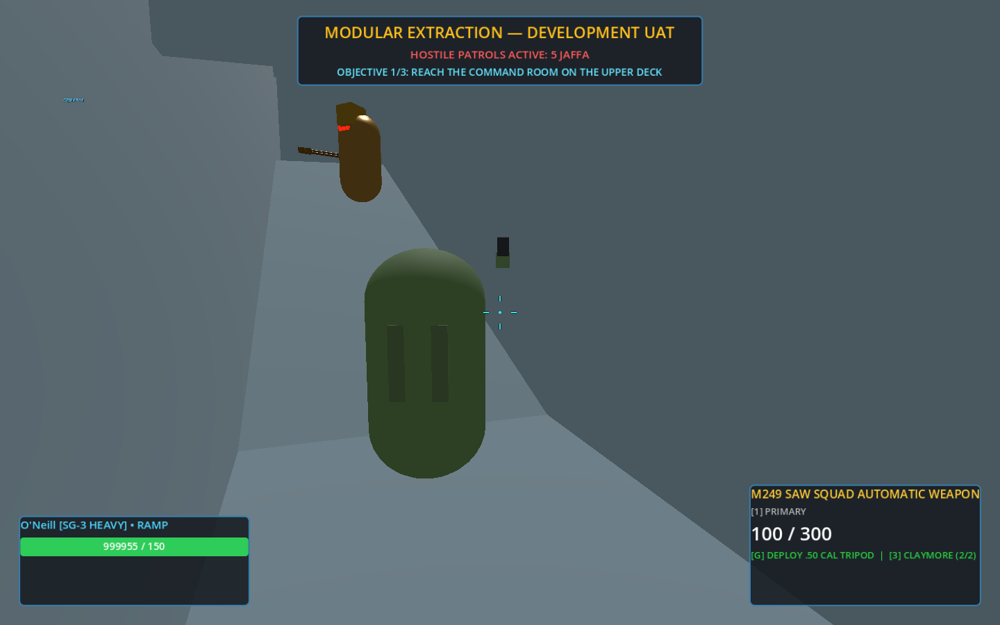
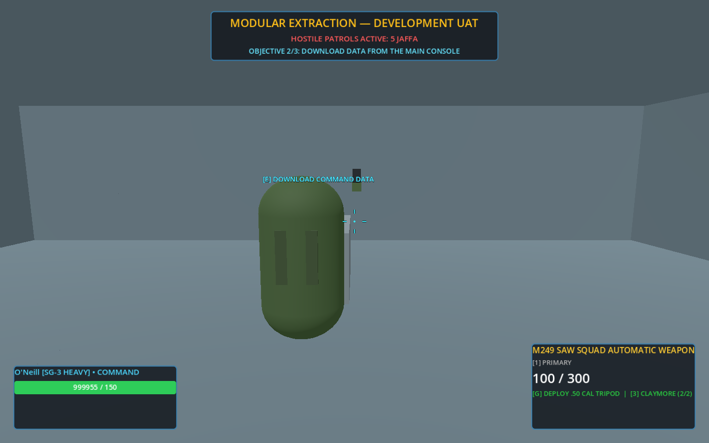
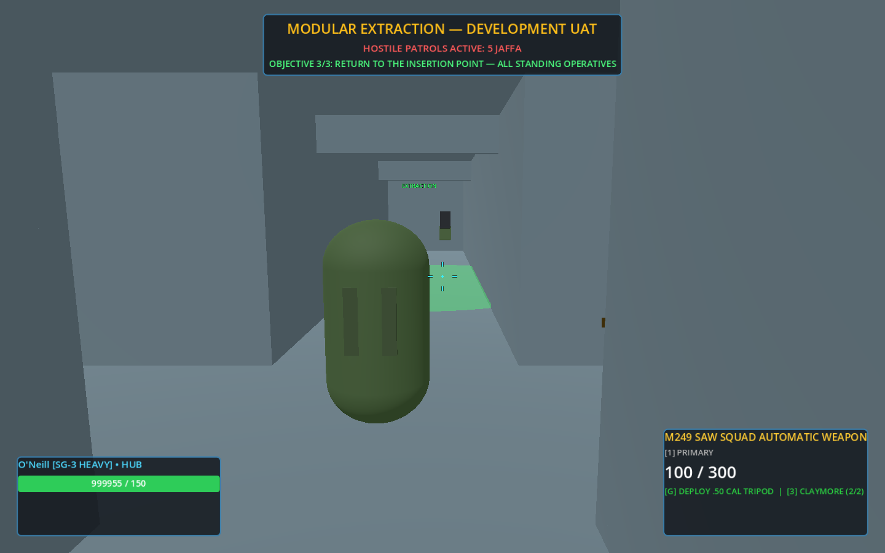
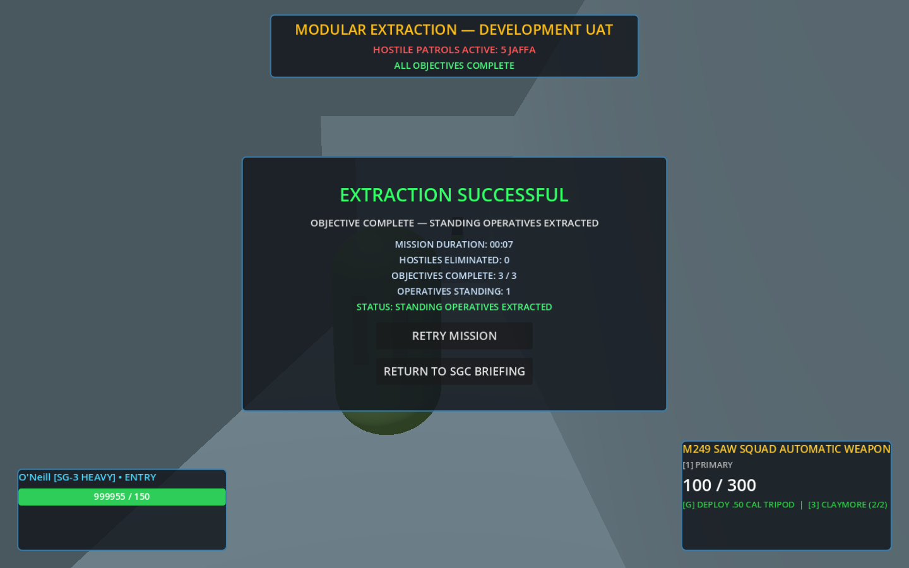

# Modular Extraction UAT — first playable modular mission

A selectable development mission on the integrated modular fixture:
**deploy → cross a patrolled facility → use a console → return to extraction → shared result.**
It is a limited vertical slice. There is no gate travel, stealth, reinforcement or campaign state.



## Play it

Use Godot **4.4.1** from a checkout of this branch.

```sh
godot --path client -- --mission modular_extraction_uat
```

For a dedicated server, run `godot --headless --path client -- --server --port 7777 --mission modular_extraction_uat` and connect clients as described in the [player guide](../PLAYING.md#multiplayer). There is no host operative; any connected operative's **Retry mission** restarts it for everyone.

The flag only preselects the mission; without it, pick **Modular Extraction UAT — Development** in the lobby's mission list. Host with **Establish SGC Base**, then **Launch Extraction UAT**. A second player joins from their lobby with the host's address, before or after launch. Difficulty is not used.

| Step | HUD text | Completes when |
|---|---|---|
| 1 | Reach the command room on the upper deck | A standing operative enters the `command` room |
| 2 | Download data from the main console | An operative within 3.5 m presses interact at the main console |
| 3 | Return to the insertion point | See the extraction rule below |



Route: south from the entry corridor to the hub, south again up the ramp, then east at the upper junction. Five Jaffa patrol in three groups: the wide service loop through the hub, the upper deck in front of the command room, and the cargo branch.

## Extraction and result rules

- Extraction is locked until steps 1 and 2 are complete. Standing in the zone earlier does nothing.
- The mission succeeds when **every standing operative is inside the extraction zone, and at least one is**. "Standing" means alive and not downed.
- Downed and dead operatives do not block extraction and are not required. They are left behind; the squad still gets a success.
- A standing operative outside the zone blocks extraction until they arrive or go down.
- If no operative is standing, the mission fails. This is the existing SGC squad-down rule, unchanged.
- The first result is final. A squad wipe after success, or a late completion after failure, changes nothing.
- The result, debrief screen and **Retry mission** use the existing shared mission-result and restart path.




## How it is built

| Piece | File | Notes |
|---|---|---|
| Mission host | `client/scripts/mission/ModularMission.gd`, `client/scenes/mission/ModularExtractionMission.tscn` | Extends `GateRoom`. Player spawning, late joins, squad-down failure, result replication and retry are inherited. SGC-only nodes (map, gate, waves, shrouds) are absent |
| Mission data | `client/resources/missions/modular_extraction_uat.tres` | Layout, ordered objectives and patrols. Room, marker and attachment ids only; no coordinates |
| Data contract | `MissionDefinition.gd`, `MissionObjective.gd`, `MissionPatrol.gd` | Objective kinds: `reach`, `interact`, `extract`. `validate()` rejects unknown rooms and attachments |
| Progression | `MissionObjectives.gd` | Server decides every completion. Clients receive the active index and request a snapshot on joining. Updates are monotonic, so repeats and crossed snapshots are ignored |
| Console use | `MissionInteractable.gd` | Added to the existing `main_console` attachment. Clients send identity; the server checks sender, reach, health and objective order |
| Lobby entry | `NetworkManager.MISSIONS`, `Lobby.gd` | Third mission; SGC Defense and SGC UAT entries are untouched |

The level is the canonical `modular_integration_demo.tres`, loaded read-only. Players spawn on four points around its saved entry marker; after the navigation bake the host checks each point is on walkable floor and refuses to start patrols otherwise.

To make another mission, save a new `MissionDefinition` and a scene that points at it. The host script needs no changes.

## Jaffa combat on modular levels

Changes to `JaffaAI.gd` are confined to the patrol state, which only `start_patrol` uses, and to levels where a `LevelAssembly` is found. SGC behaviour is unchanged.

- A patrol that sights an operative now reacts like an interrupted column: rank 0 halts and suppresses, later ranks run to cover. Patrols within weapon range are alerted.
- On a modular level, cover is the nearest reachable room `cover` marker on the same deck that is at least 4 m from the threat and within 24 m (`LevelNavigator.cover_position`). The SGC cover and flank coordinates are not used.
- **Fallback:** with no qualifying marker the Jaffa holds its current position and fights from there.
- When contact is lost the Jaffa waits out the existing suppression timer, then resumes its patrol route.

Perception, weapons and damage are the existing code paths.

## Netcode fixes found on the way

Both are in shared code and affect SGC missions too.

1. **Server-owned actors were invisible to clients.** `NetworkManager.configure_mission_sync` turned public visibility off and relied on a filter, but nothing ever granted per-peer visibility. In a real session a client received its own operative only: no host operative, no Jaffa, and its own position never reached the host. Confirmed on unmodified SGC UAT with a listen host. The filter now gates unready peers on its own.
2. **Retry raced client state.** Once client positions reached the host, the host could free an operative while that client's last updates were in flight, which logged engine errors. Clients now stop publishing and acknowledge before the host despawns (1.5 s timeout).

## Automated coverage

```sh
python3 tools/run_godot_tests.py test_modular_extraction_mission test_modular_extraction_multiplayer test_modular_extraction_dedicated test_mission_selection_uat --timeout 300
```

| Suite | Covers |
|---|---|
| `test_modular_extraction_mission` | Lobby selection and launch; entry spawn; patrols on named room markers; locked extraction and console; real patrol detection, staff fire and damage; marker cover reached; patrol resumes after contact; lone operative downed by real fire fails the mission; first result is final; after the result no Jaffa moves or fires and the operative takes no damage or bleed-out; mission banner set on change, not per frame; debrief without SGC wording; a standing operative is targeted over a nearer downed one, and a downed one only when nobody standing is in reach; retry leaves no stale Jaffa, stations or objective events; reach, out-of-reach and downed console refusals; revive; duplicate console use; extraction with a standing, downed and absent teammate; success result |
| `test_modular_extraction_multiplayer` | Two processes through the production autoload and lobby start. Client joins after step 1 while the host is taking fire and health changes every frame, and its log must contain no engine error; it receives the snapshot, host operative and five Jaffa; each replica is checked against the host's position; server refuses an out-of-reach and a local-only console attempt; client completes step 2; extraction waits for the standing host; both peers show the same result; after it, hostiles stand still and nobody takes damage on either peer; coordinated retry |
| `test_modular_extraction_dedicated` | A child process started with the real `--server --mission modular_extraction_uat` flags: no lobby, no host operative, patrols run with nobody connected and no squad-wipe result. A client joins, spawns on the entry markers, sees replicated patrols and the mission banner, completes step 1 by position, asks for a retry and gets a fresh world. When the server exits the client returns to the lobby. The server log must contain no engine error |
| `test_mission_selection_uat` | Now expects three missions; SGC UAT and Defense checks unchanged |

In all three suites the test only places operatives and reads state. Jaffa movement, perception and fire are the production controller.

`godot --path client --script res://tests/support/modular_extraction_review.gd` (needs a display) replays the mission through the real lobby start and writes stills to `build/extraction-review/`.

## Human UAT checklist (pending sign-off)

Record commit, peer roles, expected and actual result for each line.

1. **Solo:** launch from the lobby. Confirm spawn in the entry corridor, objective 1 on the HUD and five hostiles listed.
2. Stand in the entry corridor for ten seconds. Nothing completes.
3. Walk to the command room. Confirm Jaffa patrol, notice you, fire and that one of a pair moves away to cover. Doors open with interact.
4. Enter the command room: objective 2 appears. Use the main console: objective 3 appears, the console reads COMPLETE and a green ring marks the entry corridor.
5. Return to the ring. Confirm the success screen, then **Retry mission** and confirm a clean restart.
6. Let the Jaffa down you while alone. Confirm the failure screen.
7. **Two players:** host launches; second player joins after the host has entered the command room. The joiner should see objective 2, the host and the Jaffa.
8. Joiner uses the console. Both HUDs move to objective 3.
9. One player waits in the ring while the other stays outside: no result. Second player enters: both see success.
10. Repeat with one player downed outside the ring: the standing player alone completes extraction. Revive a downed teammate once and confirm play continues.
11. Launch SGC Defense and SGC UAT once each and confirm they behave as before, including a second player seeing the host and Jaffa.

## Known limitations

Each item below was re-checked against the code on 12 November 2026 and is tracked, with its planned fix, in the [risk register](../plans/master-development-roadmap.md#7-risk-and-defect-register).

- **Perception is the existing rule:** any operative within 22 m is acquired even through walls or a deck. Patrols converge quickly; this is not stealth.
- **Cover markers sit at room centres** in the current kit, so "cover" is a fallback position in an adjacent room, not concealment. Better cover needs authored markers, not code.
- **A downed operative is only targeted when no standing operative is known** to that Jaffa (since EX-1). Solo play still fails on the first down, through the unchanged squad-down rule.
- **No friendly airmen, resupply or armoury** in this mission.
- **Carried over from navigation:** no rerouting around locked doors, no avoidance between NPCs, AI leaves doors open.
- **HUD and debrief panels** are the SGC ones; this mission supplies its own banner and debrief text, and the debrief's leave button reads **Leave mission**. Mission duration and hostiles eliminated are shown; other SGC statistics are replaced.
- **On a dedicated server any operative can restart the mission** from the pause or debrief menu, not only after a result.

## Remaining blockers for SGC → Stargate → offworld travel

1. **One world per mission.** `NetworkManager.MISSIONS` maps an id to one scene and `MainGameCoordinator` swaps the whole world. Travel needs either two spaces loaded at separate origins or a mid-mission swap that keeps players, health and inventory.
2. **The gate ends the mission.** `StargateRing.player_extracted` calls `_finish_mission`. It must instead hand the operative to a transition.
3. **Spawner and snapshot scope.** Player, enemy and gadget spawners and all snapshot RPCs are children of one world root. A second space needs its own containers, and late joiners need to know which space each operative is in.
4. **Mission state above the world.** Objectives live under the mission scene and reset on a swap. Travel needs objective state owned above the worlds.
5. **Offworld gate room.** The modular kit has a `stargate_dhd` preset, but no mission uses it and inbound/outbound rules are owned by `WaveManager`.
6. **`GateRoom` still carries SGC specifics** (sectors, shutters, blast doors). This mission overrides or bypasses them; a second modular mission would justify extracting a slim shared host.
7. **Readiness during transit.** The mission-ready gate assumes one load per mission. A second load needs the same handshake without dropping in-flight actors, as the retry fix above shows.

## Recorded delivery evidence

Godot **4.4.1.stable.official.49a5bc7b6**, clean worktree of this branch: the full profile ran once after integration and passed **68/68** checks (project import, 66 suites and the persistence reader), including every existing SGC and multiplayer suite. The two-process suite was repeated six times after the retry fix without a failure. The stills above come from the real lobby start on a graphical display. Human UAT is pending.
