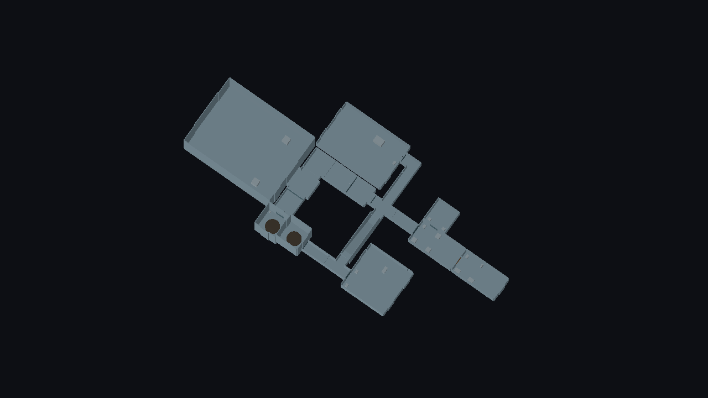

# Integrated modular construction fixture — Batch D

`res://resources/levels/modular_integration_demo.tres` is a neutral, two-deck toolchain demonstration. It uses 20 external room instances, all 15 structural PackedScene archetypes, and 19 connections. The native layout is the sole saved construction source. No new geometry, mission, enemy activation, artwork or runtime system is introduced.

The fixture was authored through the shared [AI/native authoring CLI](ai-level-authoring.md), using named socket attachments and automatic joining. One invalid doorway name was rejected before publication; correcting the disposable request produced the saved layout. The existing engine, authoring API and validators needed no changes.



The overview uses the standard roof cutaway. Tall ring chambers and the ramp are existing assets; both decks retain physical ceilings.

## Contents and routes

| Area | Stable instance IDs | Demonstrated behaviour |
|---|---|---|
| Entry and hub | `entry`, `hub` | Narrow straight and four-way junction, open corridor joins |
| Generator branch | `elbow`, `generator` | Narrow L-shaped corridor and large special hall with generator preset |
| Stores and quarters | `stores_approach`, `cargo`, `barracks`, `control` | Long chambers, small chamber, cargo/barracks/control presets, standard doors and one security door |
| Wide service route | `width_adapter`, `wide_straight`, `wide_elbow`, `wide_junction`, `return_adapter` | Both narrow/wide transitions, wide corridor/corner and a capped wide junction |
| Hangar branch | `hangar` | Existing oversized structural shell and cargo/hangar preset, connected through its wide entrance |
| Deck transition | `ramp`, `upper_junction` | Continuous physical ramp from `deck0` at 0 m to `upper` at 4 m; upper T-junction |
| Command branch | `command` | Large square chamber and command preset; saved destination |
| Transport route | `lower_rings`, `upper_approach`, `upper_rings` | Existing tall chambers and shared ring scenes, reciprocal stable endpoint IDs across decks |

Start at `entry`. Its north branch passes through `elbow` to the generator. Its south branch reaches `hub`: east leads to cargo, control and barracks; west reaches the wide service route, hangar and lower rings; south climbs the ramp. At the upper junction, east reaches command and west reaches the upper rings. All rooms have continuous walking access; ring transport is not used as a navigation substitute.

Corridor joins are open. Room entrances use existing E-operated doors. The cargo/barracks connection is a security door with access ID `crew_quarters`, initially unlocked so neutral exploration remains possible. Its lock interface is existing server-authoritative scaffolding; no key, alarm or mission system is added.

Both ring endpoints are paired (`rings_lower` ↔ `rings_upper`) but idle, and enemy spawning is disabled. The fixture does not start gate or hostile progression. Functional content remains independent of structure: these are the same reusable cargo, barracks, generator, security-control, ring-transport, command and cargo/hangar presets used elsewhere.

Dimensions, clearances, sockets and placement constraints remain authoritative in the live catalogue. Do not copy a coordinate database into this guide or a second JSON graph.

## Open, validate and play

Use Godot **4.4.1**, from this branch's checkout:

```sh
python3 tools/level_authoring.py prepare
python3 tools/level_authoring.py validate --layout res://resources/levels/modular_integration_demo.tres
python3 tools/level_authoring.py preview --layout res://resources/levels/modular_integration_demo.tres
```

Preview uses the existing player controller. WASD moves, the mouse aims and E operates a nearby unlocked door. Close the preview window when finished. This fixture is opened through the modular authoring workflow; it is not an additional server mission or game mode.

To retain explicit derived outputs:

```sh
python3 tools/level_authoring.py build --layout res://resources/levels/modular_integration_demo.tres --output user://modular_integration_demo.tscn --nav-output user://modular_integration_navigation.tres
python3 tools/level_authoring.py preview --scene user://modular_integration_demo.tscn --capture /tmp/modular-integration-overview.png
```

Capturing requires a working graphical display. The overview hides roof visuals while retaining physical ceilings. Built scenes/navigation and captures are disposable outputs; they are not checked-in copies of the structural kit.

For native Godot editing:

1. Open this checkout's `client/project.godot` and enable **Modular Map Editor** under Project Settings → Plugins.
2. Open the **Modular Map** bottom panel and load `res://resources/levels/modular_integration_demo.tres`.
3. **Frame layout**, switch between `deck0` and `upper`, and inspect the ramp's deck bindings and inactive room outlines.
4. Select rooms to inspect their preset/attachment controls; select the cargo/barracks connection to inspect its security classification.
5. Use **Validate**, **Rebuild** and **Preview 3D**. Save a separate `.tres` before experimenting, preserving the canonical fixture.

The editor, CLI and AI agents use the same resource and assembly pipeline.

## Discover and reuse as a template

The capability catalogue includes `integration_lab` as a composite layout template:

```sh
python3 tools/level_authoring.py catalogue --kind composite --search 'integration' --detail
```

A disposable request can expand it into ordinary editable instances. Declare compatible deck elevations, provide a unique prefix, and use the existing composite operation:

```json
{
  "version": 1,
  "create": {"decks": {"deck0": 0, "upper": 4}, "theme_id": "neutral"},
  "operations": [
    {"op": "composite", "composite_id": "integration_lab", "prefix": "lab", "at": [0, 0], "turn": 1}
  ]
}
```

Save through `tools/level_authoring.py apply` to a new layout path. Connections, roles, deck bindings, security metadata and reciprocal endpoint IDs remain ordinary layout data. Future edits are made to that new native `.tres`, not to the disposable request. The headless integration test checks expansion at a 90-degree rotation, including prefixed ring target IDs.

## Validation and UAT

Focused automated command:

```sh
python3 tools/run_godot_tests.py test_modular_integration test_level_catalogue test_level_demonstrations --output build/test-results/integration-targeted --timeout 180
```

The integration suite checks:

- Every structural archetype and required functional room appears, with neutral appearance and external PackedScene identity.
- Automatic joining recovers all 19 geometric connections; an invalid linked-room move rolls back.
- Both directions of navigation reach every room, and shared enclosure/equipment/functional-marker validation passes.
- Open passages have no door blocker; standard/security doors have collision and the existing player's interaction opens the security door.
- Player, friendly airman and Jaffa capsules physically traverse both directions of the ramp/command route, narrow/wide/transport route and security doorway, remaining grounded.
- Rings stay idle with enemy spawning disabled and correct reciprocal bindings; no actors are automatically spawned.
- Native resource save/reload, built-scene reload and revalidation preserve routes, scene identity and transport pairing.

These checks supplement existing all-module/all-orientation traversal tests and multiplayer security tests; they do not replace them or weaken their gates.

Manual editor/player UAT checklist (pending human sign-off):

1. Open and frame both decks, inspect active sockets, room roles and security settings.
2. Save a copy, reopen it, then Validate, Rebuild and Preview 3D.
3. Walk every named route above, both directions on the ramp, both width adapters and all room entrances. Inspect floors/ceilings and unused socket closures.
4. Operate standard and security doors with E; confirm collision clears and occupied-door protection remains intact.
5. Change a room preset on the copy, Undo/Redo, save/reopen, and confirm structural placement/connections are preserved.
6. Keep ring equipment idle during enclosure UAT. Confirm normal SGC Defense/UAT flows remain available separately.

This completes the originally outstanding Batch D development fixture. It does not begin faction visual theming or introduce game missions.

## Recorded delivery evidence

Godot **4.4.1.stable.official.49a5bc7b6**: focused integration/catalogue/prior-demonstration checks plus import **4/4 passed** (`build/test-results/integration-targeted/summary.json`). The complete regression inventory ran once after the fixture and test changes: **63/63 passed**, including existing SGC and multiplayer suites (`build/test-results/integration-full/summary.json`). No tests were weakened and no runtime implementation files changed.

The public CLI built the saved fixture with schema, sockets, overlap, enclosure, equipment, navigation and required-marker checks passing. The graphical overview above was rendered and inspected. Human mouse-driven editor/player UAT remains pending; the checklist above is supplied for sign-off. Existing authored maps, project preferences and active working trees were left untouched during isolated development.
