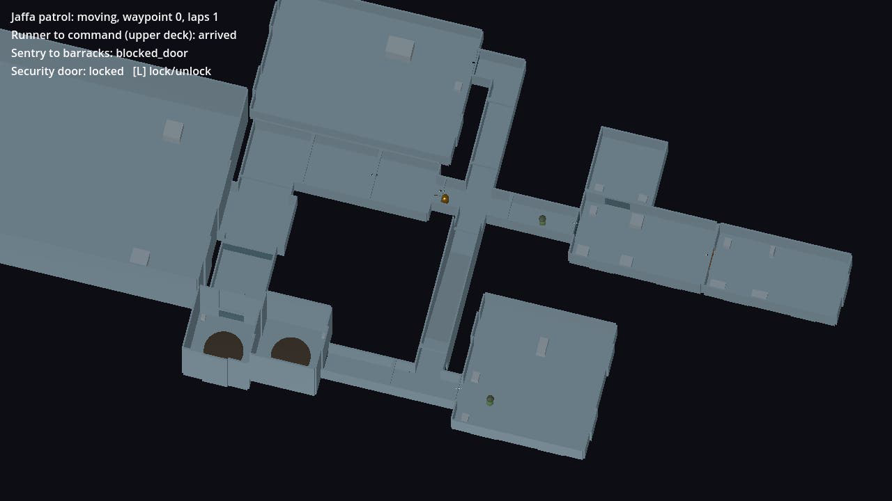

# Modular NPC navigation and patrols

The production Jaffa (`JaffaAI`) and friendly airman (`SGCAirmanAI`) controllers now navigate any `LevelAssembly` level. Nothing SGC-specific was rewritten and no second navigation bake was added: NPCs follow the navigation map the assembly already bakes, using their existing `CharacterBody3D` physics.



Recording of the same run (55 s, overview camera): [`docs/reviews/modular-npc-navigation.mp4`](../reviews/modular-npc-navigation.mp4).

## What was coupled to the SGC map

Both controllers only ever call `navigator.next_position(goal, delta)`, `navigator.reset()` and read `navigator.status`. The coupling was inside `SGCNavigator`:

| SGC assumption | Where | Modular equivalent |
|---|---|---|
| An `SGCMap` sibling must exist, otherwise the actor waits forever | `SGCNavigator._find_map` | Falls back to the nearest `LevelAssembly` |
| Routes are planned over named regions and `SGCConnection`s | `SGCNavigator._plan` | Navmesh path between any two points |
| Stairs, spiral and lift use passage reservations and scripted points | `_plan`, `_lift`, `claim_passage` | Not needed: the ramp is ordinary walkable navmesh |
| Doors mean the gate-room blast doors | `next_position` | `ModularDoor` instances found along the path |
| With no targets, Jaffa march to named SGC regions | `JaffaAI._overrun_destination` | Explicit waypoint patrol |

Sector naming, turret and tactical-anchor logic in the airman remain SGC-flavoured but do not affect commanded movement.

## What changed

- `client/scripts/level/LevelNavigator.gd` (new): plans a navmesh path, follows it corner by corner, and returns only a steering point. It never moves the actor.
- `SGCNavigator`: when no `SGCMap` is present it delegates to `LevelNavigator`. With an `SGCMap` the original code path is untouched.
- `ModularDoor.open_for(actor)`: server-only request for server-owned actors, with the same 3.2 m reach and lock rules as a player. It never unlocks, never closes and never touches collision directly.
- `JaffaAI.start_patrol(points, loop)` with `patrol_waypoint_reached` and `patrol_lap_completed` signals. Patrol resumes after combat because it replaces the idle advance destination.
- Friendly movement needs no controller change: `order_move_to(level.marker(room, marker))`.

### Navigator statuses

`navigator.status` on either controller (and `navigator.level_route.status_changed` as a signal):

| Status | Meaning | Actor behaviour |
|---|---|---|
| `moving` / `arrived` | Normal travel | Walks / stops |
| `waiting_for_door` | Closed door in reach could not be opened this tick | Holds, retries |
| `blocked_door` | A locked door lies on the route (`level_route.blocked_door`) | Holds where it is, re-checks every second |
| `unreachable` | Goal is not on the navigation mesh | Holds, re-checks every second |
| `stuck` | No progress after three replans (about 12 s) | Holds, re-checks every second, resumes if cleared |

No status teleports the actor.

## Demonstration scene

`res://scenes/level/ModularNpcDemo.tscn` instances the canonical `modular_integration_demo.tres` unmodified and adds actors on the host:

- **Jaffa patrol** loops `wide_junction → wide_elbow → wide_straight → width_adapter → hub`: a wide junction, a wide corner, both width transitions, two standard doors and the four-way junction.
- **Runner** (airman) is ordered from `entry` to the saved destination marker in `command`: four-way junction, 4 m ramp, upper T-junction and a standard door.
- **Sentry** (airman) is ordered to `barracks` while the host locks the `crew_quarters` security door. It reports `blocked_door` and holds; after 30 s the host unlocks and it completes the route.

Run it with Godot 4.4.1:

```sh
godot --path client res://scenes/level/ModularNpcDemo.tscn
```

The view is a fixed overview with roofs hidden and a status readout. `L` locks or unlocks the security door on the host. Set `unlock_after` to `0` on the root node to keep the door locked.

### UAT checklist (pending human sign-off)

1. The Jaffa opens each adapter door as it approaches, walks through and keeps looping.
2. The runner climbs the ramp on foot, opens the command door and stops inside.
3. The sentry stays put with `blocked_door` while the door is locked, and no door on its route opens.
4. Press `L` (or wait 30 s): the sentry walks through cargo and the security door into barracks.
5. Press `L` again while the Jaffa or sentry is elsewhere: the lock holds and nothing walks through it.
6. Start the normal SGC Defense and SGC UAT missions and confirm Jaffa and airmen behave as before.

## Automated coverage

```sh
python3 tools/run_godot_tests.py test_modular_npc_navigation test_modular_npc_multiplayer
```

`test_modular_npc_navigation` runs the real controllers (the test only observes) and checks:

- Runner reaches the upper-deck marker, peak height above 3.9 m, grounded on 99% of ticks, command door opened.
- Jaffa completes a five-waypoint lap in order (56 m), grounded throughout, both doors opened, then loops.
- No actor moves more than 0.35 m in a tick or drops below the floor.
- Locked door: sentry reports `blocked_door`, holds within 0.3 m, door stays locked and closed, no door upstream is opened; after a server unlock it arrives.
- `open_for` refuses out-of-reach actors, locked doors and actors not owned by the server.
- Off-mesh objective reports `unreachable` and the actor holds.
- A wall added after the bake produces `stuck` with the actor on its own side; removing it lets the patrol finish.
- Freeing and re-instancing the scene rebuilds navigation and the patrol runs again.

`test_modular_npc_multiplayer` runs a host and a connected client, each with its own copy of the level:

- Only the host spawns and commands NPCs; the client receives them through `MultiplayerSpawner`.
- Client Jaffa position stays within 1 m of the host's and its state matches.
- The client copy has no patrol, no route and zero velocity.
- Door opening and the security lock replicate; the client cannot call `open_for` or `set_locked`.

Existing SGC AI suites are unchanged and run in the full regression.

## Known limitations

- **No rerouting around a locked door.** The level bakes one navigation region, so a locked door is detected on the planned path and the NPC holds. Choosing an alternative route needs per-connection navigation links or a room-graph planner. The canonical fixture is a tree, so no alternative exists there anyway.
- **The navmesh is not rebaked at runtime.** Locking a door after the bake leaves walkable mesh behind it (handled by the door check above). Geometry added later is only discovered by stalling, which takes about 12 s to report.
- **NPCs leave doors open.** `open_for` never closes.
- **No local avoidance between NPCs.** Two actors meeting head-on in a narrow corridor push against each other and may trip the stall detector.
- **Perception looks for containers named `Players`, `Allies` and `Enemies`.** The demo names its containers `Hostiles` and `Friendlies` so the two factions do not fight and the routes stay repeatable. Combat on modular levels is unverified.
- **Jaffa tactical cover and flanking positions are hard-coded gate-room coordinates.** They are not used while patrolling but would be wrong if combat started on a modular level.
- **Transport rings are not a navigation link.** NPCs only walk.
- **Client late-join mid-patrol is not tested** beyond what the spawner and door snapshots already provide.

## Recorded delivery evidence

Godot 4.4.1.stable.official.49a5bc7b6. The complete regression inventory ran once after integration, in a clean worktree of this branch: **66/66 records passed** (project import plus 64 suites, one of which runs in two phases), including the two new suites and all existing SGC AI and multiplayer suites. No existing test was changed. The recording and still above were rendered from the demo scene and inspected. Human UAT of the checklist is still pending.
