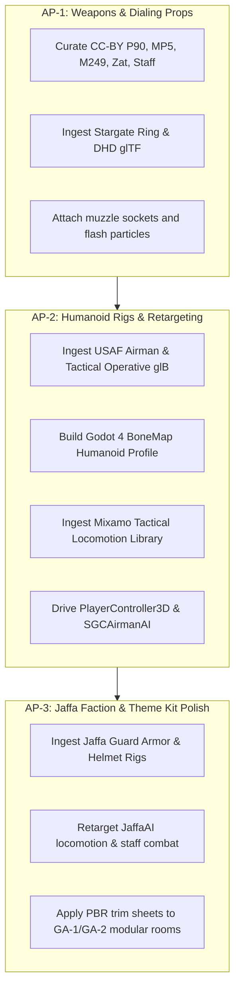

# Community Asset Ingestion & 3D Art Pipeline

**Document Status:** Approved Architecture Plan  
**Target Engine:** Godot 4.4+  
**Context:** Stargate: Operation Jiaolong — Visual Evolution from Greybox/CSG to Production 3D Assets

---

## 1. Executive Summary & Rationale

Currently, all characters, weapons, props (Stargate ring, DHD, blast doors), and compound rooms rely on CSG primitives and geometric box placeholders (`CSGBox3D`, `CylinderMesh`, basic `StandardMaterial3D` blocks). While effective for rapid greybox level validation, tactical perception tuning (ST-1/ST-2), and multiplayer netcode hardening (GT-1/GT-2), full immersion requires moving to production 3D assets without rebuilding meshes, rigs, and animations from scratch by hand.

The gaming community has vast libraries of high-quality Creative Commons (CC0, CC-BY 3.0/4.0), public domain, and royalty-free assets specifically suited for Stargate and modern tactical sci-fi games:
- **Canonical Props:** Stargates with chevrons, DHD pedestal dials, iris plates, MALP probes.
- **USAF Operatives & Allies:** Tactical Air Force airmen, SG-1 combat fatigues, vests, helmets, goggles.
- **Goa'uld Factions:** Serpent Guard / Horus Guard Jaffa armor, ornate headdresses, Ma'Tok staff weapons, Zat'nik'tels.
- **Ballistic Weapons:** FN P90 personal defense weapons, MP5 submachine guns, M249 SAWs, Beretta M9 sidearms.
- **Tactical Humanoid Animations:** Mixamo mocap suites (tactical walks, jogs, sprints, crouch-walks, ADS tracking, reloads, downs, revives).

---

## 2. Ingestion Sources & Asset Catalog

### 2.1 Stargate, DHD & Dialing Hardware
| Asset Target | Source & Format | License | Ingestion Strategy |
|---|---|---|---|
| **Stargate Ring & Chevrons** | Sketchfab (e.g. *Stargate SG-1 Canonical Ring* by community modelers) in `.glb` / `.gltf` | CC-BY | Direct drop-in replacing `StargateRing` CSG hierarchy. Separate mesh nodes for inner spinning ring and 9 chevrons for emissive material overrides. |
| **DHD Pedestal Console** | Sketchfab / OpenGameArt `.glb` | CC-BY / CC0 | Replaces `DHDDialer` cylinder mesh. Retains collision shapes and interactive action prompt coordinates. |
| **Iris Mechanical Blades** | Mechanical iris model or 20-blade fan rig | CC-BY / CC0 | Rigged mesh with blend shapes or pivot animations hooked to `iris_open_ratio`. |

### 2.2 Character Rigs & Retargeting (Operatives & Enemies)
| Character Target | Base Mesh & Textures | Skeleton / Rig | Ingestion Strategy |
|---|---|---|---|
| **USAF SG-1 Operatives** (O'Neill, Carter, Marine) | Mixamo SWAT / Military Operator / Hazmat meshes; Kenney CC0 Characters; Sketchfab Tactical Soldiers | Mixamo Humanoid Skeleton | Standardized Godot 4 `BoneMap` retargeting. Uniform bone names (`Hips`, `Spine`, `Head`, `LeftArm`, `RightArm`, `LeftLeg`, `RightLeg`). |
| **SG-3 Heavy Support** | Heavy ballistic armor with backpack and tactical vest | Mixamo Humanoid | Scaled variant with deployable shield and weapon sling sockets. |
| **Jaffa Guards & Shock Troops** | Serpent Guard / Horus Guard armor models (Sketchfab CC-BY Stargate collections) | Mixamo / Rigify Humanoid | Retargeted to same humanoid animation library with customized crest and eye emissive shaders. |

### 2.3 Firearms & Weapon Models
| Weapon | Description & Poly Target | Source | Notes |
|---|---|---|---|
| **FN P90** | Bullpup PDW, translucent 50-round top magazine, integrated optical sight (5k–10k tris) | Sketchfab / OpenGameArt CC-BY | Separate magazine node for reload animations; muzzle bone for muzzle flash and tracer spawns. |
| **MP5 Navy** | 9mm SMG with flashlight and suppressor | Sketchfab / Kenney CC0 | Standard CQB primary. |
| **M249 SAW** | 5.56mm light machine gun with box mag and bipod | Sketchfab CC-BY | Primary for SG-3 Heavy. |
| **Zat'nik'tel** | Goa'uld energy pistol with closed / open coiled states | Sketchfab CC-BY Stargate community | 2-stage animated mesh or blend shape for open/close state. |
| **Ma'Tok Staff Weapon** | Jaffa energy staff with opening firing petals | Sketchfab CC-BY Stargate community | Animated firing tip mesh, rear buttstrike collision. |

### 2.4 Animations (Tactical Locomotion & Combat)
Mixamo provides hundreds of high-grade optical motion capture sequences under royalty-free game license:
- **Locomotion:** Rifle Idle, Walk Forward/Strafe/Backward, Run/Jog Forward/Strafe, Crouch Idle, Crouch Walk.
- **Tactical:** Aim Down Sights (ADS) turn/pitch blend trees, Sprint Dodge Roll, Take Cover (Low / High wall).
- **Interactions:** Reload P90 / MP5 / LMG, Dial DHD button press, Plant C4 / Claymore, Body Dragging.
- **Reactions:** Bullet Impact Flinch, Knockdown, Downed Crawl, Bleedout Idle, Revive Treatment, Death.

---

## 3. Godot 4.4 Ingestion Technical Pipeline

### 3.1 File Formats: Native glTF 2.0 & uFBX
1. **glTF 2.0 (`.glb`) is Primary:**
   - Standard binary `.glb` carries geometry, PBR textures, skeletons, skinning, and animations in one self-contained, lightweight file.
   - Godot 4.4 features native high-performance glTF import with automatic LOD generation and shadow mesh stripping.
2. **FBX Support via Native uFBX:**
   - Godot 4.3+ ships with native **uFBX** integration, allowing direct import of Mixamo FBX files without needing external FBX2glTF conversion binaries.

### 3.2 Humanoid Skeleton Retargeting via `BoneMap`
Godot 4 introduces standard humanoid retargeting:
```
Mixamo / Community FBX 
        │
        ▼ (Godot Import Dock)
Select: "Animation Library" or "Rigged Model"
        │
        ▼
Skeleton3D Profile -> Set to "SkeletonProfileHumanoid"
        │
        ▼ (Automatic bone mapping)
Mixamo 'mixamorig:Hips'      -> Humanoid 'Root / Hips'
Mixamo 'mixamorig:Spine'     -> Humanoid 'Spine'
Mixamo 'mixamorig:Head'      -> Humanoid 'Head'
Mixamo 'mixamorig:RightHand' -> Humanoid 'RightHand'
        │
        ▼
Export as shared .res AnimationLibrary usable across ANY character!
```
**Outcome:** One tactical locomotion animation library (`tactical_rifle_anims.res`) drives SG-1 operatives, USAF Airmen AI, and Jaffa Guard AI without needing separate animation files per model!

### 3.3 Socket System for Props and Weapons
Each character rig defines BoneAttachment3D sockets:
- `RightHandSocket` (for active weapon trigger hand).
- `LeftHandSocket` (for two-handed rifle foregrip IK target).
- `BackHolsterSocket` (for secondary weapon stowed on back).
- `ChestVestSocket` (for GDO, radio, patch ROM).

### 3.4 PBR Material Standards & Lighting Fidelity (Decision D-015 Compliance)
- As proven in Decision D-015 during GA-1 visual validation, high-metallic PBR surfaces wash out under intense ambient environment lights unless roughness and albedo are carefully balanced.
- Standard PBR pipeline:
  - `albedo_texture`: 1K or 2K sRGB albedo.
  - `orm_texture` or individual maps: Red = Occlusion, Green = Roughness, Blue = Metallic.
  - `normal_texture`: OpenGL format (+Y) tangent-space normal maps.
  - `emission_texture`: For chevrons, Zat energy conduits, visor glow, and Jaffa armor eyes.

---

## 4. Phased Implementation Roadmap



### Milestone AP-1: Weapons & Dialing Props
- Replace greybox weapon boxes with textured glTF weapon meshes.
- Place bone/marker sockets for muzzle flare, shell ejection, and optical sights.
- Replace CSG Stargate ring and DHD with detailed community model while keeping existing collision cylinders and event horizon shaders intact.

### Milestone AP-2: Humanoid Rigs & Tactical Animations
- Establish standard `SkeletonProfileHumanoid` in Godot.
- Ingest Mixamo tactical animations into a shared `AnimationLibrary`.
- Replace `PlayerController3D` and `SGCAirmanAI` capsule meshes with rigged humanoid characters using `AnimationTree` (State Machine + 2D blend spaces for strafing/running/aiming).

### Milestone AP-3: Jaffa Faction & Modular Theme Textures
- Ingest Jaffa Guard models and staff combat animations.
- Supply high-resolution PBR trim sheets and decal textures for the Goa'uld theme kit (GA-1 / GA-2).

---

## 5. Licensing, Attribution & Compliance

Every third-party community model or animation imported into the repository must adhere strictly to open-source compliance:
1. **Asset Manifest:** Recorded in `credits/ATTRIBUTIONS.md` with:
   - Asset title and creator name.
   - Original download source URL.
   - License type (CC0 1.0, CC-BY 3.0, CC-BY 4.0, MIT).
   - Any modifications made (e.g. LOD simplification, texture rebaking, bone renaming).
2. **License Text:** Full license terms bundled in `credits/licenses/`.
3. **No Commercial Exclusives:** No proprietary non-distributable assets that would compromise repository openness or hosted CI builds.
