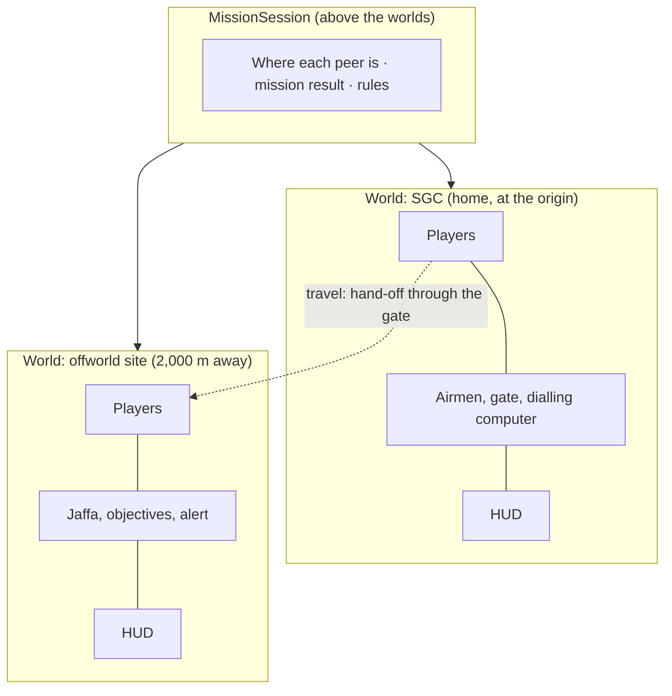

# Gate travel with a split team (GT-0)

A design for travelling between the SGC and an offworld site when players do not have to travel together. The owners required this on 14 November 2026 ([D-013](../DECISIONS.md)); it replaces the "one world at a time" strategy of D-002. This document changes no code. It is what milestones GT-1 to GT-3 are built from.

Audited at `f23db84` (the GA-1 branch; the networking and mission code is the same as `main` at `ce9ad71`).

## 1. Summary

- **Two places are live at once:** the SGC, which is always home, and one offworld site.
- **Both run in one server process, side by side,** the site 2 km from the SGC. An experiment on 14 November ran them together with no errors (section 4).
- **Every player's game holds both places and shows one.** Stepping through the gate loads nothing; the operative is handed from one place to the other.
- **The main work is not networking.** It is 48 places in the code that find "the players" or "the enemies" by searching the whole game, which is only correct while one world exists. With two, the experiment showed a sentry that could not see an operative standing in front of it.
- **Existing missions do not change.** The four missions in the lobby stay single-world. Travel is a new kind of mission entry.

## 2. Rules the owners chose

Decided 14 November 2026 and recorded as [D-017](../DECISIONS.md).

| Question | Decision | What follows |
|---|---|---|
| How many places at once? | The SGC plus one offworld site | The host runs two worlds, never more. Two away teams on two planets is out of scope |
| When does the mission fail? | When every operative, in either place, is down | A whole away team can be down and the mission continues while someone in the SGC is standing. That person can step through |
| Where does a late joiner arrive? | In the SGC | They walk to the gate and step through to join the away team |
| When can operatives use the gate? | Out at any time during the mission; home only after the objectives are complete | The SGC gate stays open to the site for the whole mission. The site's gate opens for home when the objectives are done |

Two rules follow from these and are set here as defaults. An owner can change either without changing the design.

- **Success.** The mission succeeds when the objectives are complete and no standing operative remains offworld, provided at least one came home. An operative left downed offworld is reported as lost in the debrief.
- **The SGC is quiet during a travel mission.** No Jaffa come through the SGC gate while a team is away. Defending the base while a team is offworld would be a new mission type, not part of travel.

## 3. Terms

| Term | Meaning |
|---|---|
| **Session** | One hosted game, from leaving the lobby to returning to it |
| **World** | One self-contained place with its own level, enemies, objectives and navigation: the SGC, or an offworld site. Today a mission is exactly one world (`GateRoom.tscn` or a `ModularMission` scene) |
| **Home** and **site** | The SGC world and the offworld world of a travel mission |
| **Present** | A player's game *presents* the one world their operative is in: it is drawn, heard, and its HUD is shown. The other world is still there and kept up to date, but hidden and silent |
| **Travel** | Handing one operative from a world to the other, with their health and equipment |

## 4. What the code does today

### 4.1 One world, replaced whole

`MainGameCoordinator` keeps one world (`current_gate_room`) under `WorldContainer` and replaces it for every start and retry (`client/scripts/world/MainGameCoordinator.gd:58`). `NetworkManager.MISSIONS` maps a mission to one scene (`client/scripts/net/NetworkManager.gd:39`). Each world scene owns its players, enemies, three spawners, objectives and HUD. A peer is "ready" for the mission as a whole (`mission_ready_peers`), and replication and mission RPCs are held back from peers that are not (`configure_mission_sync`, `mission_rpc`).

Stepping into an authorised outbound gate ends the mission as a victory for everyone (`GateRoom._on_player_extracted`, `client/scripts/world/GateRoom.gd:609`). The trigger is already server-side and already says which operative stepped through (`StargateRing._on_extraction_entered`).

### 4.2 What already suits two worlds

| | Evidence |
|---|---|
| Each world has its own navigation map | `SGCMap.gd:388` and `LevelAssembly.gd:166` each create one |
| Each world has its own spawners, addressed by path | `Players`, `Enemies` and gadget spawners are children of the world root |
| A world works away from the origin | Experiment below: the compound built and routed 2,000 m away with no errors |
| Squad status is counted from the world's own `Players` | `GateRoom._evaluate_squad_status` |
| A handshake for removing an operative cleanly exists | The retry sequence: prepare, acknowledge, then despawn (`NetworkManager._complete_mission_restart`) |

### 4.3 What breaks: whole-game lookups

Actors find their surroundings by searching the entire game for a node name and taking the first match:

```gdscript
var players_container := get_tree().root.find_child("Players", true, false)
```

With one world that is always the right node. With two it is whichever world was loaded first.

| | Count | Where |
|---|---|---|
| Whole-game lookups by name | **48** | `PlayerController3D.gd` 23, `SGCAirmanAI.gd` 10, `TransportRings.gd` 4, `ClaymoreMine.gd` 2, `JaffaAI.gd` 2, and one each in `JaffaPerception.gd`, `DeployableTurret.gd`, `C4Satchel.gd`, `HUD.gd`, `StargateRing.gd`, `SGCElevator.gd`, `GeneralsDefenseTerminal.gd` |
| Names searched for | | `Players` 11, `Enemies` 6, `Allies` 6, `GateRoom` 5, `SGCDialingConsole` 3, and ten others |
| Group lookups across the whole game | 17 | `cover`, `interactable`, `turret`, `smoke_cloud`, `modular_door` and others. Most are followed by a distance check and are safe 2 km apart; each needs classifying |
| Effects added to the top of the game instead of their world | 21 | Tracers, sparks, blast flashes. Harmless in position, but they outlive the world they belong to |
| Both mission scenes name their root `GateRoom` | | Two side by side need distinct names; five lookups search for `GateRoom` by name |

### 4.4 The experiment

A throwaway script hosted a server, loaded `SGCUATBase.tscn` and `GoauldInfiltrationMission.tscn` under one parent with the compound moved 2,000 m along X, and ran them headless. Results, on the development machine:

| Check | Compound alone | SGC first, then compound | Compound first, then SGC |
|---|---|---|---|
| Engine errors or warnings | 0 | 0 | 0 |
| Compound built; setup and level errors | none | none | none |
| Compound navigation returns a route | yes | yes, at X = 2,000 | yes, at X = 2,000 |
| A sentry notices an operative 3 m in front of it | **yes** | **no** (three sentries tried) | yes |
| The first `Players` node in the game belongs to | the compound | **the SGC** | the compound |
| Nodes in the game | 3,102 | 6,558 | 6,558 |

The SGC alone is 3,460 nodes. So the two worlds coexist as they are, and the only fault found was the one section 4.3 predicts: with the SGC loaded first, the compound's sentries look for operatives in the SGC.

**Not measured:** the cost in frame time. The engine's headless timing figures were not additive between the runs, so no figure is given here. GT-1 must measure it with rendering on (section 8).

## 5. The design

### 5.1 Strategy

1. **One server process and one connection**, as today.
2. **Up to two worlds under `WorldContainer`, in the same 3D space**, the site at a fixed offset of 2,000 m. They have separate navigation maps already. Nothing with a range (sight, hearing, blast, interaction) reaches 2 km.
3. **Every peer loads both worlds; each presents one.** The server simulates both. Because nothing is loaded or unloaded when someone travels, replication needs no per-world filtering and a message can never arrive for a world the receiver has not got.
4. **Worlds stay self-contained scenes**, each with its own players, enemies, spawners, objectives and HUD, exactly as now. A world finds its own contents through its own root, never by searching the whole game.
5. **A session object above the worlds** knows which worlds exist, which world each peer is in, and the mission's result. Worlds report to it; it applies the rules of section 2.
6. **Travel is a hand-off.** The server removes the operative from one world and creates it in the other with its carried state, using the same prepare-acknowledge-despawn order as retry.



### 5.2 Alternatives rejected

| Alternative | Why not |
|---|---|
| **Each client loads only the world it is in** | Needs per-peer, per-world visibility on six spawners and every synchronizer, a world-aware `mission_rpc`, and a load and unload handshake for each traveller. That handshake is where the retry bug of PR #39 came from (state in flight to a node that has gone). It saves client memory and load time; it can be added later behind the same session object if those prove to be a problem |
| **Separate 3D worlds in sub-viewports** | Isolates physics and lighting completely, but every scene, the HUD, mouse capture and every test assume the main viewport. Too much stable code moves for what distance already gives |
| **A network connection per world, or a server process per world** | The host is also a player. A second process on the host's machine, or two connections per client, is more to run and more to fail than one process holding two scenes |
| **Operatives owned by the session, teleported between worlds** | No hand-off and no state to carry, which is attractive. But it removes `Players` and its spawner from every world scene, and the suites address operatives through the world (`room.players_container`) throughout. The regression risk is larger than a hand-off that reuses the retry sequence |

### 5.3 Finding your own world

One helper replaces the 48 lookups:

- A world root joins the group `mission_world`.
- `MissionWorld.of(node)` returns the nearest ancestor in that group, or the top of the game when there is none. The fallback keeps every test that builds a bare scene working unchanged.
- A lookup becomes `MissionWorld.of(self).find_child("Players", true, false)`.

An operative, enemy, gadget or prop is always inside its world, so the answer is always its own. A static check in the Python suite fails if a whole-game lookup by name is written again.

### 5.4 Presenting one world

A world gains one switch, `set_presented(on)`. Off means:

| | When not presented |
|---|---|
| Drawn | The world root is hidden. Its lights go with it |
| Environment | Its `WorldEnvironment` is not the active one. Only the presented world's sky colour and ambient light apply |
| HUD | Hidden and not processing |
| Sound | Positional sound is out of range at 2 km. Sound that is not positional is muted |
| Per-frame visuals for the local player | Sector shrouds and fog of war are skipped |
| Simulation | **Unchanged.** Physics, navigation, AI and replication keep running |

A dedicated server presents nothing. The host presents the world its own operative is in, like any client.

### 5.5 Travel hand-off

For one operative moving from world A to world B:

1. The server sees the operative enter A's open gate (`StargateRing.player_extracted`, which exists).
2. The server tells that peer to prepare. The peer stops publishing its operative and acknowledges, as it does for retry.
3. The server takes the operative's carried state (class, health, ammunition, equipment), removes it from A, and records the peer as being in B.
4. The server creates the operative in B at B's arrival point with that state. Every peer already has B loaded, so the spawn needs no readiness check.
5. The travelling peer's game switches presentation from A to B and binds B's HUD to the new operative.
6. Both worlds re-evaluate their squad status; the session applies the fail rule.

If the peer does not acknowledge in time, the server proceeds, as retry does. If the peer disconnects mid-travel, the operative is simply not created in B.

### 5.6 Mission rules at session level

| Today, in each world | With a session |
|---|---|
| A world spawns every ready peer | A world spawns the peers the session places in it. Without a session, every ready peer: unchanged |
| All operatives in the world down → mission failed | The world reports "nobody standing here". The session fails the mission only when that is true of every world that has operatives |
| One operative enters the authorised gate → victory | The gate asks the session to move that operative. Victory is the session's success rule |
| A late joiner spawns in the world | The session places a late joiner in the home world |
| Retry replaces the world | Retry replaces both worlds; everyone starts at home |

Single-world missions take the left column unchanged: with one world and no travel, every rule on the right reduces to the rule on the left.

### 5.7 A travel mission, start to finish

1. In the lobby the host picks a travel mission: a new entry that names a home scene and a site scene. The four existing entries are untouched.
2. Both worlds load on every peer. Everyone starts in the SGC, which is quiet. The site does not start its patrols and timers until the first operative arrives.
3. Someone dials out on the dialling computer. The gate opens to the site and stays open until the mission has a result.
4. Each operative who steps through arrives at the site's entry point (`gate` / `entry` in the infiltration compound) with their health and equipment. Others may stay.
5. The site's objectives run as they do now. A player who joins late appears in the SGC and can follow.
6. When the objectives are complete the site's gate opens for home. Each operative who steps through arrives on the SGC ramp.
7. The mission succeeds when no standing operative remains offworld and at least one came home. It fails when every operative in both worlds is down. The debrief is shown in the SGC.

## 6. Edge cases

| Case | Behaviour |
|---|---|
| The whole away team is down; one operative is standing in the SGC | The mission continues. Downed operatives bleed out in 20 seconds (`HealthComponent.MAX_BLEEDOUT_TIME`), so a rescue only works if the rescuer is already at the gate. Afterwards the SGC operative can go alone or abandon the mission |
| Nobody in the SGC ever goes | A stalemate the players choose. GT-2 gives the SGC an "abort mission" control so they need not leave the session to end it |
| Everyone is in the SGC and all are downed there | Cannot happen in a quiet SGC. If a later mission type puts enemies there, the same fail rule covers it |
| A client disconnects while offworld | Their operative is removed from the site, as today, and the fail rule is re-evaluated. If they reconnect they arrive in the SGC as a late joiner with a fresh loadout |
| The host leaves | The session ends, as today |
| An operative steps out through the SGC gate after the mission has a result | The gate closes when the result is set, so they cannot |
| Objectives complete while an operative is still walking to the SGC gate | They can still go out. Success waits until no standing operative is offworld |
| Dedicated server | Simulates both worlds and presents neither. No rule changes |

## 7. Milestones

These replace GT-1 to GT-3 in the master plan. Sizes use the plan's scale.

### GT-1 — Worlds that can coexist · L

No travel and no visible change. Afterwards two worlds can run side by side correctly.

- `MissionWorld.of` and the 48 lookups moved to it; the 17 group lookups classified, and scoped where distance does not make them safe; effects added to their world.
- Distinct world root names when two are loaded; the five `GateRoom` name lookups scoped.
- A `MissionSession` that lists the worlds, records which world each peer is in, and applies the fail rule. Worlds spawn only the peers placed in them. `MainGameCoordinator` can load one world or two.
- `set_presented` on a world.
- **Tests:** the experiment made permanent, in both load orders (a sentry notices an operative in its own world and ignores one in the other; airmen likewise); squad status per world and the session's fail rule; a late joiner is placed at home; presentation flags; the static check against whole-game lookups.
- **Acceptance:** every existing suite passes unchanged. Frame time is measured on a real display with one world and with two, and reported.
- **Not in scope:** the host split of [D-008](../DECISIONS.md). `ModularMission` can go on extending `GateRoom`; coexistence does not need them separated. It stays as risk R11.

### GT-2 — Outbound travel · L

- A travel mission in the lobby: SGC home, infiltration compound as the site.
- Dialling out opens the gate for the mission; stepping through runs the hand-off of section 5.5. Carried state is complete: a test compares an operative before and after.
- The travelling player's game switches presentation. Late joiners arrive in the SGC. The fail rule spans both worlds. An "abort mission" control in the SGC.
- **Tests:** two-process travel with one operative staying; travel under packet delay; a late joiner following; the whole away team down with one at home.
- **Human check:** step through with two players, one staying. Look and listen for anything from the other world.

### GT-3 — Return and debrief · M

- A working gate at the site (the `stargate_dhd` preset's gate is inert today). It opens for home when the objectives are complete.
- The success rule, a debrief in the SGC with the mission's real figures and who was lost, and retry for a two-world mission.

## 8. Risks

| | Risk | Mitigation |
|---|---|---|
| T1 | A whole-game lookup is missed and reads the wrong world, silently | The static check; the coexistence suite runs in both load orders so whichever world is "first" is tested as "second" too |
| T2 | The host cannot run two worlds at an acceptable frame rate | Measure in GT-1 before any travel is built. Levers: the site does not start until someone arrives; the hidden world is not drawn; airmen in a quiet SGC are idle |
| T3 | The travel hand-off loses a message in flight, as retry once did | Reuse the retry order exactly; test with two processes and with delay |
| T4 | Carried state is incomplete (for example explosives refill on arrival) | One function gathers it and one applies it; a test compares every field |
| T5 | Something from the hidden world leaks: a sound, a light, a HUD element | `set_presented` owns all of it in one place; a human check in GT-2 |
| T6 | Loading two worlds makes joining slow or uses too much memory on a client | Not measured. If it matters, the rejected "load only your world" option fits behind the same session object |
| T7 | Physics is less steady 2 km from the origin | Positions there resolve to about a quarter of a millimetre in single precision. The compound built and routed there without error; movement feel is a GT-2 human check |
| T8 | Retry and disconnect paths assume one world | Covered by GT-1's session tests and GT-3's retry test |

## 9. What this does not cover

- More than one offworld site at a time.
- Enemies in the SGC while a team is away.
- Carrying anything between sessions (campaign progress: milestone CA-1).
- Ring transport and other in-world teleports, which stay inside one world.
