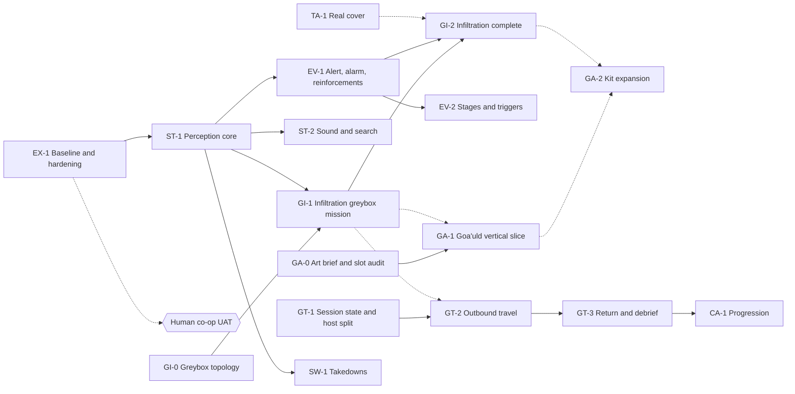

# Master development roadmap — detailed plan

Audited 12 November 2026 against `main` at `bf56743` (PR #40 merged). Godot **4.4.1**, GDScript, native ENet.

[ROADMAP.md](../../ROADMAP.md) is the authoritative summary and says what to do next. This document holds the evidence and the detail: the capability matrix, dependency graph, milestone definitions, the art and content track, the risk register and three agent-ready work packages. Architectural choices are recorded in the [decision log](../DECISIONS.md). Game intent is in the [GDD](../../GDD.md).

This is a plan. Nothing in sections 3 onward is implemented.

## 1. How to read status

| State | Meaning |
|---|---|
| **Verified** | Implemented and covered by an automated suite in `client/tests/` |
| **Awaiting human** | Implemented and automated, with a written human checklist that nobody has signed off |
| **Partial** | Some of the feature exists; the gap is stated |
| **Placeholder** | An identifier, marker, description or prop exists; the behaviour does not |
| **Missing** | No code |
| **Defect / debt** | Confirmed against current code in this audit |

The repository records human playtest feedback on the SGC (Sprint 21 findings, the UAT fixes in PRs #24, #25 and #37) but no completed acceptance sign-off for any mission. Nothing below is marked human-verified.

**Regression evidence.** The last full local run is 69/69 on the PR #40 branch (recorded in [the authoring review](../reviews/ai-level-authoring-2.md)). Hosted CI is not green: see R1 in section 7.

## 2. Capability matrix

Paths are under `client/` unless they start with `tools/` or `docs/`.

### Core game and multiplayer

| System | State | Evidence and gap |
|---|---|---|
| Hosting and joining (listen host) | Verified | `scripts/net/NetworkManager.gd`; `test_netcode_smoke`, `test_multiplayer_mission_join` |
| Dedicated server | Partial | `--server` loads the selected mission scene directly (`MainGameCoordinator._ready`). `test_sprint5_dedicated_smoke` covers SGC. The modular mission has never been launched on a dedicated server |
| Player classes and loadouts | Partial | Four profiles set weapons, health and speed. Class gadget exists for Heavy (tripod turret) and Recon (C4) only (`PlayerController3D._deploy_tactical_gadget`). The lobby descriptions also promise a rocket launcher, flashbangs, sprint dodge, MALP scout, fast dialling, melee parry and symbiote regeneration: none exist in code |
| Mission selection | Verified | Three entries in `NetworkManager.MISSIONS`; host-owned, synced on join and retry; `test_mission_selection_uat` |
| World lifecycle | Verified, single world | One scene per mission id; `MainGameCoordinator` swaps the whole world. No mid-mission world change |
| Authority and replication | Verified | Server resolves combat, objectives and shared interactions; `test_multiplayer_combat_authority`, `test_multiplayer_state_replication`, `test_gate_client_authority` |
| Late joining | Verified, one known defect | Readiness gate plus per-object snapshots. Health updates sent to a client that is still loading are dropped with an engine error (R7) |
| Reconnection | Partial | `--reconnect` retries the connection five times. A returning peer is a new operative; no health, inventory or position is restored |
| Mission restart | Verified | Acknowledged restart (`prepare_mission_restart` / `acknowledge_mission_restart`); `test_mission_restart_cleanup`, two-process retry in `test_modular_extraction_multiplayer` |
| Combat, weapons, damage | Verified | `WeaponBase` plus six weapons, server-validated fire, Zat stun/kill/vaporise; balance never human-accepted |
| Downing, bleed-out, revive | Verified | `HealthComponent` (20 s bleed-out, revive to 40%); hold-to-revive in `PlayerController3D`; airmen auto-revive |
| Inventory, ammunition, resupply | Partial | Per-weapon ammunition and reserve, armoury resupply and armour stations in the SGC only. No sharing between players; no resupply on modular levels |
| Success, failure, debrief | Partial | Shared result RPC, debrief panel and retry. Wording and statistics are SGC-specific; the modular mission overwrites the labels each frame |

### Tactical gameplay

| System | State | Evidence and gap |
|---|---|---|
| Friendly squad commands | Verified (SGC) | Radial wheel, pings, move/hold/regroup/turret orders; `test_squad_radial_wheel`, `test_airman_tactical_anchors` |
| Friendly NPC navigation | Awaiting human | Airmen navigate modular levels through `SGCNavigator` → `LevelNavigator` (PR #38). Tactical anchors, leapfrog and suppression still read SGC sectors |
| Jaffa patrols and navigation | Awaiting human | `JaffaAI.start_patrol`; `test_modular_npc_navigation`, `test_modular_npc_multiplayer` |
| Enemy detection | Defect | No view cone, no suspicion. A Jaffa acquires any living operative within 22 m without line of sight (`JaffaAI._find_nearest_target`, the `closest_any_target` branch) and walks to them. Firing does require line of sight |
| Cover and flanking | Partial | SGC: sandbag cover and corridor flank from literal coordinates. Modular: nearest room `cover` marker, which is a room-centre point, not cover (R3). No flanking on modular levels |
| Suppression and firefights | Partial | Lead rank halts and fires, others relocate; airman cover fire in SGC. No suppression effect on the target |
| Door interaction | Verified | `ModularDoor` open/close, server-validated, snapshots; AI opens doors with `open_for` |
| Locked doors and access control | Partial | Security doors lock, replicate and block AI. Nothing in a mission can lock or unlock one: `set_locked` is only called by `ModularNpcDemo.gd` |
| NPC avoidance and rerouting | Missing | No avoidance code. A locked door on the path produces `blocked_door` and the NPC waits |
| Mounted weapons | Verified (SGC) | Fixed .50 cal turrets and the Heavy tripod; airmen can crew them. Not available as a modular attachment |
| Deployable equipment | Verified (SGC) | Claymore, C4, ballistic shield, smoke; smoke blocks AI sight |
| Stealth interactions, takedowns | Missing | Body dragging exists. No takedown, knife, silenced-weapon or body-discovery logic |

### Stargate systems

| System | State | Evidence and gap |
|---|---|---|
| Gate operation and dialling | Verified (SGC) | `StargateRing` states and direction reservation; `DHDDialer` seven chevrons plus GDO; `test_gate_lifecycle_and_modes` |
| DHD and SGC console | Verified (SGC) | `SGCDialingConsole`, buffer lockout and ROM upload |
| Iris | Verified (SGC) | Hard-difficulty iris repair (`IrisServoHousing`) |
| Gate travel, world transitions | Missing | Entering an authorised outbound gate ends the mission with a victory (`GateRoom._on_player_extracted`). No second world |
| Transport rings | Placeholder in missions | `TransportRings` has beam, pair teleport and reinforcement code from the early sprints. It is not instanced in the SGC. On modular levels the `ring_transport` preset places paired but idle rings; nothing triggers them, and the teleport runs on every peer without server validation |
| Goa'uld shield mechanics | Missing | `DeployableShield` is the Tau'ri ballistic shield |
| Jaffa and faction equipment | Partial | Jaffa guard and shock guard with staff weapons; player staff and Zat. No other faction units |
| Offworld entry and extraction | Partial | Modular Extraction UAT spawns at a layout entry marker and extracts by returning to it. No gate is involved |
| SGC return and debrief | Missing | The debrief panel exists; there is no return to a persistent SGC |

### Content creation

| System | State | Evidence and gap |
|---|---|---|
| Structural prefabs | Verified | 15 module definitions in `resources/level_modules/`; `test_modular_catalogue`, `test_modular_level` |
| Functional room presets | Verified | 16 presets in `resources/room_presets/`. Markers and system references are labels, not behaviour |
| Multi-deck placement | Verified | Ramp and deck bindings; `test_modular_vertical`, `test_modular_integration` |
| Map editor | Awaiting human | `addons/modular_editor/`; mouse workflows need the manual checklist in [the editor guide](../maps/modular-editor.md) |
| AI-assisted planning | Verified | `LevelPlanner`, `plan` command; `test_level_planning`. No fresh-agent benchmark yet |
| Connectivity and topology checks | Verified | `LevelTopology`, eleven checks, connectivity only |
| Composite clusters | Verified | Eight composites in `resources/level_composites/` |
| Theme support | Placeholder for factions | Theme contract and resolver work (`test_level_themes`). Only `neutral` has art; `goauld`, `asgard`, `tokra`, `replicator` and `tauri_sgc` all carry `art_status = "fallback"` |
| Faction visual assets | Missing | None. The SGC map uses dimensioned placeholders and material briefs |
| Outdoor terrain, villages | Missing | No terrain, no exterior scenes |
| Authoring documentation | Verified | [AI authoring guide](../maps/ai-level-authoring.md); catalogue summary 13.7 KB |

### What is actually playable

| Mission | What a player gets | Standing |
|---|---|---|
| SGC Defense | Wave defence across three floors, difficulty objectives, dial out, extract | Most complete. Two-human acceptance outstanding |
| SGC UAT Base | The same base with no hostiles | Exploration and controls testing |
| Modular Extraction UAT | Reach a room, use a console, return; five patrolling Jaffa | Development slice on a neutral test fixture. No stealth, alarm or gate |

## 3. Decision: gameplay, map or art first

**Order: gameplay systems (a minimal perception core) first, the mission map second and built on it, art third as one small vertical slice.** The greybox layout for the map is cheap and starts in parallel now. The full art kit waits for a play-tested mission.

| Criterion | A — gameplay systems | B — mission map | C — Goa'uld art |
|---|---|---|---|
| Gameplay benefit | Highest. Detection through walls makes every modular mission a brawl; fixing it changes how every future mission plays | High once A lands; today a larger map only spreads the same brawl over more rooms | None on its own; raises appeal of something not yet fun |
| Engineering dependencies | Needs only the current mission host | Layout needs nothing. A worthwhile mission on it needs A | Needs a slot audit of the theme resolver; independent of gameplay code |
| Regression risk | Medium: edits `JaffaAI`. Contained by keeping wave Jaffa on current rules | Low: new resources, one mission entry | Low for collision and navigation if the theme contract holds; medium for readability |
| Agent cost | High-reasoning sessions, narrow scope | Mostly scripted authoring: one `plan` request and a data resource | High and open-ended; visual iteration needs a human eye each round |
| Reuse | Every mission style in the GDD uses perception and alert state | The map is the shared testbed for stealth, events, cover, art | Reused only by Goa'uld and Ha'tak content |
| Safe in parallel | With map layout and art brief | Layout with anything; mission wiring after A | Brief and slice with anything that does not move sockets or footprints |

**Minimum before a serious stealth mission is playable** (Option A, in order):

1. Sight requires line of sight. No acquisition through walls, doors or decks.
2. A view cone, so position relative to a patrol matters.
3. Graded awareness with a visible tell: unaware, suspicious, alerted, with time to react.
4. Losing the target: investigate the last seen position, then resume the patrol.
5. A level-wide alert with a consequence: alarm, reinforcements. This is the first use of mission events.

Items 1–4 are milestone ST-1. Item 5 is EV-1. Sound, searching, takedowns, body discovery and light-based concealment are not in the minimum.

**What to author now for Option B, and what waits.** Author the room graph now: it costs one planner request and gives every other workstream a fixed target. Use the existing two-deck compound brief as the starting point. Leave patrol routes, guard counts and objective placement until ST-1 exists, because they depend on view cones. Nothing found in this audit requires new geometry; the existing modules, presets and composites cover every room in the brief.

**Smallest useful proof for Option C.** One narrow corridor, one door frame and one small chamber in the `goauld` theme, seen in the mission. The rest of the kit follows the rooms the first mission actually uses, after that mission has been played.

Why not art first: the [team contract](../../TEAM_CONTRACT.md) puts gameplay before bespoke art, and a kit built before the mission is played will be built for the wrong rooms. Why not the map first: the existing extraction mission already shows that combat on a bigger map is not the missing ingredient.

## 4. Dependencies and critical path

Solid arrows are hard technical dependencies. Dotted arrows are desirable sequencing only.

**Smallest route to a fun two-player Goa'uld infiltration:** EX-1 → ST-1 → GI-1 (using GI-0) → EV-1 → GI-2. Human UAT sits after GI-1 and again after GI-2. No gate travel, no art and no special weapons are on this path.

**Smallest route to SGC → gate → offworld → SGC:** GT-1 → GT-2 → GT-3. It needs one offworld mission to arrive in, so GI-1 is the natural destination, but GT-1 can start without it.

| Question | Answer |
|---|---|
| Unblocks several others | ST-1 (stealth, alarm, takedowns, every infiltration mission); EV-1 (reinforcements, Alpha Site defence, multi-stage missions); GT-1 (travel, campaign, a slim mission host) |
| Cosmetic or optional | All of GA; door auto-close; HUD wording; an editor panel for `plan` and `topology` |
| Premature abstraction to avoid | A general event framework before a second mission shows what it needs. Splitting `GateRoom` before the gate-travel decision. A faction system. Putting terrain into `LevelLayout`. Campaign saves before there are missions to link. Sharing perception with airmen before it is right for Jaffa. Further planner work without a failing brief |

**Parallel work without conflicting writes**

| Stream | Writes to | Can run alongside |
|---|---|---|
| ST-1, TA-1, TA-3, SW-1 | `scripts/entities/JaffaAI.gd`, `scripts/level/LevelNavigator.gd` | One at a time among themselves |
| EX-1, GT-1 | `GateRoom.gd`, `NetworkManager.gd`, `HUD.gd`, `HealthComponent.gd` | One at a time among themselves |
| GI-1, EV-1, EV-2 | `scripts/mission/*`, `resources/missions/` | One at a time among themselves |
| GI-0 and other layouts | New files in `resources/levels/`, `docs/maps/briefs/` | Anything |
| GA-0, GA-1 | `resources/level_themes/`, new art scenes | Anything that does not move sockets or footprints |
| OW-0 | Documentation and a throwaway scene | Anything |

## 5. Milestones

Complexity is relative: S is part of one agent session, M one session, L two or three, XL must be split before starting. **Agent** names the cheapest suitable worker: *Fable* for high-reasoning engineering, *Codex* for well-specified implementation, *scripted* for authoring through `tools/level_authoring.py` and data resources.

Every milestone ends with the full regression profile, a draft PR and updated maintained documents. That is not repeated below.

### A — Extraction mission hardening

**EX-1 — Trustworthy baseline and extraction hardening** · M · Codex · full work package in section 8.

**EX-2 — Two-human acceptance of the current build** · human task, not agent work
- **Experience:** two people finish Modular Extraction UAT and SGC Defense together and write down what broke.
- **Baseline:** written checklists exist in [the mission guide](../maps/modular-extraction-mission.md) and [TESTING.md](../TESTING.md); none is signed.
- **Deliverable:** a dated record in `docs/reviews/` with commit, roles and results; defects raised as issues.
- **Prerequisite:** EX-1 merged, and the play machine on that commit (R2).
- **Independent:** yes. It gates nothing technically, but ST-1 tuning is better informed after it.

### B — Stealth and perception

**ST-1 — Perception and awareness core** · M · Fable · full work package in section 8.

**ST-2 — Sound, investigation and search**
- **Experience:** unsuppressed gunfire draws nearby patrols; a patrol that loses you searches the area before giving up.
- **Baseline:** none. No noise events exist.
- **New:** host-side noise events with a radius (weapon fire, explosions, sprinting optional); a search state that visits two or three points around the last known position; suppressed weapons emit a smaller radius.
- **Non-goals:** sound propagation through geometry, light and shadow, body discovery.
- **Prerequisites:** ST-1.
- **Components:** the perception script from ST-1, `WeaponBase`, `JaffaAI`.
- **Multiplayer / AI:** server only; clients see the replicated awareness state from ST-1.
- **Acceptance:** a shot within the radius moves an unaware sentry to suspicious and sends it to the source; a suppressed shot at the same range does not.
- **Tests / UAT:** new suite on the modular fixture; human check that the radius feels fair.
- **Risks:** tuning by number without play; too many simultaneous investigators jamming corridors (no avoidance).
- **Complexity:** M · Fable · independent of F, G, J.

### C — Mission scripting and events

**EV-1 — Alert state, alarm and reinforcements**
- **Experience:** once the compound knows you are there, a klaxon sounds, patrols converge and reinforcements arrive; reaching an alarm console first can prevent it.
- **Baseline:** `_alert_nearby_formation_jaffa` alerts siblings within 22 m. `TransportRings` and `WaveManager` can spawn Jaffa. No level-wide state.
- **New:** one host-owned alert level on the mission (calm, searching, alarm) with a snapshot for late joiners; escalation from ST-1 awareness; an alarm console interaction that a Jaffa must reach to raise the alarm; a reinforcement budget spawned at named room markers. Expressed as a short typed list on `MissionDefinition`, handled by one director node in the mission scene.
- **Non-goals:** a general scripting language, ring-delivered reinforcements, door lockdown, mission stages.
- **Prerequisites:** ST-1. GI-1 strongly preferred, so the vocabulary is drawn from a real mission.
- **Components:** `scripts/mission/MissionDefinition.gd`, a new director script beside `MissionObjectives.gd`, `ModularMission.gd`, HUD notice.
- **Multiplayer / AI:** alert level is replicated and monotonic within an escalation; reinforcements use the existing enemy spawner.
- **Acceptance:** alarm raised → reinforcements up to the budget and no more; alarm console disabled → no reinforcements; late joiner sees the current level; retry resets it.
- **Tests / UAT:** single-process and two-process suites; human run of both outcomes.
- **Risks:** this is where a second mission manager could appear. `WaveManager` stays the SGC Defense director and is not generalised.
- **Complexity:** M · Fable · independent of F, J.

**EV-2 — Stages, triggers and door or power actions**
- **Experience:** missions with a middle: cut the power to open a door, a timed escape after sabotage.
- **Baseline:** sequential objectives of three kinds (`reach`, `interact`, `extract`).
- **New:** triggers (objective complete, alert level, room entered, timer) and actions (lock or unlock a security door by `security_id`, start a timer, enable an objective, show a notice). Optional and parallel objectives only if a designed mission needs them.
- **Non-goals:** visual scripting, branching narrative.
- **Prerequisites:** EV-1 and at least two designed missions that need it.
- **Components:** `scripts/mission/*`, `ModularDoor.set_locked`.
- **Multiplayer / AI:** each action is a server call with its own snapshot; locking a door needs TA-3 rerouting to avoid stranded patrols.
- **Acceptance:** a console unlocks a named security door for all peers and late joiners; a timer failure ends the mission through the existing result path.
- **Risks:** premature generality. Add a trigger or action only when a mission definition uses it.
- **Complexity:** M–L · Fable.

### D — Tactical AI and combat

**TA-1 — Real cover from authored props**
- **Experience:** Jaffa fight from behind crates and barricades and can be flanked out of them.
- **Baseline:** `LevelNavigator.cover_position` picks a room-centre marker. Presets already place solid `cover` components (for example `security_checkpoint`, `cargo`) that the AI ignores.
- **New:** cover points derived from solid cover attachments, on the side away from the threat, checked with a ray; crouch behind low cover; relocate when the threat's angle defeats the cover.
- **Non-goals:** flanking manoeuvres, destructible cover, player cover changes.
- **Prerequisites:** none hard. Better after ST-1, which changes when combat starts.
- **Components:** `LevelNavigator.gd`, `LevelRoomComposer.gd` (read attachments), `JaffaAI._assign_tactical_role`.
- **Multiplayer / AI:** server only. SGC cover logic untouched.
- **Acceptance:** from the chosen point, a ray to the threat is blocked by the prop at torso height; with no qualifying prop the current fallback still applies.
- **Tests / UAT:** extend `test_modular_extraction_mission`; human check that firefights read as cover combat.
- **Risks:** bare modules have no cover props, so rooms without presets still fall back.
- **Complexity:** M · Fable · conflicts with ST-1 on `JaffaAI.gd`; run after it.

**TA-2 — Flanking, suppression and squad tactics on modular levels** · L · Fable
- Jaffa choose a second route to the threat using the room graph; airmen get anchors from room markers instead of SGC sectors. Prerequisites: TA-1, TA-3. Split before starting.

**TA-3 — Navigation follow-ups: rerouting, avoidance, door closing**
- **Experience:** patrols walk round a locked door, do not jam in corridors, and close doors behind them.
- **Baseline:** all three confirmed missing (R4, R5, R6).
- **New:** reroute using the layout's room graph with the locked connection removed (`LevelTopology.path` already does this search), then path room to room; simple yielding between NPCs in narrow rooms; optional door close after passing, with the existing occupied-doorway check.
- **Non-goals:** runtime navmesh rebake, crowd simulation.
- **Prerequisites:** none. Becomes necessary with EV-2 door actions and looped maps.
- **Components:** `LevelNavigator.gd`, `ModularDoor.gd`.
- **Acceptance:** on a looped layout with one locked door, a patrol reaches its waypoint by the other route; two NPCs meeting head-on both arrive.
- **Risks:** closed doors change sight lines, which interacts with ST-1.
- **Complexity:** M · Fable.

### E — Goa'uld infiltration mission

**GI-0 — Greybox compound topology** · S · scripted · part of the GI-1 package and safe to do at any time.

**GI-1 — Infiltration greybox mission** · M · Codex with scripted authoring · full work package in section 8.

**GI-2 — Infiltration mission complete**
- **Experience:** the same compound with consequences: alarm, reinforcements, a guarded checkpoint worth avoiding, firefights with real cover.
- **Baseline:** GI-1.
- **New:** EV-1 wired into the mission; cover props placed for TA-1; patrols tuned from human runs; resupply point if CO-1 exists.
- **Non-goals:** gate travel, art, new enemy types.
- **Prerequisites:** GI-1, EV-1. TA-1 preferred.
- **Acceptance:** two humans complete it by a quiet route and by a loud route on the same build, and both are reported as worth replaying.
- **Complexity:** M · Codex plus scripted authoring. The human gate is the real cost.

### F — Goa'uld architecture and visual identity

See section 6 for sequencing.

**GA-0 — Visual brief and slot audit** · S · Codex · documentation and read-only inspection
- A written design language (silhouettes, door proportions, rib spacing, palette, lighting mood) and a table of what each theme slot (`wall_panels`, `floor_detail`, `ceiling_detail`, `door_frame`, `room_detail`) actually renders today in `LevelThemeResolver`. Original designs inspired by the setting; no copied production assets.

**GA-1 — Goa'uld vertical slice**
- **Experience:** one stretch of the mission looks like a Goa'uld installation.
- **Baseline:** `goauld.tres` exists with `art_status = "fallback"`.
- **New:** themed visuals for one narrow corridor, one door frame and one 8 × 8 m chamber; theme status moved off `fallback` for those modules only.
- **Non-goals:** the full catalogue, props, a lighting pass, any change to collision, sockets or navigation.
- **Prerequisites:** GA-0. A decision on how art is produced (open question 7).
- **Components:** `resources/level_themes/goauld.tres`, new visual scenes or materials, `LevelThemeResolver` only if the slot audit finds a gap.
- **Acceptance:** `test_level_themes` and enclosure checks pass; collision and navigation output identical with and without the theme; a capture reviewed by a human.
- **Risks:** readability of doors and cover under a dark palette; scope creep into props.
- **Complexity:** M–L · depends on the art method · independent of all gameplay streams.

**GA-2 — Kit expansion** · XL · split per room group, ordered by the rooms the first mission uses: remaining corridors and junctions, large chambers, ramp and tall rooms, functional props (consoles, generator, crates), lighting and atmosphere.

### G — Stargate world transitions

**GT-1 — Mission session state and host split**
- **Experience:** none visible. It makes travel possible.
- **Baseline:** objectives, result and operatives belong to one world scene; `ModularMission` extends the 900-line `GateRoom`.
- **New:** a session object above the world that owns roster state (class, health, ammunition), objective progress and result; a slim mission host extracted from `GateRoom` that both the SGC and modular missions use.
- **Non-goals:** any travel; any change to SGC Defense rules.
- **Prerequisites:** the transition strategy confirmed ([D-002](../DECISIONS.md)).
- **Components:** `NetworkManager.gd`, `MainGameCoordinator.gd`, `GateRoom.gd`, `ModularMission.gd`.
- **Multiplayer / AI:** every existing join, retry and snapshot test must pass unchanged.
- **Acceptance:** all multiplayer suites green with no behaviour change; a second modular mission needs no SGC overrides.
- **Risks:** highest regression risk in the plan. It touches the stable SGC mission.
- **Complexity:** L · Fable · conflicts with EX-1; run after it.

**GT-2 — Outbound travel** · L · Fable
- Briefing in the SGC, dial out, the squad steps through and arrives in the offworld mission with its health and ammunition. Squad-level transition using the existing readiness handshake. Late joiners load the world the squad is in. Prerequisites: GT-1, one offworld mission. Risks: operatives in flight during the swap (the retry fix in PR #39 shows the failure mode).

**GT-3 — Return and debrief** · M · Fable
- Dial home from an offworld gate, return to the SGC, debrief with real mission statistics. Needs an offworld gate room: the `stargate_dhd` preset exists but its gate is inert and its rules belong to `WaveManager` today.

### H — Expanded co-op mechanics

**CO-1 — Co-op kit on modular missions** · M · Codex
- Resupply and armoury as room attachments, a rule for solo play (open question 5), revive under the new perception rules. Check `ArmoryResupplyStation` and `ArmoryArmorStation` before writing anything new: both exist and work in the SGC.

**CO-2 — Roles and sharing** · M · design first
- Ammunition sharing, medic revive speed or heal, deployable cover offworld. Bring the lobby class descriptions and the code into agreement in either direction. Do not add perks merely because the description lists them.

### I — Special weapons and faction mechanics

**SW-1 — Stealth takedown and quiet weapons** · M · Fable · needs ST-1 and ST-2
- Takedown on an unaware Jaffa from behind; Zat as the quiet option (stun is already 20 s); bodies can already be dragged. Intended interaction: quiet tools trade speed and ammunition for not raising awareness.

**SW-2 — Goa'uld personal shield and countermeasures** · M · design first
- A shielded enemy that stops fast projectiles and is beaten by slow or thrown attacks and flanking. Needs a thrown or melee attack to exist first.

**SW-3 — Specialised enemies** · L · after GI-2
- Variants with a role (officer who raises the alarm, heavy, sniper), each changing how a room is approached.

### J — Outdoor world construction

**OW-0 — Outdoor authoring boundary spike** · S · Fable · design plus a throwaway prototype
- Decide how an exterior scene joins an interior `LevelLayout`: recommended as a separate terrain scene with its own navigation region and a doorway contract, not as modules ([D-006](../DECISIONS.md)).

**OW-1 — Exterior gate site** · L · needs OW-0 · a small outdoor arrival area with a gate, DHD and one building entrance.

**OW-2 — Village or outpost** · XL · split later.

### K — Other factions and locations

| Location | Geometry | Art | Systems it adds | Earliest sensible start |
|---|---|---|---|---|
| SGC extensions | Existing `SGCMap` regions | Existing placeholders | None | Any time; low priority |
| Tau'ri Alpha Site | Modular kit; demo layout exists (`ai2_tauri_alpha_site.tres`) | Closest to the SGC palette | Defence waves on a modular level, evacuation escort | After EV-1 |
| Goa'uld mothership or pyramid | Modular kit, multi-deck, rings as travel | Reuses the Goa'uld kit | Working ring transport | After GI-2 and GA-1 |
| Asgard ship or base | Modular kit; demo layout exists | New kit | Transport or beaming rules | After GA-2 proves the art pipeline |
| Tok'ra tunnels | Likely needs new organic tunnel modules | New kit | Possibly crystal-grown doors | After a module-authoring review |
| Replicator structures | Modular kit plus block dressing | New kit | A new enemy with different movement | Last; most new systems |

### L — Campaign and replayability

**CA-1 — Mission progression and outcomes** · M–L · needs GT-3 and at least two offworld missions.
**CA-2 — Variation and difficulty** · M · patrol and objective variants per run, difficulty tiers for offworld missions. Patrol variation can start after GI-2 because it is data.

## 6. Visual and content track

Each task lists the earliest point at which it can start without creating rework.

| # | Task | Ready when | Rework risk if started earlier |
|---|---|---|---|
| V0 | Goa'uld visual reference and design brief (GA-0) | Now | None |
| V1 | Theme slot compatibility audit (GA-0) | Now | None; read-only |
| L1 | First greybox mission topology (GI-0) | Now | Low; the layout is a planner request and can be regenerated |
| V2 | Corridor, door frame and chamber slice (GA-1) | After V0 and V1, and the art-method decision | Low while sockets and footprints are untouched |
| L2 | Encounter and patrol placement | After ST-1 | High before it: placement depends on view cones |
| L3 | Functional prop replacement (consoles, generator, crates, cover) | After TA-1 fixes how cover props are read, and GI-1 has been played | Medium: cover dimensions drive AI behaviour |
| V3 | Lighting and atmosphere | After V2 and once the GI-1 layout is frozen | Medium: lighting changes readability of doors, cover and awareness tells |
| V4 | Expansion to further room types (GA-2) | After GI-2 human UAT | High before it: the mission decides which rooms matter |
| V5 | Other faction kits | After V4 proves the pipeline; Alpha Site first, then mothership reuse, then Asgard, Tok'ra, Replicator | High |
| V6 | Outdoor environment requirements | After OW-0 | High: the indoor/outdoor boundary is undecided |

The first designed Goa'uld mission (GI-1) is the shared testbed. Perception, events, cover, extraction rules and the art slice are all proven on that one map before anything is scaled.

## 7. Risk and defect register

Each previously reported issue was checked against the code at `bf56743`.

| # | Item | Verdict | Evidence | Addressed by |
|---|---|---|---|---|
| R1 | **Hosted CI full profile is red on `main`** | Fixed in EX-1 (PR #42), pending the hosted run | Failing on every push to `main` since PR #35 (`ad643b2`, 10 Nov): six merges, #35 to #40. `test_level_authoring` runs `tools/level_authoring.py`, which looks for `godot` on `PATH`; the workflow installs the engine elsewhere and passes it only to the test runner. Fast and multiplayer profiles pass. Local full runs pass | EX-1 |
| R2 | Play machine checkout is behind `main` | New, confirmed | `/home/flax/games/Team-Discovery-Channel` is on `feat/modular-npc-navigation` at `19b8317` with local edits. It does not contain PR #39 or #40, so the extraction mission is not launchable from the documented path | Owner action before EX-2 |
| R3 | Cover markers without real cover | Confirmed | Every module gets a generated `Markers/cover`; `cover_position` uses only that. Solid `cover` attachments are ignored | TA-1 |
| R4 | Perception through walls and decks | Confirmed, with a correction | Acquisition within 22 m ignores line of sight; there is no view cone. Firing does need line of sight. The older note "range plus line of sight" in the offworld plan was imprecise | ST-1 |
| R5 | NPC avoidance | Confirmed missing | No avoidance code; head-on NPCs can trip the stall detector | TA-3 |
| R6 | Locked-door rerouting | Confirmed missing | `LevelNavigator._locked_ahead` holds with `blocked_door`. Planned maps now contain loops, so an alternative often exists and is not used | TA-3 |
| R7 | Late join during combat | Fixed for actors, doors, objectives and result (EX-1) | Reproduced in EX-1, then fixed: `SGCNetworkManager.mission_rpc` sends only to peers that have the receiving node, and `test_modular_extraction_multiplayer` now joins during a firefight with an error-free client log. SGC-only props (gate, lift, wave manager, shutters) still broadcast to every peer; not reproduced, not changed | EX-1; SGC props open |
| R8 | Doors left open after a patrol passes | Confirmed | `ModularDoor.open_for` never closes and there is no auto-close | TA-3 |
| R9 | Enemy behaviour after the result | Modular fixed (EX-1); SGC open | Modular: Jaffa `stand_down()` and operative health is frozen at the result. SGC: nothing stops live Jaffa; they keep acting behind the result screen | GT-1 (shared host) |
| R10 | Dedicated-server acceptance | Automated for both missions; human open | SGC: `test_sprint5_dedicated_smoke`. Modular: `test_modular_extraction_dedicated` (EX-1), which also found and fixed two defects: a client could not request a retry, and a client kept running a dead world after the server stopped. No human has accepted either | EX-2 |
| R11 | SGC coupling in mission hosting | Wording fixed (EX-1); structure open | `ModularMission` still extends `GateRoom` and stubs its sector and snapshot methods. Since EX-1 it sets its banner on change and its own debrief through `HUD.set_mission_banner` and `HUD.set_debrief` | GT-1 (split) |
| R12 | Gate travel and mission-state ownership | Confirmed missing | One operative entering the authorised gate ends the SGC mission as a victory. Objective state lives inside the world scene | GT-1 to GT-3 |
| R13 | Human two-player testing | Outstanding | No signed checklist for any mission | EX-2 |
| R14 | Jaffa keep attacking downed operatives | Changed in EX-1 to the default of open question 3 | A downed operative is only chosen when no standing one is in perception. Applies to all Jaffa, SGC included | Revisit if question 3 is answered differently |
| R15 | Security doors cannot be operated in a mission | New, confirmed | `set_locked` has no caller outside the demo scene | EV-2 |
| R16 | Ring transport is not mission-ready | New, confirmed | No trigger on modular levels; the teleport moves operatives on each peer without server validation | Review before any mothership work |
| R17 | Per-tick tree searches in AI | New, debt | `JaffaAI._find_nearest_target` searches the whole tree for `Players` and `Allies` and casts several rays on every physics tick, per Jaffa | ST-1 (perception tick and cached containers) |
| R18 | Class descriptions promise absent kit | New, confirmed | See the class row in section 2 | CO-2 |
| R19 | Stale limitations in older guides | Confirmed | The navigation guide still listed modular combat as unverified and cover as SGC coordinates, both superseded by PR #39. Corrected with dated notes in this change | Done here |
| R20 | Authoring tools untested by a fresh agent | Outstanding | Stated in the authoring review | GI-0 doubles as that test if run by a new session |

Items verified as **no longer open**: server-owned actors invisible to clients (fixed in PR #39, `configure_mission_sync`), the retry race on client operatives (fixed in PR #39), and "client late join mid-patrol untested" from the navigation guide (now covered).

## 8. The first three work packages

One package per agent session. Order: **EX-1 first**, then ST-1, then GI-1. GI-0, the layout half of GI-1, may be done at any time.

**Why EX-1 goes first.** Every PR since #35 has merged without a green hosted regression. ST-1 edits the enemy state machine that the SGC suites protect, so the hosted signal has to be trustworthy before that change lands. EX-1 also removes the defects that would otherwise be mistaken for stealth problems (frozen or still-shooting enemies at the result, attacks on downed operatives), and it is the build the first two-human session should use. Only the CI repair is a hard dependency of ST-1; the remainder is sequencing, so ST-1 may start once that part is merged.

### Package 1 — EX-1 Trustworthy baseline and extraction hardening

1. **Objective.** Hosted CI green on `main`, and the Modular Extraction UAT mission free of the known rough edges so that two humans can run its checklist.
2. **Prerequisites.** None.
3. **Likely files.** `tools/run_godot_tests.py` and `tools/tests/` (export the engine path to child processes) or `.github/workflows/validation.yml`; `client/scripts/mission/ModularMission.gd`; `client/scripts/entities/HealthComponent.gd` (readiness-gated publish); `client/scripts/entities/JaffaAI.gd` (target filter only); `client/scripts/ui/HUD.gd` (mission banner and debrief text setters); a new dedicated-server suite; `docs/PLAYING.md`, `docs/TESTING.md`.
4. **Boundaries.** No new mechanics. No change to detection, cover or navigation. No split of `GateRoom`. SGC Defense rules unchanged. The downed-target rule follows open question 3; default is that Jaffa do not select a downed operative while a standing one is known.
5. **Acceptance tests.**
   - Hosted `Godot full` job passes on the PR.
   - New suite: a dedicated server started with `--server --mission modular_extraction_uat` accepts a client, spawns its operative and the patrols, and completes a retry.
   - Joining during a firefight logs no engine error on the joining client and health is correct once the operative appears.
   - After a result, no Jaffa fires or moves and no operative takes damage, on host and client.
   - The modular mission sets its HUD banner and debrief text once through a HUD method, not every frame, and no SGC wording appears.
   - All existing suites pass unchanged except where the downed-target rule is asserted.
6. **Human verification.** Run the eleven-step checklist in [the mission guide](../maps/modular-extraction-mission.md) with two people, including one dedicated-server session. Record it under `docs/reviews/`.
7. **Risks and rollback.** `HealthComponent` is shared by every actor; a mistake shows up as desynchronised health. Keep the CI repair, the health change and the mission changes in separate commits so each can be reverted alone.
8. **Done when.** CI is green on the PR, the new suite and the full profile pass locally, the documents name the mission in the player guide, and the PR lists the checklist as pending human sign-off.

**Handoff prompt**

> Repository `flaxos/Team-Discovery-Channel`, Godot 4.4.1. Read `ROADMAP.md`, then package 1 (EX-1) in `docs/plans/master-development-roadmap.md` and risk items R1, R7, R9, R10, R11, R14. Work on a new branch from `main` in a separate worktree; preserve all uncommitted files in the main checkout. First make the hosted `Godot full` CI job pass: `test_level_authoring` fails there because `tools/level_authoring.py` cannot find the engine the runner was given. Then harden the Modular Extraction UAT mission exactly as listed under "Acceptance tests", in separate commits. Do not add mechanics, change detection or split `GateRoom`. Run targeted suites while working and the full profile once at the end. Open a draft PR, update `docs/PLAYING.md` and `docs/TESTING.md`, and do not merge.

### Package 2 — ST-1 Perception and awareness core

1. **Objective.** Patrolling Jaffa notice operatives only by seeing them, inside a view cone, over a short readable interval, and give up when they lose them.
2. **Prerequisites.** The CI repair from EX-1.
3. **Likely files.** New `client/scripts/entities/JaffaPerception.gd` (or similar single script); `client/scripts/entities/JaffaAI.gd`; `client/scenes/entities/JaffaGuard.tscn` and `JaffaShockGuard.tscn` (replicated awareness property, overhead tell); new `client/tests/test_jaffa_perception.gd` and a two-process check; `docs/maps/modular-extraction-mission.md`.
4. **Boundaries.**
   - Two profiles. *Sentry* is the new behaviour and is selected by `start_patrol`. *Assault* is today's behaviour and remains for column marches and wave Jaffa, so SGC Defense plays as before.
   - Sentry rules: sight needs line of sight, range and a horizontal cone; awareness goes unaware → suspicious → alerted, filling while a target is seen and draining when it is not; taking damage alerts at once; an alerted sentry that loses its target walks to the last seen position, waits, then resumes its patrol; the existing nearby-alert call still spreads an alert. Range, cone angle and timings are exported values.
   - Run perception at a fixed lower rate than physics and look up the operative containers once (R17).
   - Out of scope: noise, searching beyond the last seen point, level-wide alarm, takedowns, light, airman perception, any change to weapons or damage.
5. **Acceptance tests.** On the integrated fixture, with the production controller:
   - An operative behind a wall within 22 m is never acquired. The same on the deck above or below.
   - An operative behind the sentry, outside the cone, is not noticed; inside the cone, awareness rises and reaches alerted only after the configured interval.
   - Stepping out of sight before the interval ends returns the sentry to unaware without combat.
   - Smoke and a closed door block sight; opening the door restores it.
   - Damage alerts immediately. Losing the target leads to the last seen position, then back to the patrol route in order.
   - A client sees the same awareness state as the host for each Jaffa, including after joining late.
   - `test_jaffa_ai_smoke`, `test_jaffa_column_march` and every SGC suite pass unmodified. `test_modular_extraction_mission` may be adjusted only where it relied on instant detection.
6. **Human verification.** Two players cross the fixture to the command room without being alerted, on purpose, at least once; then get seen on purpose and confirm the tell is readable in the third-person camera with time to react.
7. **Risks and rollback.** Third-person camera lets players see round corners, so cones that feel fair in first person may feel blind here; expect tuning. The profile switch is the rollback: setting patrols back to the assault profile restores current behaviour without reverting code.
8. **Done when.** The new suites and the full profile pass, hosted CI is green, the mission guide's limitation about detection is replaced by the new rules, and the PR states the tuning values as provisional pending human play.

**Handoff prompt**

> Repository `flaxos/Team-Discovery-Channel`, Godot 4.4.1. Read `ROADMAP.md`, then package 2 (ST-1) in `docs/plans/master-development-roadmap.md`, decision D-004 in `docs/DECISIONS.md`, and `client/scripts/entities/JaffaAI.gd` (`_find_nearest_target`, `_has_line_of_sight`, `_process_advance_state`, `start_patrol`). Implement a sentry perception profile for patrolling Jaffa: line-of-sight and view-cone sight, three awareness states with a replicated overhead tell, investigate the last seen position, resume patrol. Wave and column Jaffa keep today's behaviour; no SGC suite may change. Write `test_jaffa_perception` first from the listed acceptance tests. No noise, alarm, takedowns or airman changes. Separate worktree and branch from `main`, targeted suites while working, one full run at the end, draft PR, do not merge.

### Package 3 — GI-1 Goa'uld infiltration greybox mission

1. **Objective.** A fourth selectable mission on a purpose-planned compound that can be finished quietly or loudly, in greybox, to serve as the testbed for everything after it.
2. **Prerequisites.** ST-1 for the mission. None for the layout (GI-0).
3. **Likely files.** New `client/resources/levels/goauld_infiltration_01.tres` (authored only through `python3 tools/level_authoring.py plan`); new `docs/maps/briefs/goauld_infiltration_01.requirements.json`; new `client/resources/missions/goauld_infiltration.tres`; new `client/scenes/mission/GoauldInfiltrationMission.tscn` pointing at it; one entry in `NetworkManager.MISSIONS`; `client/tests/test_goauld_infiltration_mission.gd`; a new guide in `docs/maps/`; `test_mission_selection_uat` (mission count).
4. **Boundaries.**
   - Layout: start from the brief behind `ai2_goauld_compound_two_deck.tres` but save a new layout; do not edit the demonstration maps. Roughly 18 to 24 rooms on two decks with an insertion room, a security checkpoint, barracks, a generator objective, an upper command area reached by the ramp, a ring room and at least two room-disjoint routes from insertion to the generator. Prefer the `stargate_dhd` preset for the insertion room so gate travel can attach later; if the planner cannot fit it, report that and use a plain entry.
   - Mission: existing objective kinds only (`reach`, `interact`, `extract`); for example sabotage the generator console, download from the command console, return to insertion. Patrol groups on room markers using the sentry profile.
   - Out of scope: alarm and reinforcements, unlocking doors, new objective kinds, art, gate travel, friendly airmen, changes to `ModularMission.gd` beyond what a second definition strictly needs. Theme id `goauld` is set and will render the neutral fallback.
5. **Acceptance tests.**
   - `validate` and `build` pass for the layout; the requirements file passes `topology` (two disjoint routes, a route avoiding the checkpoint, command only via the ramp, declared dead ends, required roles).
   - `MissionDefinition.validate()` returns no errors; every patrol room and objective attachment resolves.
   - The mission launches from the lobby and from `--mission`; at spawn no sentry can see the insertion point.
   - Objectives complete in order under the production controllers; extraction, failure, retry and late join behave as in the existing mission.
   - With patrols present, a scripted operative following the quiet route's rooms is not alerted when it stays outside every cone; following the checkpoint route it is.
   - The three existing missions are unchanged.
6. **Human verification.** Two players complete the mission once by each route and note duration, where they were seen, and any room that felt empty or unfair. No duration target is set yet.
7. **Risks and rollback.** The planner uses one shell per preset room and a bounded search; an awkward loop may be refused, in which case simplify the graph rather than hand-place rooms. Patrol timing may make the quiet route impossible or trivial: that is the tuning the testbed exists for. Rollback is removing one `MISSIONS` entry; the resources are additive.
8. **Done when.** The mission is selectable, its suite and the full profile pass, captures of the layout are in the guide with the requirement results, and the PR lists the human run as pending.

**Handoff prompt**

> Repository `flaxos/Team-Discovery-Channel`, Godot 4.4.1. Read `ROADMAP.md`, package 3 (GI-1) in `docs/plans/master-development-roadmap.md`, `docs/maps/ai-level-authoring.md` and `docs/maps/modular-extraction-mission.md`. Author a new two-deck Goa'uld compound layout with `python3 tools/level_authoring.py plan` (discover capabilities with `catalogue --summary` first; write no coordinates by hand; do not modify existing layouts), save its requirements file and confirm them with `topology`. Then add a second `MissionDefinition`, a mission scene and one `NetworkManager.MISSIONS` entry so it is selectable, using only the existing objective kinds and sentry patrols. No alarm, door unlocking, art or gate travel. Write the listed acceptance tests. Separate worktree and branch from `main`, full profile once at the end, draft PR with layout captures, do not merge.

## 9. Agent and cost guidance

The authoring pipeline (capability catalogue, tactical metadata, graph planner, topology checks, composites, transactional layout edits, the shared guide) is treated as finished infrastructure. Do not rebuild or extend it without a brief that it demonstrably fails.

| Work | Worker | Why |
|---|---|---|
| New layouts, loops, decks, clusters; topology requirement files; theme assignment; captures | Scripted authoring with any agent | One `plan` request and a few CLI calls; no engine code read |
| New mission definitions, patrol routes, objective lists on existing kinds | Scripted authoring | Data resources validated by `MissionDefinition.validate()` |
| New room presets or attachments, HUD text, CI fixes, added tests, documentation | Codex-class | Well specified, local, checkable |
| Perception, alert state, cover, navigation rerouting, takedowns | Fable-class | State machines with multiplayer and regression consequences |
| Mission host split, gate travel, late join, session state | Fable-class | Highest coupling in the codebase |
| Art | Depends on the method chosen | Needs human review each round regardless |

Rules that keep cost down:

1. One milestone per session, started from its work package, not from the history.
2. Name the files and the acceptance tests in the prompt. Write the test first.
3. Targeted suites during the work; the full profile once at the end.
4. Discover with `catalogue --summary`; open implementation scripts only when a tool reports a gap.
5. Use the write-set table in section 4 to decide what may run at the same time.
6. Accept the planner's known limits (one shell per preset room, bounded search, no graph repair) until a real brief is blocked by them.

## 10. Open questions for the product owners

These change scope or design. Each has a default that the plan assumes until answered.

1. **Does the squad travel through the gate as one group, or can players be in different worlds?** Default: one group. Splitting roughly doubles the travel work.
2. **Is detection ever a mission failure?** Default: never; it escalates.
3. **Do Jaffa attack downed operatives?** Default: not while a standing operative is known.
4. **Do friendly airmen go offworld in the first infiltration mission?** Default: no.
5. **Should a solo player fail on the first down?** Today yes, because the squad is then down. Default: unchanged until CO-1.
6. **Is the offworld loop the main game, with SGC Defense as one mission among several, or the reverse?** Default: offworld becomes the main loop; SGC Defense stays as it is.
7. **How is art made?** In-engine procedural pieces built by agents, or assets from a modelling tool. Blocks GA-1 only.
8. **How far should class descriptions be honoured?** Trim the text or build the perks. Default: trim until CO-2.
9. **Is any saved progress wanted before there are three or more offworld missions?** Default: no.
