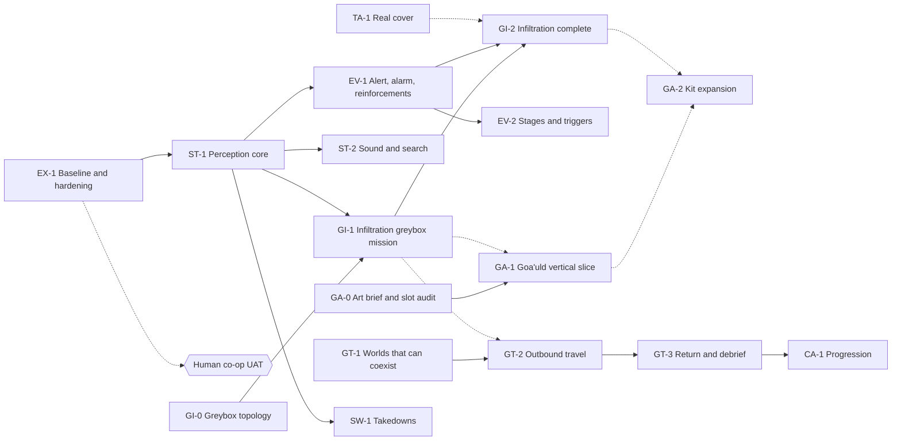

# Master development roadmap — detailed plan

Audited 12 November 2026 against `main` at `bf56743` (PR #40 merged); status of implemented milestones updated 13 November 2026 at `6af561b` (PR #49). Godot **4.4.1**, GDScript, native ENet.

[ROADMAP.md](../../ROADMAP.md) is the authoritative summary and says what to do next. This document holds the evidence and the detail: the capability matrix, dependency graph, milestone definitions, the art and content track, the risk register and three agent-ready work packages. Architectural choices are recorded in the [decision log](../DECISIONS.md). Game intent is in the [GDD](../../GDD.md).

**Resume update, 23 November 2026.** Sprints 7–9 are merged through #82, with owner art review pending. [Sprint 10’s held-weapon audit](../reviews/2026-11-23-sprint10-held-weapon-audit.md) covers the six weapons' fit, mission appearance, downed views, runtime cost and clean export. **Sprint 11’s M2 integration is ready for review** in the [asset sprint programme](asset-vertical-slices.md). [Sprint 11 review](../reviews/2026-11-23-sprint11-m2-intake.md). The audit below records the original development baseline and later milestone updates.

Sections 3 onward are the plan. [ROADMAP.md](../../ROADMAP.md) records which milestones have been implemented since; the capability matrix below is updated as they land, with the milestone named.

## 1. How to read status

| State | Meaning |
|---|---|
| **Verified** | Implemented and covered by an automated suite in `client/tests/` |
| **Awaiting human** | Implemented and automated, with a written human checklist that nobody has signed off |
| **Partial** | Some of the feature exists; the gap is stated |
| **Placeholder** | An identifier, marker, description or prop exists; the behaviour does not |
| **Missing** | No code |
| **Defect / debt** | Confirmed against current code in this audit |

The repository records human playtest feedback on the SGC (Sprint 21 findings, the UAT fixes in PRs #24, #25 and #37) but no completed acceptance sign-off for any mission. Nothing below is marked human-verified.

**Regression evidence.** The audit's last full local run was 69/69 on the PR #40 branch. Since then each milestone's pull request records its own full run (77/77 on the GI-2 branch), and hosted CI is green again since EX-1: see R1 in section 7 and [TESTING.md](../TESTING.md#current-baseline).

## 2. Capability matrix

Paths are under `client/` unless they start with `tools/` or `docs/`.

### Core game and multiplayer

| System | State | Evidence and gap |
|---|---|---|
| Hosting and joining (listen host) | Verified | `scripts/net/NetworkManager.gd`; `test_netcode_smoke`, `test_multiplayer_mission_join` |
| Dedicated server | Partial | `--server` loads the selected mission scene directly (`MainGameCoordinator._ready`). `test_sprint5_dedicated_smoke` covers SGC; `test_modular_extraction_dedicated` covers the modular mission host (EX-1). Any connected client can restart the mission |
| Player classes and loadouts | Verified against the lobby (R18) | Four profiles supply weapons, health and base speed. Heavy has the tripod and Recon has C4. The lobby names the shared field kit and uses the same weapon names as the in-game display. `test_lobby_class_loadouts` checks each card against a spawned operative. |
| Mission selection | Verified | Four entries in `NetworkManager.MISSIONS` (the fourth since GI-1); host-owned, synced on join and retry; `test_mission_selection_uat` |
| World lifecycle | Verified, single world | One scene per mission id; `MainGameCoordinator` swaps the whole world. No mid-mission world change |
| Authority and replication | Verified | Server resolves combat, objectives and shared interactions; `test_multiplayer_combat_authority`, `test_multiplayer_state_replication`, `test_gate_client_authority` |
| Late joining | Verified | Readiness gate plus per-object snapshots. Mission messages go only to ready peers that have the actor (EX-1, fixes R7) |
| Reconnection | Partial | `--reconnect` retries the connection five times. A returning peer is a new operative; no health, inventory or position is restored |
| Mission restart | Verified | Acknowledged restart (`prepare_mission_restart` / `acknowledge_mission_restart`); `test_mission_restart_cleanup`, two-process retry in `test_modular_extraction_multiplayer` |
| Combat, weapons, damage | Verified | `WeaponBase` plus six weapons, server-validated fire, Zat stun/kill/vaporise; balance never human-accepted |
| Downing, bleed-out, revive | Verified | `HealthComponent` (20 s bleed-out, revive to 40%); hold-to-revive in `PlayerController3D`; airmen auto-revive |
| Inventory, ammunition, resupply | Verified (SGC & Offworld CO-1) | Per-weapon ammunition and reserve. SGC and offworld compound armoury (`ArmoryArmorStation` and `ArmoryResupplyStation` in `armoury.tres`) provide server-validated tactical plate repair (+150 ballistic ammo reserve up to 300) and munitions/equipment resupply with cooldowns, reach validation, late-join sync, and retry reset (`test_offworld_resupply`, `test_offworld_resupply_multiplayer`). Sprint 5 adds host-validated sharing of compatible active reserves with conserved transfers, aimed HUD interaction, retry and travel coverage (`test_ammunition_sharing*`). |
| Success, failure, debrief | Partial | Shared result RPC, debrief panel and retry. Modular missions set their own banner and debrief text once (EX-1), including whether the alarm was raised (EV-1). The panel layout is still the SGC one |

### Tactical gameplay

| System | State | Evidence and gap |
|---|---|---|
| Friendly squad commands | Verified in SGC and Goa'uld Infiltration | The modular mission can stage two Airmen. The host resolves wheel orders and pings to authored cover approaches and rally markers, including orders from remote operatives. [Friendly squad orders](../maps/modular-vertical-kit.md#friendly-squad-orders) |
| Friendly NPC navigation | Modular orders verified by automated tests | Airmen use `SGCNavigator` → `LevelNavigator` for authored cover and rally positions. The four-operative suites check traversal, replication, and retry. Automatic SGC leapfrogging still uses its own sectors. |
| Jaffa patrols and navigation | Awaiting human | `JaffaAI.start_patrol`; `test_modular_npc_navigation`, `test_modular_npc_multiplayer` |
| Enemy detection | Awaiting human (patrols); defect (gate waves) | Patrols use sentry perception (ST-1): view cone, line of sight, suspicious before alerted, search; `test_jaffa_perception`. Gate waves and columns keep the assault rule, which acquires any operative within 22 m through walls (`_find_nearest_target`) |
| Cover and flanking | Partial | SGC: sandbag cover and corridor flank from literal coordinates. Modular (TA-1): Jaffa crouch behind solid low cover props, stand to fire over them and move when flanked (`test_jaffa_prop_cover`); rooms without props fall back to the room-centre `cover` marker. TA-2 chunk 1 adds bounded server-owned alternate-entrance flanking for review (sprint 4); suppression and friendly squad tactics remain future work |
| Suppression and firefights | Implemented for modular Jaffa sentries | Operative ballistic hits and nearby rounds can suppress a sentry on the host. Suppressed guards crouch, seek authored cover and hold their fire for a bounded interval. [Rules and tests](../maps/modular-flanking.md#suppression) |
| Door interaction | Verified | `ModularDoor` open/close, server-validated, snapshots; AI opens doors with `open_for`; TA-3 closes AI-opened doors after clearance, respects occupied doorways and preserves manual openings (`test_modular_navigation_ta3_multiplayer` covers late-join snapshot and closure) |
| Level-wide alert and alarm | Awaiting human | `MissionAlert` (EV-1): calm, alerted and alarm levels; a runner must reach an alarm console; operatives can disable consoles; reinforcement budget; `test_mission_alert`, `test_mission_alert_multiplayer` |
| Locked doors and access control | EV-2 complete (chunks 1–4); human review pending | `MissionTrigger`/`MissionEvents` handle `objective_completed`, `alarm_raised`, `alert_searching`, and `room_entered` conditions with `release_door`, `lock_door` (occupied-doorway deferred), `start_timer`, `enable_objective`, and `show_notice` actions, plus monotonic bitmask snapshots and retry across listen/dedicated peers (`test_mission_events*`, `test_ev2_triggers_and_acoustics*`). [Contract](../maps/mission-events.md) |
| NPC avoidance and rerouting | Awaiting human (TA-3) | `LevelNavigator` uses the room graph with live locks and navmesh legs, and steers nearby NPCs to their right. `blocked_door` holds only when no alternate route can be built. `test_modular_navigation_ta3` |
| Mounted weapons | Verified (SGC) | Fixed .50 cal turrets and the Heavy tripod; airmen can crew them. Not available as a modular attachment |
| Deployable equipment | Verified (SGC) | Claymore, C4, ballistic shield, smoke; smoke blocks AI sight |
| Stealth interactions, takedowns | Partial | Body dragging exists. Weapon noise with a suppressed MP5, sentry hearing/search (ST-2), and `LevelAcoustics` wall/closed-door sound propagation (`test_jaffa_hearing`, `test_ev2_triggers_and_acoustics`). SW-1 adds rear takedowns on unaware sentries and quiet Zat incapacitation (`test_stealth_takedowns_and_weapons`). Knife combat and body discovery remain unimplemented. |

### Stargate systems

| System | State | Evidence and gap |
|---|---|---|
| Gate operation and dialling | Verified (SGC) | `StargateRing` states and direction reservation; `DHDDialer` seven chevrons plus GDO; `test_gate_lifecycle_and_modes` |
| DHD and SGC console | Verified (SGC) | `SGCDialingConsole`, buffer lockout and ROM upload |
| Iris | Verified (SGC) | Hard-difficulty iris repair (`IrisServoHousing`) |
| Gate travel, world transitions | Verified (GT-2/GT-3) | Two-world `MissionSession` (`travel_infiltration`) with outbound dialing, complete state hand-off, presentation switching, and D-017 split-squad rules (`test_gate_travel`, `test_gate_travel_multiplayer`) |
| Transport rings | Implemented in modular missions (R16) | Interact from the pad to carry eligible operatives to the paired endpoint. The server checks the receiving pad, synchronizes phases to both ends and sends the active phase on join. The same operative nodes keep their health and gear. |
| Goa'uld shield mechanics | Missing | `DeployableShield` is the Tau'ri ballistic shield |
| Jaffa and faction equipment | Partial | Jaffa guard and shock guard with staff weapons; player staff and Zat. No other faction units |
| Offworld entry and extraction | Verified (GT-3) | `ModularMission` wires nested `Stargate` and `DHD`; site gate opens for home after objectives complete and lands returning operatives on the SGC ramp (`test_gate_return`, `test_gate_return_multiplayer`) |
| SGC return and debrief | Verified (GT-3) | `MissionSession.sync_debrief` presents SGC debrief with real kills, objectives, duration, alert status, and returned vs lost operative callsigns across both worlds (`test_gate_return`, `test_gate_return_multiplayer`) |

### Content creation

| System | State | Evidence and gap |
|---|---|---|
| Structural prefabs | Verified | 15 module definitions in `resources/level_modules/`; `test_modular_catalogue`, `test_modular_level` |
| Functional room presets | Verified | 16 presets in `resources/room_presets/`. Markers and system references are labels, not behaviour |
| Multi-deck placement | Verified | Ramp and deck bindings; `test_modular_vertical`, `test_modular_integration` |
| Map editor | Awaiting human | `addons/modular_editor/`; mouse workflows need the manual checklist in [the editor guide](../maps/modular-editor.md) |
| AI-assisted planning | Verified | `LevelPlanner`, `plan` command; `test_level_planning`. No fresh-agent benchmark yet |
| Connectivity and topology checks | Verified | `LevelTopology`, eleven checks, connectivity only |
| Composite clusters | Verified | Eight composites in `resources/level_composites/` |
| Theme support | Working for `goauld` (first slice); placeholder for the other factions | Theme contract and resolver work (`test_level_themes`). `goauld` has a palette on every module and generated pieces for `Room01Straight` and `Room04Chamber` (GA-1, `test_goauld_theme`, [kit guide](../maps/goauld-theme-kit.md)); not yet reviewed by a person. `asgard`, `tokra`, `replicator` and `tauri_sgc` carry `art_status = "fallback"` |
| Community asset intake | Partial | AP-1a ships two stylized Kenney weapons; researched high-fidelity/static/rig candidates, `tools/asset_intake.py` and `tools/gltf_to_glb.py` support staging ([handoff](../assets/README.md)). AP-1c dresses the SGC armoury ammo stations with a CC0 Poly Haven crate (`CrateStackVisual`, `test_imported_crate_visual`); AP-1d replaces the sidearm with a CC BY 4.0 Beretta M9 converted by `pack_model_glb.gd` (`test_imported_m9_visual`); both pending art review ([playbook](../assets/community-asset-playbook.md)). AP-1e adds the realistic P90 and AP-1f the 13,328-triangle M249 SAW with unchanged muzzle and a nested COLLADA conversion route (`test_imported_m249_visual`, [review](../reviews/2026-11-16-ap1f-m249.md)). Sprint 7 adds shared work-order validation and generated distributed credits/full licence text, and replaces the generic MP5 stand-in with the owner-downloaded, measured WillyG99 MP5SD ([review](../reviews/2026-11-18-sprint7-mp5-intake.md)). No humanoid adapter or complete tactical animation set imported |
| Faction visual assets | Integrated (AP-1g) | Imported Stargate glyph ring/seven anchored inserts, with unchanged gameplay aperture and controls; source body omitted. Owner authorized inclusion on 17 November 2026 with missing uploader-authorship evidence documented; independent authorship and human art acceptance remain unestablished. [Record](../reviews/2026-11-16-ap1g-stargate.md). The SGC map otherwise uses dimensioned placeholders and material briefs |
| Outdoor terrain, villages | Missing | No terrain, no exterior scenes |
| Authoring documentation | Verified | [AI authoring guide](../maps/ai-level-authoring.md); catalogue summary 13.7 KB |

### What is actually playable

| Mission | What a player gets | Standing |
|---|---|---|
| SGC Defense | Wave defence across three floors, difficulty objectives, dial out, extract | Most complete. Two-human acceptance outstanding |
| SGC UAT Base | The same base with no hostiles | Exploration and controls testing |
| Modular Extraction UAT | Reach a room, use a console, return; five patrolling Jaffa | Development slice on a neutral test fixture. No alarm consoles or gate |
| Goa'uld Infiltration — Greybox | Sabotage, download upstairs, return to the gate; six sentries that see and hear; a guarded and a quiet route; alarm consoles and reinforcements; cover at the checkpoint, antechamber and stores (GI-1, ST-2, EV-1, TA-1, GI-2) | Greybox stealth testbed, every phase 3 system live. Human runs outstanding |

## 3. Decision: gameplay, map or art first

**Order: gameplay systems (a minimal perception core) first, the mission map second and built on it, art third as one small vertical slice.** The greybox layout for the map is cheap and starts in parallel now. The full art kit waits for a play-tested mission.

| Criterion | A — gameplay systems | B — mission map | C — Goa'uld art |
|---|---|---|---|
| Gameplay benefit | Highest. Detection through walls makes every modular mission a brawl; fixing it changes how every future mission plays | High once A lands; today a larger map only spreads the same brawl over more rooms | None on its own; raises appeal of something not yet fun |
| Engineering dependencies | Needs only the current mission host | Layout needs nothing. A worthwhile mission on it needs A | Needs a slot audit of the theme resolver; independent of gameplay code |
| Regression risk | Medium: edits `JaffaAI`. Contained by keeping wave Jaffa on current rules | Low: new resources, one mission entry | Low for collision and navigation if the theme contract holds; medium for readability |
| Agent cost | High-reasoning sessions, narrow scope | Mostly scripted authoring: one `plan` request and a data resource | High and open-ended; visual iteration needs a human eye each round |
| Reuse | Every mission style in the GDD uses perception and alert state | The map is the shared testbed for stealth, events, cover, art | Reused only by Goa'uld and Ha'tak content |
| Safe in parallel | With map layout and art brief | Layout with anything; mission wiring after A | Brief and slice with anything that does not move sockets or footprints |

**Minimum before a serious stealth mission is playable** (Option A, in order):

1. Sight requires line of sight. No acquisition through walls, doors or decks.
2. A view cone, so position relative to a patrol matters.
3. Graded awareness with a visible tell: unaware, suspicious, alerted, with time to react.
4. Losing the target: investigate the last seen position, then resume the patrol.
5. A level-wide alert with a consequence: alarm, reinforcements. This is the first use of mission events.

Items 1–4 are milestone ST-1. Item 5 is EV-1. Sound, searching, takedowns, body discovery and light-based concealment are not in the minimum.

**What to author now for Option B, and what waits.** Author the room graph now: it costs one planner request and gives every other workstream a fixed target. Use the existing two-deck compound brief as the starting point. Leave patrol routes, guard counts and objective placement until ST-1 exists, because they depend on view cones. Nothing found in this audit requires new geometry; the existing modules, presets and composites cover every room in the brief.

**Smallest useful proof for Option C.** One narrow corridor, one door frame and one small chamber in the `goauld` theme, seen in the mission. The rest of the kit follows the rooms the first mission actually uses, after that mission has been played.

Why not art first: the [team contract](../../TEAM_CONTRACT.md) puts gameplay before bespoke art, and a kit built before the mission is played will be built for the wrong rooms. Why not the map first: the existing extraction mission already shows that combat on a bigger map is not the missing ingredient.

## 4. Dependencies and critical path

Solid arrows are hard technical dependencies. Dotted arrows are desirable sequencing only.

**Smallest route to a fun two-player Goa'uld infiltration:** EX-1 → ST-1 → GI-1 (using GI-0) → EV-1 → GI-2. Human UAT sits after GI-1 and again after GI-2. No gate travel, no art and no special weapons are on this path.

**Smallest route to SGC → gate → offworld → SGC:** GT-1 → GT-2 → GT-3. It needs one offworld mission to arrive in, so GI-1 is the natural destination, but GT-1 can start without it.

| Question | Answer |
|---|---|
| Unblocks several others | ST-1 (stealth, alarm, takedowns, every infiltration mission); EV-1 (reinforcements, Alpha Site defence, multi-stage missions); GT-1 (travel, campaign, a slim mission host) |
| Cosmetic or optional | All of GA; door auto-close; HUD wording; an editor panel for `plan` and `topology` |
| Premature abstraction to avoid | A general event framework before a second mission shows what it needs. Splitting `GateRoom` before the gate-travel decision. A faction system. Putting terrain into `LevelLayout`. Campaign saves before there are missions to link. Sharing perception with airmen before it is right for Jaffa. Further planner work without a failing brief |

**Parallel work without conflicting writes**

| Stream | Writes to | Can run alongside |
|---|---|---|
| ST-1, TA-1, TA-3, SW-1 | `scripts/entities/JaffaAI.gd`, `scripts/level/LevelNavigator.gd` | One at a time among themselves |
| EX-1, GT-1 | `GateRoom.gd`, `NetworkManager.gd`, `HUD.gd`, `HealthComponent.gd` | One at a time among themselves |
| GI-1, EV-1, EV-2 | `scripts/mission/*`, `resources/missions/` | One at a time among themselves |
| GI-0 and other layouts | New files in `resources/levels/`, `docs/maps/briefs/` | Anything |
| GA-0, GA-1 | `resources/level_themes/`, new art scenes | Anything that does not move sockets or footprints |
| OW-0 | Documentation and a throwaway scene | Anything |

## 5. Milestones

Complexity is relative: S is part of one agent session, M one session, L two or three, XL must be split before starting. **Agent** names the cheapest suitable worker: *Fable* for high-reasoning engineering, *Codex* for well-specified implementation, *scripted* for authoring through `tools/level_authoring.py` and data resources.

Every milestone ends with the full regression profile, a draft PR and updated maintained documents. That is not repeated below.

### A — Extraction mission hardening

**EX-1 — Trustworthy baseline and extraction hardening** · M · Codex · full work package in section 8.

**EX-2 — Two-human acceptance of the current build** · human task, not agent work
- **Experience:** two people finish Modular Extraction UAT and SGC Defense together and write down what broke.
- **Baseline:** written checklists exist in [the mission guide](../maps/modular-extraction-mission.md) and [TESTING.md](../TESTING.md); none is signed.
- **Deliverable:** a dated record in `docs/reviews/` with commit, roles and results; defects raised as issues.
- **Prerequisite:** EX-1 merged, and the play machine on that commit (R2).
- **Independent:** yes. It gates nothing technically, but ST-1 tuning is better informed after it.

### B — Stealth and perception

**ST-1 — Perception and awareness core** · M · Fable · full work package in section 8.

**ST-2 — Sound, investigation and search** · *implemented in PR #49*
- **Experience:** unsuppressed gunfire draws nearby patrols; a patrol that loses you searches the area before giving up.
- **Baseline:** none. No noise events exist.
- **New:** host-side noise events with a radius (weapon fire, explosions, sprinting optional); a search state that visits two or three points around the last known position; suppressed weapons emit a smaller radius.
- **Non-goals:** sound propagation through geometry, light and shadow, body discovery.
- **Prerequisites:** ST-1.
- **Components:** the perception script from ST-1, `WeaponBase`, `JaffaAI`.
- **Multiplayer / AI:** server only; clients see the replicated awareness state from ST-1.
- **Acceptance:** a shot within the radius moves an unaware sentry to suspicious and sends it to the source; a suppressed shot at the same range does not.
- **Tests / UAT:** new suite on the modular fixture; human check that the radius feels fair.
- **Risks:** tuning by number without play; too many simultaneous investigators jamming corridors (no avoidance).
- **Complexity:** M · Fable · independent of F, G, J.

### C — Mission scripting and events

**EV-1 — Alert state, alarm and reinforcements** · *implemented in PR #46; see [the alert guide](../maps/mission-alert.md)*
- **Experience:** once the compound knows you are there, a klaxon sounds, patrols converge and reinforcements arrive; reaching an alarm console first can prevent it.
- **Baseline:** `_alert_nearby_formation_jaffa` alerts siblings within 22 m. `TransportRings` and `WaveManager` can spawn Jaffa. No level-wide state.
- **New:** one host-owned alert level on the mission (calm, searching, alarm) with a snapshot for late joiners; escalation from ST-1 awareness; an alarm console interaction that a Jaffa must reach to raise the alarm; a reinforcement budget spawned at named room markers. Expressed as a short typed list on `MissionDefinition`, handled by one director node in the mission scene.
- **Non-goals:** a general scripting language, ring-delivered reinforcements, door lockdown, mission stages.
- **Prerequisites:** ST-1. GI-1 strongly preferred, so the vocabulary is drawn from a real mission.
- **Components:** `scripts/mission/MissionDefinition.gd`, a new director script beside `MissionObjectives.gd`, `ModularMission.gd`, HUD notice.
- **Multiplayer / AI:** alert level is replicated and monotonic within an escalation; reinforcements use the existing enemy spawner.
- **Acceptance:** alarm raised → reinforcements up to the budget and no more; alarm console disabled → no reinforcements; late joiner sees the current level; retry resets it.
- **Tests / UAT:** single-process and two-process suites; human run of both outcomes.
- **Risks:** this is where a second mission manager could appear. `WaveManager` stays the SGC Defense director and is not generalised.
- **Complexity:** M · Fable · independent of F, J.

**EV-2 — Stages, triggers and door or power actions** · **built (chunks 1–4; `docs/maps/mission-events.md`, `test_mission_events*`, `test_mission_countdown*`, `test_alarm_escape*`, `test_ev2_triggers_and_acoustics*`)**

- **Chunk 1:** objective-completed door releases with topology validation, late-join snapshots, and retry.
- **Chunk 2 & 3:** `start_timer` extraction windows (`goauld_timed_extraction`, `goauld_alarm_escape`).
- **Chunk 4:** general `room_entered` and `alert_searching` conditions, `lock_door` (with occupied-doorway deferral and soft-lock proof), `enable_objective` (`initially_enabled = false` + monotonic `(index, enabled_bits, completed_bits)` replication), `show_notice` (`tauri_alpha_site` & `goauld_mothership_boarding` consumers), and wall/closed-door sentry sound propagation (`LevelAcoustics` + `JaffaAI.hear`).

### D — Tactical AI and combat

**TA-1 — Real cover from authored props** · *implemented in PR #49*
- **Experience:** Jaffa fight from behind crates and barricades and can be flanked out of them.
- **Baseline:** `LevelNavigator.cover_position` picks a room-centre marker. Presets already place solid `cover` components (for example `security_checkpoint`, `cargo`) that the AI ignores.
- **New:** cover points derived from solid cover attachments, on the side away from the threat, checked with a ray; crouch behind low cover; relocate when the threat's angle defeats the cover.
- **Non-goals:** flanking manoeuvres, destructible cover, player cover changes.
- **Prerequisites:** none hard. Better after ST-1, which changes when combat starts.
- **Components:** `LevelNavigator.gd`, `LevelRoomComposer.gd` (read attachments), `JaffaAI._assign_tactical_role`.
- **Multiplayer / AI:** server only. SGC cover logic untouched.
- **Acceptance:** from the chosen point, a ray to the threat is blocked by the prop at torso height; with no qualifying prop the current fallback still applies.
- **Tests / UAT:** extend `test_modular_extraction_mission`; human check that firefights read as cover combat.
- **Risks:** bare modules have no cover props, so rooms without presets still fall back.
- **Complexity:** M · Fable · conflicts with ST-1 on `JaffaAI.gd`; run after it.

**TA-2 — Flanking, suppression and squad tactics on modular levels** · L · **built (chunks 1 & 2 PR #75/review; chunk 3 TA-2 friendly squad tactics milestone; [modular-flanking spec](../maps/modular-flanking.md), `test_modular_flanking*`, `test_modular_suppression`, `test_ta2_squad_tactics*`, `test_modular_squad_orders*`)**
- **Chunk 1:** Jaffa alternate-entrance flanking via live room graph, socket/navmesh routes, and replicated `is_tactical_flanking`.
- **Chunk 2:** Ballistic near-miss & hit suppression causing modular Jaffa sentries to duck/reposition to prop cover.
- **Chunk 3:** `LevelNavigator.room_tactical_anchors` derives modular Airman anchors (authored `cover` attachments, live `DeployableShield`, `Markers/cover`, lateral doorway jambs, and `entry`/`patrol`/`destination` rally points); `ModularSquadOrders` and `SGCAirmanAI` support modular bounding leapfrog, coordinated revive cover fire, and Airman MP5 suppression of Jaffa sentries with `SGCAirman.tscn` state replication.

**TA-3 — Navigation follow-ups: rerouting, avoidance, door closing** · **implemented 16 November 2026 on this branch; human check pending**
- **Experience:** patrols walk round a locked door, do not jam in corridors, and close doors behind them.
- **Baseline:** avoidance, rerouting and automatic closing were missing (R5, R6, R8).
- **New:** reroute using the layout's room graph with the locked connection removed (`LevelTopology.path` already does this search), then path room to room; simple yielding between NPCs in narrow rooms; optional door close after passing, with the existing occupied-doorway check.
- **Non-goals:** runtime navmesh rebake, crowd simulation.
- **Prerequisites:** none. Becomes necessary with EV-2 door actions and looped maps.
- **Components:** `LevelNavigator.gd`, `ModularDoor.gd`.
- **Acceptance:** on a looped layout with one locked door, a patrol reaches its waypoint by the other route; two NPCs meeting head-on both arrive while co-patrol and trailing non-interference is preserved (resolving post-combat patrol resumption stalls). `test_modular_navigation_ta3` also checks live locks, all-routes-blocked recovery, the infiltration graph and safe closing. `test_modular_navigation_ta3_multiplayer` checks server authority, late-join open state and replicated automatic closure. The overview demo explicitly opts out of closing to preserve route visibility.
- **Risks:** closed doors change sight lines, which interacts with ST-1.
- **Complexity:** M · Fable.

### E — Goa'uld infiltration mission

**GI-0 — Greybox compound topology** · S · scripted · part of the GI-1 package and safe to do at any time.

**GI-1 — Infiltration greybox mission** · M · Codex with scripted authoring · full work package in section 8.

**GI-2 — Infiltration mission complete** · *agent part in PR #49 (systems wired, loud-route suite, playtest template); tuning from human runs and the replay gate remain*
- **Experience:** the same compound with consequences: alarm, reinforcements, a guarded checkpoint worth avoiding, firefights with real cover.
- **Baseline:** GI-1.
- **New:** EV-1 wired into the mission; cover props placed for TA-1; patrols tuned from human runs; resupply point if CO-1 exists.
- **Non-goals:** gate travel, art, new enemy types.
- **Prerequisites:** GI-1, EV-1. TA-1 preferred.
- **Acceptance:** two humans complete it by a quiet route and by a loud route on the same build, and both are reported as worth replaying.
- **Complexity:** M · Codex plus scripted authoring. The human gate is the real cost.

### F — Goa'uld architecture and visual identity

See section 6 for sequencing.

**GA-0 — Visual brief and slot audit** · S · Codex · documentation and read-only inspection · **done 14 November 2026: [Goa'uld visual brief](../maps/goauld-visual-brief.md)**
- A written design language (silhouettes, door proportions, rib spacing, palette, lighting mood) and a table of what each theme slot (`wall_panels`, `floor_detail`, `ceiling_detail`, `door_frame`, `room_detail`) actually renders today in `LevelThemeResolver`. Original designs inspired by the setting; no copied production assets.

**GA-1 — Goa'uld vertical slice** · **built 14 November 2026; human capture review pending** · [kit guide](../maps/goauld-theme-kit.md)
- **Experience:** one stretch of the mission looks like a Goa'uld installation.
- **Baseline:** `goauld.tres` exists with `art_status = "fallback"`.
- **New:** themed visuals for one narrow corridor, one door frame and one 8 × 8 m chamber; theme status moved off `fallback` for those modules only.
- **Non-goals:** the full catalogue, props, a lighting pass, any change to collision, sockets or navigation.
- **Prerequisites:** GA-0. A decision on how art is produced (open question 7).
- **Components:** `resources/level_themes/goauld.tres`, new visual scenes or materials, `LevelThemeResolver` only if the slot audit finds a gap.
- **Acceptance:** `test_level_themes` and enclosure checks pass; collision and navigation output identical with and without the theme; a capture reviewed by a human.
- **Risks:** readability of doors and cover under a dark palette; scope creep into props.
- **Complexity:** M–L · depends on the art method · independent of all gameplay streams.

**GA-2 — Kit expansion** · XL · split per room group, ordered by the rooms the first mission uses: remaining corridors and junctions, large chambers, ramp and tall rooms, functional props (consoles, generator, crates), lighting and atmosphere.

Sprint 6 is merged in PR #77 and implements the first corridor group for owner review: `room01`–`room09`, 14 native compound rooms with pieces. It recovers unfinished work, completes junction variants and preserves production physical geometry; [evidence](../reviews/2026-11-18-sprint6-goauld-corridors.md). Owner art acceptance remains pending before larger chambers. The owner-requested next art sequence is [community-first vertical slices, Sprints 7–35](asset-vertical-slices.md), with a shared Codex/Antigravity workflow, weapons and SGC first, then rigged characters, offworld and bounded mothership art. Sprint 7 is merged via #79/#78 with its community MP5SD, intake and distributed credits; owner art acceptance remains pending. Sprints 8 and 9 merged the original staff and Zat. [Sprint 10](../reviews/2026-11-23-sprint10-held-weapon-audit.md) records the six-weapon audit and remaining art decisions. Sprint 11 covers the M2 defensive position.

### G — Stargate world transitions

Rewritten 14 November 2026 from the [split-world travel design](gate-travel-split-worlds.md) (GT-0, [D-016](../DECISIONS.md), [D-017](../DECISIONS.md)). The earlier versions assumed the squad always travels together.

**GT-0 — Split-world travel design** · done (documentation). Two worlds side by side in one process, every peer holding both and presenting one; the owners' rules for a split team.

**GT-1 — Worlds that can coexist** · built 14 November 2026 ([as built](gate-travel-split-worlds.md#gt-1-as-built))
- **Experience:** none visible. Afterwards the SGC and an offworld site can run side by side correctly.
- **Baseline:** 48 lookups find `Players`, `Enemies`, `Allies` or `GateRoom` by searching the whole game. With two worlds loaded a sentry cannot see an operative in front of it (GT-0 experiment).
- **New:** `MissionWorld.of(node)` and every whole-game lookup moved to it; a `MissionSession` above the worlds that records which world each peer is in and applies the fail rule; worlds spawn only the peers placed in them; a world can be presented or hidden; `MainGameCoordinator` can load one world or two.
- **Non-goals:** any travel; a lobby entry; the host split of D-008 (risk R11 stays open); any change to an existing mission's behaviour.
- **Components:** `PlayerController3D.gd`, `SGCAirmanAI.gd`, `JaffaAI.gd`, `JaffaPerception.gd`, weapons and props with lookups, `GateRoom.gd`, `MainGameCoordinator.gd`, `NetworkManager.gd`, a new session script.
- **Acceptance:** every existing suite passes unchanged; the experiment as a permanent suite in both load orders; a static check against whole-game lookups; frame time measured on a display with one world and with two.
- **Risks:** a missed lookup fails silently (T1); host frame time (T2).
- **Complexity:** L · Fable.

**GT-2 — Outbound travel** · L · Fable · **built 14 November 2026 ([as built](gate-travel-split-worlds.md#gt-2-as-built))**
- A travel mission in the lobby (SGC home, infiltration compound as the site). Dial out, step through, arrive with health and equipment; others may stay. The gate stays open for the mission. Late joiners arrive in the SGC. The mission fails only when everyone in both worlds is down. An "abort mission" control in the SGC. Prerequisites: GT-1. Risks: the hand-off losing a message in flight (T3), incomplete carried state (T4), leaks from the hidden world (T5). Human check with two players, one staying.

**GT-3 — Return and debrief** · M · Fable · **built 15 November 2026 ([as built](gate-travel-split-worlds.md#gt-3-as-built))**
- A working gate at the site (the `stargate_dhd` preset's gate is wired inside `ModularMission`) that opens for home when the objectives are complete. Success when no standing operative remains offworld and at least one came home. Debrief in the SGC with real figures and who was lost. Retry for a two-world mission.

### H — Expanded co-op mechanics

**CO-1 — Co-op kit on modular missions** · M · Codex/Antigravity · **built 16 November 2026 (`test_offworld_resupply`, `test_offworld_resupply_multiplayer`)**
- Functional offworld armoury resupply using existing authored stations: `ArmoryArmorStation` (tactical plate repair + full health, +150 ballistic reserve ammo up to 300, 3.0 s cooldown) and `ArmoryResupplyStation` (active weapon reserve capacity replenishment via `WeaponBase.resupply()`, tactical gear restock: 2 claymores, 2 C4, 1 deployable shield [`MAX_DEPLOYABLE_SHIELDS`], 2 smoke grenades, 3.0 s export override cooldown).
- Integrated into `armoury.tres` preset within `GoauldInfiltrationMission` (`Room04Chamber`) preserving room footprints, navigation/collision envelopes, objectives, and patrol markers.
- Server-authoritative validation (`ServerInteraction.resolve`), reach validation ($\le 3.5$ m) across remote and host entry paths, late-join cooldown/state snapshots, and state reset on coordinated retry. Preserves legacy SGC zero-cooldown crate behavior, solo failure-on-down rules, and existing station behaviors.

**CO-2 — Roles and sharing** · M · **built (chunk 1 PR #76; chunk 2 CO-2 roles/revive/medkit/cover milestone; [chunk 1 spec](ammunition-sharing.md), [chunk 2 spec](co2-roles-and-cover.md), `test_ammunition_sharing*`, `test_co2_roles_and_cover*`)**
- Ammunition sharing (`B`), Tech Specialist (`carter_tech`) Field Medic 2× revive speed (`1.25 s`) & `75%` recovery HP plus 2 server-validated `[G]` Field Medkits (`+50 HP`, `3.0 m` reach/LOS, travel/campaign carryover & armoury restock), validated offworld `DeployableShield` cover with crouch/LOS/bolt blocking and `LevelNavigator` registration, and 1:1 agreement across `NetworkManager.CLASS_PROFILES`, `LobbyUI`, and `TacticalHUD`.

### I — Special weapons and faction mechanics

**SW-1 — Stealth takedown, body discovery and quiet weapons** · M · Fable · **built (`test_stealth_takedowns_and_weapons`, `test_stealth_body_discovery_and_cqc`, `_multiplayer`, `_dedicated`)**
- Takedown on an unalerted Jaffa from behind (`JaffaAI.can_be_taken_down_by`, `perform_stealth_takedown`, `PlayerController3D.try_stealth_takedown`); Zat as the quiet option (`noise_radius = 4.0`, silent stun/kill/vaporize on unalerted sentries without spreading a 1-hop alert or raising `MissionAlert`); both dead and Zat-stunned Jaffa bodies can be dragged out of sightlines. Follow-up adds patrolling sentry **body discovery** (`JaffaPerception.visible_undiscovered_body`, escalating to `ALERTED` + `MissionAlert.SEARCHING` on slain comrades and `SUSPICIOUS` investigation on Zat-stunned comrades while dragged/vaporized bodies stay concealed) and **combat knife / thrown knife CQC** (`ThrownKnife`, rebindable `[6]` `"throw_knife"`, silent stealth kill on unalerted unshielded sentries, quiet `8 m` wall-impact acoustic lure via `LevelAcoustics`, deflected by active Goa'uld personal shields while slow `[F]` close-quarters melee bypasses shields, knife recovery, Armoury restock, and gate-travel carryover). Licensed external `.glb` weapon meshes (`p90_smg.glb`, `mp5_silenced.glb`) wired in `WeaponBase` alongside SW-1 (`AP-1a`).

**SW-2 — Goa'uld personal shield and countermeasures** · M · **built (SW-2 milestone; `docs/plans/goauld-personal-shield.md`, `test_goauld_personal_shield`, `test_goauld_personal_shield_multiplayer`, `test_goauld_personal_shield_dedicated`)**
- Server-authoritative `GoauldPersonalShield` (`goauld_personal_shield.gdshader`) blocks fast ballistic projectiles (`"bullet"`, `"50cal_heavy"`), grants suppression immunity, and triggers perception/alert escalation on deflection; beaten by operative slow melee/flank strikes (`"melee"` action, `[F]`), silent rear takedowns, Zat overload (`6.0 s` lockout), Ma'Tok Staff plasma drain/overload, and C4/Claymore blasts. Deployed on Mothership Bridge Commander, heavy Horus reinforcements, and Wave 3+ Medium/Hard SGC Defense officers.

**SW-3 — Specialised enemies & Goa'uld System Lord Boss** · L · **built ([SW-3 spec](sw3-specialist-enemies-and-boss.md), `GoauldSystemLord.tscn`, `GoauldShockGrenade.tscn`, `test_sw3_specialist_enemies_and_boss`, `test_sw3_specialist_enemies_multiplayer`, `test_sw3_specialist_enemies_dedicated`)**
- Strictly in-canon Goa'uld/Jaffa combat roles (`JaffaAI.combat_role`, replicated via `MultiplayerSynchronizer`): **First Prime / Officer** (expanded 30 m alert spread, Rally Command clearing nearby suppression, priority faster alarm runner), **Heavy Staff Cannon Trooper** (220 HP, 30% frontal ballistic plate bypassed by flanks/plasma/melee, 5-hit suppression resistance, 3-bolt rapid heavy volley), **Shock Grenadier** (canonical spherical `GoauldShockGrenade` flushing cover with wall-LOS concussive damage & 0.55× flash disorientation), and **Goa'uld System Lord Boss** (`320 HP`, `140`-energy `GoauldPersonalShield`, stealth-takedown resistance with `150 HP` flank melee bypass, **Kara Kesh** telekinetic shockwave push & cover-breakable/overload-interruptible focused neural beam, and `TacticalHUD` Boss Health & Shield Bar). Deployed across Ha'tak Mothership Bridge/Engineering, Goa'uld Infiltration, Alarm Escape, Outdoor Gate Site, and SGC Defense Waves 2–4.

### J — Outdoor world construction

**OW-0 — Outdoor authoring boundary spike** · S · **built ([outdoor-world-boundary.md](outdoor-world-boundary.md), `OutdoorBoundary`, `test_ow0_outdoor_boundary`)**
- Proves decision [D-006](../DECISIONS.md): `LevelLayout` and `LevelEnclosureValidator` stay strictly enclosed interior-only; `OutdoorBoundary` opens explicitly declared exterior sockets after interior enclosure validation passes, mounts a runtime `ModularDoor`, bakes an independent exterior `NavigationRegion3D` using `LevelNavigation.profile()`, joins it to `LevelAssembly.navigation_map` with a bidirectional `NavigationLink3D`, and validates round-trip navigation across the doorway (including 2 km split-world offsets).

**OW-1 — Exterior gate site** · L · **built (`OutdoorGateSiteMission.tscn`, `outdoor_gate_site_bunker.tres`, `outdoor_gate_site.tres`, `test_ow1_exterior_gate_site`, `test_ow1_exterior_gate_site_multiplayer`, `test_ow1_exterior_gate_site_dedicated`)**
- Playable outdoor arrival clearing with active offworld `Stargate`, `DHD`, natural cliff/boulder cover (`exterior_cover`), Airman fireteam support, outdoor and cross-boundary Jaffa patrols, one doorway entrance into a 5-room Goa'uld modular bunker (`bunker_entry` → `bunker_command`), telemetry download, exterior Stargate extraction, and SGC-to-exterior two-world gate travel (`travel_outdoor_site`).

**OW-2 — Village or outpost** · XL · split later.

### K — Other factions and locations

| Location | Geometry | Art | Systems it adds | Earliest sensible start |
|---|---|---|---|---|
| SGC extensions | Existing `SGCMap` regions | Existing placeholders | None | Any time; low priority |
| Tau'ri Alpha Site | Modular kit; demo layout exists (`ai2_tauri_alpha_site.tres`) | Closest to the SGC palette | Defence waves on a modular level, evacuation escort | After EV-1 |
| Goa'uld mothership or pyramid | Modular kit, multi-deck, rings as travel | Reuses the Goa'uld kit | Working ring transport | After GI-2 and GA-1 |
| Asgard ship or base | Modular kit; demo layout exists | New kit | Transport or beaming rules | After GA-2 proves the art pipeline |
| Tok'ra tunnels | Likely needs new organic tunnel modules | New kit | Possibly crystal-grown doors | After a module-authoring review |
| Replicator structures | Modular kit plus block dressing | New kit | A new enemy with different movement | Last; most new systems |

### L — Campaign and replayability

**CA-1 — Mission progression and outcomes** — *implemented* (Operation Ha'tak Strike, Briefing Terminal, carried inventory, host disk persistence).
**CA-2 — Variation and difficulty** — *implemented* ([CA-2 spec](campaign-variation-and-tiers.md), offworld Easy/Medium/Hard tiers, deterministic `run_seed`, composable mutators, patrol route/officer shield variation, data-driven `MissionObjectiveVariant` bonus steps, tactical ratings/honors, persistent career records; verified via `test_campaign_variation_and_tiers`, `test_campaign_variation_multiplayer`, `test_campaign_variation_dedicated`).

## 6. Visual and content track

Each task lists the earliest point at which it can start without creating rework.

| # | Task | Ready when | Rework risk if started earlier |
|---|---|---|---|
| V0 | Goa'uld visual reference and design brief (GA-0) | Now | None |
| V1 | Theme slot compatibility audit (GA-0) | Now | None; read-only |
| L1 | First greybox mission topology (GI-0) | Now | Low; the layout is a planner request and can be regenerated |
| V2 | Corridor, door frame and chamber slice (GA-1) | After V0 and V1, and the art-method decision | Low while sockets and footprints are untouched |
| L2 | Encounter and patrol placement | After ST-1 | High before it: placement depends on view cones |
| L3 | Functional prop replacement (consoles, generator, crates, cover) | After TA-1 fixes how cover props are read, and GI-1 has been played | Medium: cover dimensions drive AI behaviour |
| V3 | Lighting and atmosphere | After V2 and once the GI-1 layout is frozen | Medium: lighting changes readability of doors, cover and awareness tells |
| V4 | Expansion to further room types (GA-2) | After GI-2 human UAT | High before it: the mission decides which rooms matter |
| V5 | Other faction kits | After V4 proves the pipeline; Alpha Site first, then mothership reuse, then Asgard, Tok'ra, Replicator | High |
| V6 | Outdoor environment requirements | After OW-0 | High: the indoor/outdoor boundary is undecided |

The first designed Goa'uld mission (GI-1) is the shared testbed. Perception, events, cover, extraction rules and the art slice are all proven on that one map before anything is scaled.

## 7. Risk and defect register

Each previously reported issue was checked against the code at `bf56743`.

| # | Item | Verdict | Evidence | Addressed by |
|---|---|---|---|---|
| R1 | **Hosted CI full profile is red on `main`** | Fixed in EX-1 (PR #42); hosted `Godot full` passed on PRs #42 and #43 | Failing on every push to `main` since PR #35 (`ad643b2`, 10 Nov): six merges, #35 to #40. `test_level_authoring` runs `tools/level_authoring.py`, which looks for `godot` on `PATH`; the workflow installs the engine elsewhere and passes it only to the test runner. Fast and multiplayer profiles pass. Local full runs pass | EX-1 |
| R2 | Play machine checkout was behind `main` | Historical; superseded 17 November 2026 | Use the existing checkout and finish on `main` when a merge is requested. Do not create an alternate play directory; AGENTS.md governs the workflow | Check branch/commit before play |
| R3 | Cover markers without real cover | Fixed where rooms have low cover (TA-1, PR #49) | Sentries fight from behind solid low cover attachments (`LevelNavigator.prop_cover`). Rooms without such props, including all bare structural modules, still fall back to the generated room-centre marker | TA-1; more cover is content work |
| R4 | Perception through walls and decks | Fixed for patrols (ST-1, PR #43); gate waves unchanged | Patrols use the sentry profile (`JaffaPerception`): range, view cone and line of sight, graded awareness. Gate waves and column marches keep the assault rule, which still acquires within 22 m without line of sight, so SGC Defense plays as before | — |
| R5 | NPC avoidance | Implemented (TA-3); human pending | Local right-hand steering on the assembly navigation map; colliding head-on Jaffa both reach their waypoints (`test_modular_navigation_ta3`). Not crowd simulation | Human corridor check |
| R6 | Locked-door rerouting | Implemented (TA-3); human pending | `LevelTopology.path` searches the native room graph with live locked connections excluded; navmesh legs are checked for locked crossings. No available route still reports `blocked_door`; runtime unlocks retry | Human loop check |
| R7 | Late join during combat | Fixed for actors, doors, objectives and result (EX-1) | Reproduced in EX-1, then fixed: `SGCNetworkManager.mission_rpc` sends only to peers that have the receiving node, and `test_modular_extraction_multiplayer` now joins during a firefight with an error-free client log. SGC-only props (gate, lift, wave manager, shutters) still broadcast to every peer; not reproduced, not changed | EX-1; SGC props open |
| R8 | Doors left open after a patrol passes | Implemented (TA-3); human pending | Server timer closes AI-opened doors after nearby NPCs leave and the doorway clears. `auto_close_delay = 0` opts out; manually opened doors stay open; closure and late-join state replicate | Human sight-line check |
| R9 | Enemy behaviour after the result | Fixed for SGC Defense and modular missions | The shared result stops combatants and turrets, freezes health, and retires live bolts and armed charges. The SGC staging callback respects the result. Four-player listen and dedicated tests cover post-result joins and a fresh retry. | Human play review |
| R10 | Dedicated-server acceptance | Automated for both missions; human open | SGC: `test_sprint5_dedicated_smoke`. Modular: `test_modular_extraction_dedicated` (EX-1), which also found and fixed two defects: a client could not request a retry, and a client kept running a dead world after the server stopped. No human has accepted either | EX-2 |
| R11 | SGC coupling in mission hosting | Wording fixed (EX-1); structure open | `ModularMission` still extends `GateRoom` and stubs its sector and snapshot methods. Since EX-1 it sets its banner on change and its own debrief through `HUD.set_mission_banner` and `HUD.set_debrief` | Open. No longer part of GT-1 ([D-016](../DECISIONS.md)): coexistence does not need the split |
| R12 | Gate travel and mission-state ownership | Fixed (GT-1 to GT-3) | `MissionSession` coordinates two-world coexistence, outbound/return Stargate travel, carried state, D-017 split-team outcome evaluation, and SGC debrief (`test_gate_travel`, `test_gate_return`) | Fixed in GT-1, GT-2, GT-3 |
| R13 | Human two-player testing | Outstanding | No signed checklist for any mission | EX-2 |
| R14 | Jaffa keep attacking downed operatives | Changed in EX-1 to the default of open question 3 | A downed operative is only chosen when no standing one is in perception. Applies to all Jaffa, SGC included | Revisit if question 3 is answered differently |
| R15 | Security doors had no mission action | Addressed by EV-2-1 | Generator sabotage now releases named command security through the existing server API, with real peer snapshots/retry coverage | Human pacing review; remaining EV-2 chunks separate |
| R16 | Ring transport lacks an authoritative mission interaction | Implemented for authored modular pairs | Server-validated boarding and destination clearance, movement handoff, busy lock and late snapshots. Four-operative listen and dedicated suites exercise the compound pair in both directions and through retry | Human play review |
| R17 | Per-tick tree searches in AI | Fixed for sentries (ST-1); assault unchanged | Sentry perception runs at 10 Hz and caches the operative containers. The assault rule still searches the tree and casts rays every physics tick per Jaffa | Revisit if SGC Defense frame time suffers |
| R18 | Class descriptions promise absent kit | Fixed by the loadout audit | Lobby cards reflect actual starting weapons, stats and gear. Reopening the lobby restores the selected class on the card and picker. | Expand roles through CO-2 if designed |
| R19 | Stale limitations in older guides | Confirmed | The navigation guide still listed modular combat as unverified and cover as SGC coordinates, both superseded by PR #39. Corrected with dated notes in this change | Done here |
| R20 | Authoring tools untested by a fresh agent | Outstanding | Stated in the authoring review | GI-0 doubles as that test if run by a new session |
| R21 | Module headers outside their own cell | New, confirmed (GA-1) | The north and south headers of `Room05` to `Room13`, `Room15` and `Room16` are centred 0.1 m beyond the cell edge and overlap the adjoining room's header. Invisible with one material; flickers against a themed lintel. GA-1 stood lintel gold 5 mm proud; Sprint 6 finishes both faces so a neighbouring header back retains the design. Existing structural offsets are preserved | Separate structural pass with collision/enclosure re-verification; the cosmetic mitigation is covered by Sprint 6 join captures |
| R22 | Jaffa armour rendered dark | Fixed (GA-1, D-015) | `JaffaGuard.tscn` and `JaffaShockGuard.tscn` used metallic 0.85 to 0.95. No mission has a sky or reflection probe, so the armour rendered dark olive: 1.1 to 1.3 : 1 against Goa'uld walls. Now matte, about 5 : 1. Measured in the [kit guide](../maps/goauld-theme-kit.md#readability-measured) | Reconsider a small metallic term if the lighting pass adds reflections |
| R23 | Whole-game lookups assume one world | Fixed (GT-1) | 48 lookups such as `get_tree().root.find_child("Players", true, false)` return the first match in the game. With the SGC and the compound loaded together, a sentry did not notice an operative 3 m away | Fixed: lookups go through `MissionWorld`; `tools/tests/test_world_scoping.py` fails on a new one |
| R24 | Second late join with another client already present | Fixed in PR #71; human/WAN check pending | Host-owned spawn visibility and movement relay, acknowledged gate handoff and restart readiness guard. Real four-operative listen/dedicated fixtures cover stalled late loads, travel, replacement joining and two retries ([review](../reviews/2026-11-17-r24-four-player-joining.md)). Session-lifecycle follow-up is R25 | Human four-player latency check |
| R25 | Burst disconnects and stale session cleanup | Sprint 1 implemented; validation in PR | Host-only transport, authoritative roster announcements, post-poll removal, unified lobby return and cancellation of reconnect/handoff waits. Listen/dedicated fixtures cover bursts with a survivor, HUD leave, rejoining, retries, server loss and same-port rehost ([review](../reviews/2026-11-17-sprint1-session-lifecycle.md)) | Strict full/hosted checks, then human/WAN follow-up |

Items verified as **no longer open**: server-owned actors invisible to clients (fixed in PR #39, `configure_mission_sync`), the retry race on client operatives (fixed in PR #39), and "client late join mid-patrol untested" from the navigation guide (now covered).

## 8. The first three work packages

**All three are done** (EX-1, ST-1, GI-1). The next packages, GA-0 and GT-1, and the human play sessions are in [next-work-packages.md](next-work-packages.md). The text below is kept as written for the record.

One package per agent session. Order: **EX-1 first**, then ST-1, then GI-1. GI-0, the layout half of GI-1, may be done at any time.

**Why EX-1 goes first.** Every PR since #35 has merged without a green hosted regression. ST-1 edits the enemy state machine that the SGC suites protect, so the hosted signal has to be trustworthy before that change lands. EX-1 also removes the defects that would otherwise be mistaken for stealth problems (frozen or still-shooting enemies at the result, attacks on downed operatives), and it is the build the first two-human session should use. Only the CI repair is a hard dependency of ST-1; the remainder is sequencing, so ST-1 may start once that part is merged.

### Package 1 — EX-1 Trustworthy baseline and extraction hardening

1. **Objective.** Hosted CI green on `main`, and the Modular Extraction UAT mission free of the known rough edges so that two humans can run its checklist.
2. **Prerequisites.** None.
3. **Likely files.** `tools/run_godot_tests.py` and `tools/tests/` (export the engine path to child processes) or `.github/workflows/validation.yml`; `client/scripts/mission/ModularMission.gd`; `client/scripts/entities/HealthComponent.gd` (readiness-gated publish); `client/scripts/entities/JaffaAI.gd` (target filter only); `client/scripts/ui/HUD.gd` (mission banner and debrief text setters); a new dedicated-server suite; `docs/PLAYING.md`, `docs/TESTING.md`.
4. **Boundaries.** No new mechanics. No change to detection, cover or navigation. No split of `GateRoom`. SGC Defense rules unchanged. The downed-target rule follows open question 3; default is that Jaffa do not select a downed operative while a standing one is known.
5. **Acceptance tests.**
   - Hosted `Godot full` job passes on the PR.
   - New suite: a dedicated server started with `--server --mission modular_extraction_uat` accepts a client, spawns its operative and the patrols, and completes a retry.
   - Joining during a firefight logs no engine error on the joining client and health is correct once the operative appears.
   - After a result, no Jaffa fires or moves and no operative takes damage, on host and client.
   - The modular mission sets its HUD banner and debrief text once through a HUD method, not every frame, and no SGC wording appears.
   - All existing suites pass unchanged except where the downed-target rule is asserted.
6. **Human verification.** Run the eleven-step checklist in [the mission guide](../maps/modular-extraction-mission.md) with two people, including one dedicated-server session. Record it under `docs/reviews/`.
7. **Risks and rollback.** `HealthComponent` is shared by every actor; a mistake shows up as desynchronised health. Keep the CI repair, the health change and the mission changes in separate commits so each can be reverted alone.
8. **Done when.** CI is green on the PR, the new suite and the full profile pass locally, the documents name the mission in the player guide, and the PR lists the checklist as pending human sign-off.

**Handoff prompt**

> Repository `flaxos/Team-Discovery-Channel`, Godot 4.4.1. Read `ROADMAP.md`, then package 1 (EX-1) in `docs/plans/master-development-roadmap.md` and risk items R1, R7, R9, R10, R11, R14. Work in the existing checkout; preserve unfinished work and follow AGENTS.md for branches and delivery. First make the hosted `Godot full` CI job pass: `test_level_authoring` fails there because `tools/level_authoring.py` cannot find the engine the runner was given. Then harden the Modular Extraction UAT mission exactly as listed under "Acceptance tests", in separate commits. Do not add mechanics, change detection or split `GateRoom`. Run targeted suites while working and the full profile once at the end. Open a draft PR, update `docs/PLAYING.md` and `docs/TESTING.md`, and merge only when the user requests it.

### Package 2 — ST-1 Perception and awareness core

1. **Objective.** Patrolling Jaffa notice operatives only by seeing them, inside a view cone, over a short readable interval, and give up when they lose them.
2. **Prerequisites.** The CI repair from EX-1.
3. **Likely files.** New `client/scripts/entities/JaffaPerception.gd` (or similar single script); `client/scripts/entities/JaffaAI.gd`; `client/scenes/entities/JaffaGuard.tscn` and `JaffaShockGuard.tscn` (replicated awareness property, overhead tell); new `client/tests/test_jaffa_perception.gd` and a two-process check; `docs/maps/modular-extraction-mission.md`.
4. **Boundaries.**
   - Two profiles. *Sentry* is the new behaviour and is selected by `start_patrol`. *Assault* is today's behaviour and remains for column marches and wave Jaffa, so SGC Defense plays as before.
   - Sentry rules: sight needs line of sight, range and a horizontal cone; awareness goes unaware → suspicious → alerted, filling while a target is seen and draining when it is not; taking damage alerts at once; an alerted sentry that loses its target walks to the last seen position, waits, then resumes its patrol; the existing nearby-alert call still spreads an alert. Range, cone angle and timings are exported values.
   - Run perception at a fixed lower rate than physics and look up the operative containers once (R17).
   - Out of scope: noise, searching beyond the last seen point, level-wide alarm, takedowns, light, airman perception, any change to weapons or damage.
5. **Acceptance tests.** On the integrated fixture, with the production controller:
   - An operative behind a wall within 22 m is never acquired. The same on the deck above or below.
   - An operative behind the sentry, outside the cone, is not noticed; inside the cone, awareness rises and reaches alerted only after the configured interval.
   - Stepping out of sight before the interval ends returns the sentry to unaware without combat.
   - Smoke and a closed door block sight; opening the door restores it.
   - Damage alerts immediately. Losing the target leads to the last seen position, then back to the patrol route in order.
   - A client sees the same awareness state as the host for each Jaffa, including after joining late.
   - `test_jaffa_ai_smoke`, `test_jaffa_column_march` and every SGC suite pass unmodified. `test_modular_extraction_mission` may be adjusted only where it relied on instant detection.
6. **Human verification.** Two players cross the fixture to the command room without being alerted, on purpose, at least once; then get seen on purpose and confirm the tell is readable in the third-person camera with time to react.
7. **Risks and rollback.** Third-person camera lets players see round corners, so cones that feel fair in first person may feel blind here; expect tuning. The profile switch is the rollback: setting patrols back to the assault profile restores current behaviour without reverting code.
8. **Done when.** The new suites and the full profile pass, hosted CI is green, the mission guide's limitation about detection is replaced by the new rules, and the PR states the tuning values as provisional pending human play.

**Handoff prompt**

> Repository `flaxos/Team-Discovery-Channel`, Godot 4.4.1. Read `ROADMAP.md`, then package 2 (ST-1) in `docs/plans/master-development-roadmap.md`, decision D-004 in `docs/DECISIONS.md`, and `client/scripts/entities/JaffaAI.gd` (`_find_nearest_target`, `_has_line_of_sight`, `_process_advance_state`, `start_patrol`). Implement a sentry perception profile for patrolling Jaffa: line-of-sight and view-cone sight, three awareness states with a replicated overhead tell, investigate the last seen position, resume patrol. Wave and column Jaffa keep today's behaviour; no SGC suite may change. Write `test_jaffa_perception` first from the listed acceptance tests. No noise, alarm, takedowns or airman changes. Use the existing checkout, follow AGENTS.md for branches and delivery, targeted suites while working, one full run at the end, draft PR unless the user requests a merge.

### Package 3 — GI-1 Goa'uld infiltration greybox mission

1. **Objective.** A fourth selectable mission on a purpose-planned compound that can be finished quietly or loudly, in greybox, to serve as the testbed for everything after it.
2. **Prerequisites.** ST-1 for the mission. None for the layout (GI-0).
3. **Likely files.** New `client/resources/levels/goauld_infiltration_01.tres` (authored only through `python3 tools/level_authoring.py plan`); new `docs/maps/briefs/goauld_infiltration_01.requirements.json`; new `client/resources/missions/goauld_infiltration.tres`; new `client/scenes/mission/GoauldInfiltrationMission.tscn` pointing at it; one entry in `NetworkManager.MISSIONS`; `client/tests/test_goauld_infiltration_mission.gd`; a new guide in `docs/maps/`; `test_mission_selection_uat` (mission count).
4. **Boundaries.**
   - Layout: start from the brief behind `ai2_goauld_compound_two_deck.tres` but save a new layout; do not edit the demonstration maps. Roughly 18 to 24 rooms on two decks with an insertion room, a security checkpoint, barracks, a generator objective, an upper command area reached by the ramp, a ring room and at least two room-disjoint routes from insertion to the generator. Prefer the `stargate_dhd` preset for the insertion room so gate travel can attach later; if the planner cannot fit it, report that and use a plain entry.
   - Mission: existing objective kinds only (`reach`, `interact`, `extract`); for example sabotage the generator console, download from the command console, return to insertion. Patrol groups on room markers using the sentry profile.
   - Out of scope: alarm and reinforcements, unlocking doors, new objective kinds, art, gate travel, friendly airmen, changes to `ModularMission.gd` beyond what a second definition strictly needs. Theme id `goauld` is set and will render the neutral fallback.
5. **Acceptance tests.**
   - `validate` and `build` pass for the layout; the requirements file passes `topology` (two disjoint routes, a route avoiding the checkpoint, command only via the ramp, declared dead ends, required roles).
   - `MissionDefinition.validate()` returns no errors; every patrol room and objective attachment resolves.
   - The mission launches from the lobby and from `--mission`; at spawn no sentry can see the insertion point.
   - Objectives complete in order under the production controllers; extraction, failure, retry and late join behave as in the existing mission.
   - With patrols present, a scripted operative following the quiet route's rooms is not alerted when it stays outside every cone; following the checkpoint route it is.
   - The three existing missions are unchanged.
6. **Human verification.** Two players complete the mission once by each route and note duration, where they were seen, and any room that felt empty or unfair. No duration target is set yet.
7. **Risks and rollback.** The planner uses one shell per preset room and a bounded search; an awkward loop may be refused, in which case simplify the graph rather than hand-place rooms. Patrol timing may make the quiet route impossible or trivial: that is the tuning the testbed exists for. Rollback is removing one `MISSIONS` entry; the resources are additive.
8. **Done when.** The mission is selectable, its suite and the full profile pass, captures of the layout are in the guide with the requirement results, and the PR lists the human run as pending.

**Handoff prompt**

> Repository `flaxos/Team-Discovery-Channel`, Godot 4.4.1. Read `ROADMAP.md`, package 3 (GI-1) in `docs/plans/master-development-roadmap.md`, `docs/maps/ai-level-authoring.md` and `docs/maps/modular-extraction-mission.md`. Author a new two-deck Goa'uld compound layout with `python3 tools/level_authoring.py plan` (discover capabilities with `catalogue --summary` first; write no coordinates by hand; do not modify existing layouts), save its requirements file and confirm them with `topology`. Then add a second `MissionDefinition`, a mission scene and one `NetworkManager.MISSIONS` entry so it is selectable, using only the existing objective kinds and sentry patrols. No alarm, door unlocking, art or gate travel. Write the listed acceptance tests. Use the existing checkout, follow AGENTS.md for branches and delivery, full profile once at the end, PR with layout captures; merge when the user requests it.

## 9. Agent and cost guidance

The authoring pipeline (capability catalogue, tactical metadata, graph planner, topology checks, composites, transactional layout edits, the shared guide) is treated as finished infrastructure. Do not rebuild or extend it without a brief that it demonstrably fails.

| Work | Worker | Why |
|---|---|---|
| New layouts, loops, decks, clusters; topology requirement files; theme assignment; captures | Scripted authoring with any agent | One `plan` request and a few CLI calls; no engine code read |
| New mission definitions, patrol routes, objective lists on existing kinds | Scripted authoring | Data resources validated by `MissionDefinition.validate()` |
| New room presets or attachments, HUD text, CI fixes, added tests, documentation | Codex-class | Well specified, local, checkable |
| Perception, alert state, cover, navigation rerouting, takedowns | Fable-class | State machines with multiplayer and regression consequences |
| Mission host split, gate travel, late join, session state | Fable-class | Highest coupling in the codebase |
| Art | Depends on the method chosen | Needs human review each round regardless |

Rules that keep cost down:

1. One milestone per session, started from its work package, not from the history.
2. Name the files and the acceptance tests in the prompt. Write the test first.
3. Targeted suites during the work; the full profile once at the end.
4. Discover with `catalogue --summary`; open implementation scripts only when a tool reports a gap.
5. Use the write-set table in section 4 to decide what may run at the same time.
6. Accept the planner's known limits (one shell per preset room, bounded search, no graph repair) until a real brief is blocked by them.

## 10. Open questions for the product owners

These change scope or design. Each has a default that the plan assumes until answered.

1. **Does the squad travel through the gate as one group, or can players be in different worlds?** **Answered 14 November 2026: players can be in different worlds** ([D-013](../DECISIONS.md)). This was not the default. The design it called for is written ([gate travel with a split team](gate-travel-split-worlds.md)); the strategy is [D-016](../DECISIONS.md) and the owners' four rules for a split team are [D-017](../DECISIONS.md).
2. **Is detection ever a mission failure?** Default: never; it escalates.
3. **Do Jaffa attack downed operatives?** Default: not while a standing operative is known.
4. **Do friendly airmen go offworld in the first infiltration mission?** Default: no.
5. **Should a solo player fail on the first down?** Today yes, because the squad is then down. Default: unchanged until CO-1.
6. **Is the offworld loop the main game, with SGC Defense as one mission among several, or the reverse?** Default: offworld becomes the main loop; SGC Defense stays as it is.
7. **How is art made?** **Answered 14 November 2026: in-engine pieces built by agents** ([D-012](../DECISIONS.md)). Modelled replacements stay possible later.
8. **How far should class descriptions be honoured?** R18 made the lobby reflect the implemented loadouts. Further class perks belong to CO-2 design.
9. **Is any saved progress wanted before there are three or more offworld missions?** Default: no.
