# Sprint 20 Plan: Tactical ADS Squad Submenu Selection & Interactive Keybinding Remapping

**Target Architecture:** Project SGC (Godot 4.4.1, Strict Static GDScript `untyped_declaration=2`, SGC Foothold Slice)  
**Branch:** `feat/sprint20-ads-submenu-and-keybinding-remapping`  
**Parent Sprint:** `feat/sprint19-cursor-confinement-ads-zoom-fade` (Completed & PR #19 Updated)

---

## 1. Executive Summary & Core Objectives

Based on operative playtest UAT feedback from Sprint 19, Sprint 20 addresses two critical usability and tactical control requirements:

```mermaid
flowchart TD
    subgraph Sprint20_Objectives["Sprint 20: Tactical Usability & Control Customization"]
        direction TB
        subgraph Objective1["Objective 1: ADS + Squad Radial Submenu Selection (QoL)"]
            O1_A["Hold ADS (RMB)"] --> O1_B["Hold Squad Command ([Q] or M4)"]
            O1_B --> O1_C["Radial Wheel Appears on Screen"]
            O1_C --> O1_D["Mouse Flick Selects Slice Without Releasing RMB"]
            O1_D --> O1_E["Release [Q]/M4 Confirms Order While Remaining in ADS Aim"]
        end

        subgraph Objective2["Objective 2: Interactive Keybinding Remapping & Config Persistence"]
            O2_A["Open Keybindings Modal ([ESC] / Lobby)"] --> O2_B["Click Binding Button ('Press any key...')"]
            O2_B --> O2_C["Capture Keyboard Key or Mouse Button (LMB, RMB, MMB, M4, M5, Wheel)"]
            O2_C --> O2_D["Update Godot InputMap in Real-Time"]
            O2_D --> O2_E["Serialize to user://keybindings.cfg"]
            O2_E --> O2_F["Auto-Load on Game Startup / Scene Init"]
        end
    end
```

---

## 2. Detailed Technical Breakdown

### Feature 1: Concurrent ADS & Squad Radial Submenu Selection

#### Current Behavior & Problem
- In Sprint 19, when an operative holds Right Mouse Button (ADS) and presses/holds `[Q]` (or Mouse 4) to open the `RadialCommandWheel`, the camera aim system and mouse cursor capture mode conflict with the radial wheel's mouse position tracking.
- The player is forced to release ADS (RMB) to move the mouse cursor across radial slices, breaking aim sightlines, dropping weapon posture, and disrupting combat flow during firefights against advancing Jaffa.

#### Technical Solution
1. **Input Priority & Mouse Delta Decoupling (`PlayerController3D.gd` & `RadialCommandWheel.gd`)**:
   - In `PlayerController3D._unhandled_input(event: InputEvent)`:
     - When `radial_wheel.is_open` is `true`, mouse motion events (`InputEventMouseMotion`) are routed directly to `radial_wheel.handle_mouse_motion(event.relative)` instead of rotating the camera pitch and yaw.
     - ADS state (`is_aiming_down_sights`) is maintained continuously while RMB remains held. The camera FOV and shoulder position stay smoothly locked in ADS posture.
   - When the player releases `[Q]` (or Mouse 4):
     - The selected radial command slice is dispatched to the squad (`airman_manager` / `squad_ordered.emit()`).
     - The radial wheel closes with tri-sensory confirmation (waypoint, banner, radio squawk).
     - Camera control immediately resumes under the existing ADS aim state without any jarring camera jumps or requiring the player to re-press RMB.
2. **Radial Wheel Deadzone & Aim Restoration**:
   - Retain the $45\text{px}$ center deadzone for `CANCEL`.
   - Maintain pre-locked 3D world reticle raycast target determined at the moment `[Q]` was pressed, ensuring orders target the exact location the operative was aiming at.

---

### Feature 2: Interactive Keybinding Remapping & Config Persistence

#### Current Behavior & Problem
- The Sprint 18/19 Keybindings Modal displays a retro phosphor SGC Cheyenne Mountain terminal listing all 17 actions, but the bindings are static labels (`[W]`, `[RMB]`, `[Q]`, etc.). Operatives cannot rebind keys to match custom preferences or accessibility setups (e.g. Southpaw, ESDF, custom MMO mouse buttons).
- Custom keybindings do not persist across game sessions.

#### Technical Solution
1. **Interactive Remapping UI (`KeybindingsModal.tscn` / `KeybindingsModal.gd`)**:
   - Convert static key label labels into interactive `Button` nodes styled with SGC amber/green border styling.
   - Clicking an action button puts that specific action into `AWAITING_INPUT` state:
     - Button text flashes: `[ PRESS ANY KEY / MOUSE BUTTON... ]`.
     - An input listener in `_input(event: InputEvent)` captures the next valid:
       - `InputEventKey` (e.g., any keyboard key: `Key.W`, `Key.UP`, `Key.SPACE`, `Key.TAB`, etc.).
       - `InputEventMouseButton` (e.g., `MouseButton.LEFT`, `MouseButton.RIGHT`, `MouseButton.MIDDLE`, `MouseButton.MB_XBUTTON1`, `MouseButton.MB_XBUTTON2`, `MouseButton.WHEEL_UP`, `MouseButton.WHEEL_DOWN`).
     - Checks for duplicate conflicts: warns if the key is already assigned to a critical action with an option to swap or overwrite.
     - ESC cancels the rebinding without changing the key.
2. **Dynamic `InputMap` Updating**:
   - Remove existing events for `action_name` via `InputMap.action_erase_events(action_name)`.
   - Add new `InputEvent` via `InputMap.action_add_event(action_name, new_event)`.
   - Update in-game HUD prompts and modal labels dynamically.
3. **Configuration Persistence (`user://keybindings.cfg`)**:
   - Implement `KeybindingManager` autoload singleton or helper methods in `KeybindingsModal.gd`:
     - **Save (`save_bindings_to_config()`)**:
       - Uses Godot `ConfigFile`.
       - Serializes each action to section `[Keybindings]`, storing event type (`key` or `mouse_button`) and keycode/button index.
       - Saves to `user://keybindings.cfg`.
     - **Load (`load_bindings_from_config()`)**:
       - Runs on game boot (`_ready()` of `NetworkManager` / `Lobby` / `MainGameCoordinator`).
       - If `user://keybindings.cfg` exists, parses entries and reconstructs `InputEventKey` / `InputEventMouseButton` into `InputMap`.
       - If missing, populates defaults and creates initial configuration.
     - **Reset to Defaults (`reset_defaults()`)**:
       - Dedicated `[ RESET DEFAULTS ]` button restoring canonical SGC layout.

---

## 3. Scope & Verification Strategy

### Sprint 20 Deliverables
| Deliverable | File | Verification Criteria |
| :--- | :--- | :--- |
| **ADS + [Q] Submenu** | `PlayerController3D.gd`, `HUD.gd`, `RadialCommandWheel.gd` | Operative holding RMB can open [Q] wheel, select slice via mouse motion, release [Q] to confirm, and remain in ADS without releasing RMB. |
| **Keybinding Rebind UI** | `KeybindingsModal.gd`, `KeybindingsModal.tscn` | Clicking any key binding button waits for keyboard or mouse input and updates label immediately. |
| **Config Persistence** | `KeybindingsModal.gd` / `KeybindingManager.gd` | Rebound keys save to `user://keybindings.cfg` and survive game reload / scene instantiation. |
| **Mouse Button Remap** | `KeybindingsModal.gd` | Supports Left, Right, Middle, M4 (XButton1), M5 (XButton2), and Wheel. |
| **Automated Test Suite** | `tests/test_sprint20_ads_submenu_and_remapping.gd` | Headless verification of concurrent ADS + [Q] selection and ConfigFile serialize/deserialize cycle. |

---

> [!IMPORTANT]
> Per user directive, no new code execution for Sprint 20 was initiated in this session. All current Sprint 19 implementations are committed and pushed to PR #19. Sprint 20 will execute sequentially upon approval.

## Accepted takeover amendments (8 November 2026)

Implementation is now authorized. The original approval note above describes the Gemini handoff, not a pending gate.

- Baseline first: fix captured radial deltas, center-reticle quick ping, synchronized server decisions for elevator calls, actual helix collision/headroom, and strict test failure detection. Preserve the original review under `docs/reviews/`.
- Use existing `is_command_wheel_open`, `HUD.update_radial_command_wheel_rel` and `RadialCommandWheel.update_mouse_direction` interfaces. Freeze look while selecting, preserve ADS and locked target, resume look after release, cancel on UI/focus/death transitions.
- Add one canonical KeybindingManager autoload. Register individual movement, combat, gadget, squad and zoom actions; replace direct key/button checks. Remove Q from gadget defaults. Keep G contextual: drag when a body is nearby, otherwise deploy the class gadget.
- Store arrays of typed keyboard/mouse events, including physical keys and modifiers, in a validated ConfigFile. Recover missing/invalid entries to defaults, preserve alternate bindings, report save failures, reset defaults, and notify modal/HUD consumers.
- ESC remains an emergency close/cancel key. Wheel pulses can bind discrete actions and zoom; hold actions (movement, fire, aim, sprint, interact, squad hold) reject wheel pulses with an explanation.
- Conflict capture offers swap, replace or cancel. Never silently strip the last binding of a critical action. Ignore key echoes and the click that initiated capture. Consume captured events before gameplay sees them.
- Test relative input through controller/HUD with ADS held, all wheel slices/deadzone, retained target/look/ADS, remapped gameplay actions, conflict paths, config corruption/reset/write errors, and persistence in a fresh process. Isolate test user data. Use `python3 tools/run_godot_tests.py`; a successful exit code alone is insufficient.

## Implemented behavior

- 23 implemented actions are editable in the three existing scrollable terminal columns. Unimplemented melee/orbit features are not advertised as configurable gameplay.
- The canonical defaults use Q/M4 for squad tap/hold, MMB for a quick ping, G for contextual gadget/body interaction, and H as a dedicated body-drag toggle. Keyboard modifiers and alternate defaults persist.
- Replace removes a conflicting alternate only when the other action retains a binding. Swap exchanges the complete previous action binding set with one conflicting action; ambiguous multiple-action swaps are rejected. ESC is reserved. Modifier/plain-key overlaps also require conflict resolution.
- Missing/unsupported config entries recover safely, conflicting files restore defaults, failed saves report an error, and ordinary rebind failures roll back the live InputMap. The config is written through a temporary file.
- Prompts reflect current bindings in the controls menu, gadget/claymore HUD, static scene labels and dynamic interaction text. Input capture, modal close, focus loss and incapacitation cancel pending squad input.
- Verification includes actual controller/HUD relative mouse routing, every radial slice and deadzone under held ADS, idempotent release, interactive capture/cancel/conflict paths, typed config validation, every requested mouse input, gameplay weapon remapping, and fresh-process keyboard/mouse persistence.
