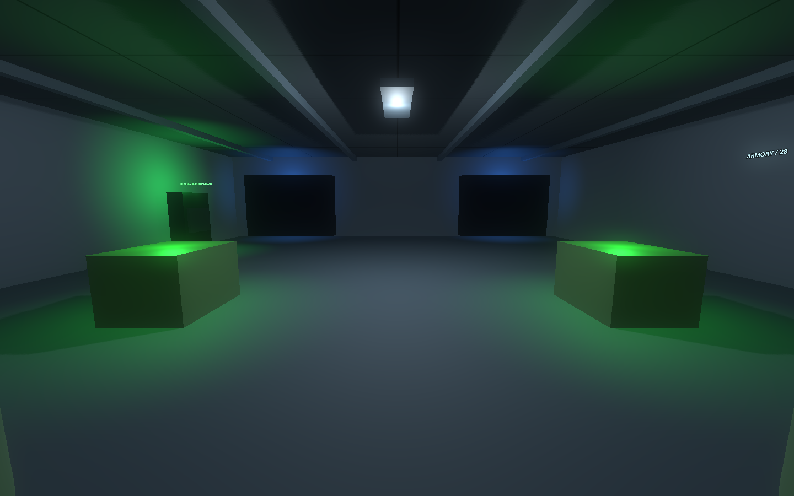
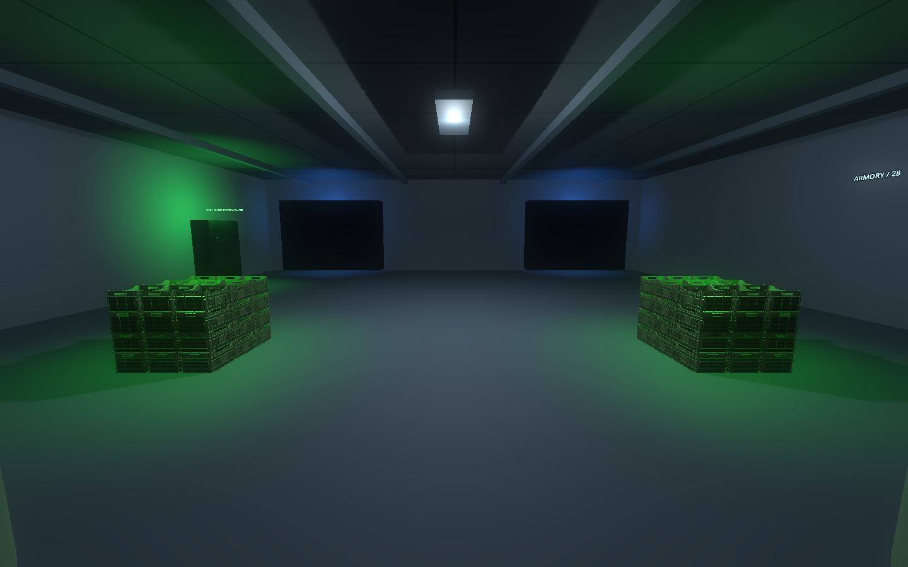
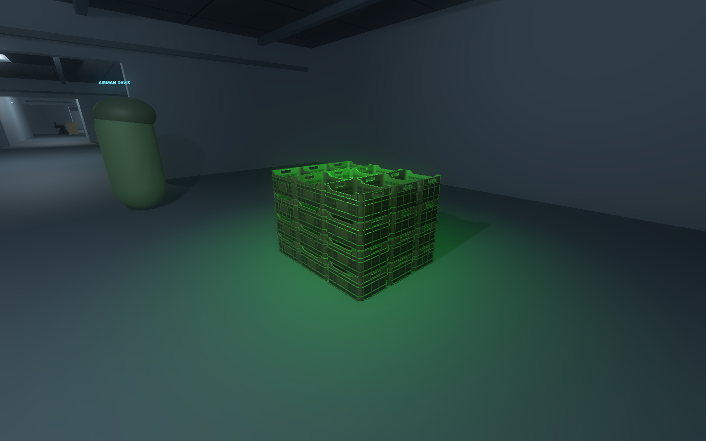
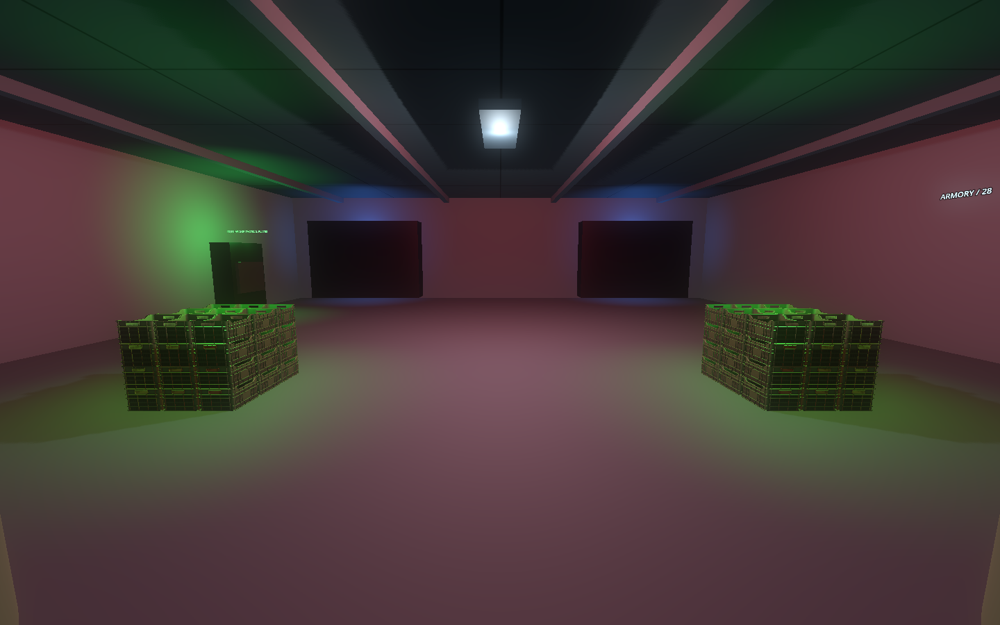

# AP-1c cosmetic proof: Poly Haven plastic crate in the SGC armoury

**Follow-up, 21 November 2026:** the M9 acquisition blocker described below was resolved in [AP-1d](2026-11-16-ap1d-beretta-m9.md). Sprint 7 subsequently delivered [distributed credits/full licences and the MP5SD](2026-11-18-sprint7-mp5-intake.md). The account-error and original queue statements below record this proof’s historical baseline. Current execution resumes at [Sprint 8, staff weapon](../plans/asset-vertical-slices.md); owner art acceptance remains separate.

Recorded 16 November 2026 on branch `feat/ap1c-crate-cosmetic-proof` from `origin/main` at `1a5146a`. Godot 4.4.1, Forward+, NVIDIA GeForce RTX 3060. This is evidence for owner art review, not acceptance.

## Why the crate and not the M9

The handoff's first choice was the [Beretta M9](https://sketchfab.com/3d-models/beretta-m9-d1200d9aa28f466484f7d3fdd7724e76). Its public metadata still reads `isDownloadable: true`, CC Attribution, 11,761 faces, but the Sketchfab download endpoint (`/v3/models/d1200d9a…/download`) answered **HTTP 401** without an account session, and none was provided. That is the exact acquisition blocker: an authorised Sketchfab account download. The M9 remains first in the weapon queue for whoever holds an account.

The documented fallback, [Plastic Crate 02](https://polyhaven.com/a/plastic_crate_02) by Fabi_G for Poly Haven, is CC0 and publicly downloadable. It is the asset in this proof.

## Acquisition and inspection

| Step | Result |
|---|---|
| Source | Poly Haven API listing `files/plastic_crate_02` → `gltf/1k`: one `.gltf`, one `.bin`, three 1024² JPEGs (diffuse, GL normal, ARM). Every file matched the listing's md5 and size. Staged at `/tmp/tdc-asset-intake/plastic_crate_02/`, outside `client/` |
| Licence | [Poly Haven licence page](https://polyhaven.com/license): staff or directly donating artists, CC0. Info API: author `Fabi_G`, `donated: true`. No conflicts |
| Packing | `tools/gltf_to_glb.py` put the files into one GLB without re-encoding (container only; embedded bytes keep their source hashes). Result `client/assets/props/plastic_crate_02_1k.glb`, 1,837,700 bytes, sha256 `0cbc8be3…2033b0` |
| Intake tool | `ok: true`, 5,840 declared triangles, one mesh, one material, three embedded images, no external dependencies ([report](../assets/intake/plastic_crate_02/intake-report.json)) |
| Khronos glTF-Validator 2.0.0-dev.3.10 | 0 errors, 1 warning: tangents are generated at runtime (`MESH_PRIMITIVE_GENERATED_TANGENT_SPACE`) ([report](../assets/intake/plastic_crate_02/gltf-validator.json)) |
| Godot 4.4.1 runtime load | One mesh at identity, 0.5055 × 0.2541 × 0.4055 m, origin at bottom centre, 5,840 triangles, about 65–70 ms headless including JPEG decoding. Material arrives as alpha depth pre-pass (from glTF `BLEND`), orange colour factor, textures without mipmaps, and the ARM red (occlusion) channel unused |

The full record is the [intake record](../assets/intake/plastic_crate_02.json).

## Placement and wrapper

The SGC armoury's two ammo resupply stations (`Level28Complex/ArmorySector/AmmoCrate1` and `AmmoCrate2`) are 1.6 × 1.0 × 1.2 m CSG boxes that are also their collision and interaction bodies. A 3 × 3 × 4 stack of crates at a uniform 0.984 scale fills that box to 1.492 × 1.000 × 1.197 m, so the visual leaves no invisible walls and never extends past the collision. The modular cargo-room crates were considered and not used: in their 1.4 × 1.2 × 1.4 m boxes a uniform stack leaves about 0.28 m of invisible collision on one axis, filling it needs a non-uniform stretch of up to 15 %, and they are TA-1 cover.

`CrateStackVisual` (in `scripts/props/`) is visual only. It adds one `MultiMeshInstance3D` named `ReplacementVisual/Crates` with 33 crates (the 3 hidden core crates are skipped), no collision, no navigation and no gameplay state. The CSG box keeps its size, collision layer and mask, interaction group and script; it stops being drawn (`transparency = 1`, no shadow). If the model is missing or cannot fit without squashing a crate more than 10 %, nothing changes and the box stays visible. Both stations share one loaded mesh.

Runtime-only material changes, with the committed GLB unchanged: drawn opaque (the JPEG has no alpha; the vents are painted dark, so a solid box does not look see-through), olive tint `Color(0.36, 0.42, 0.26)` instead of the source orange, ARM red wired as ambient occlusion, mipmaps generated. Metallic stays at the source's 0.0, as D-015 asks. The SGC navigation mesh is a baked resource built from static colliders, so a collision-free visual cannot change it.

## Captures

Generated by `godot --path client --script res://tests/support/crate_visual_review.gd` on the X11 display.

| Original box | Dressed |
|---|---|
|  |  |

| Close | Alert lighting |
|---|---|
|  |  |

The station's green status light dominates the stacks, as it did the old box. Under alert lighting the olive tint shows.

## Cost

`CRATE_COST` from the review helper, wide armoury view with both stacks in frame, vsync off, 3 s per state:

| Run | Original GPU ms | Dressed GPU ms | Primitives added | Draw calls added |
|---|---|---|---|---|
| Editor binary, sector shrouds cleared (two runs) | 1.571, 1.546 | 1.769, 1.750 | +385,440 | +2 |
| Exported release build | 3.424 | 3.820 | +385,440 | +2 |

That is 2 × 33 × 5,840 triangles, visible only in and near the armoury. The editor run before the shroud fix measured +0.49 ms. Runtime LOD generation (`ImporterMesh.generate_lods`) did not finish within 120 s on this mesh, so no LODs are generated. A lower-cost variant needs an editor-import LOD path or a decimated source, recorded as a follow-up.

## Exported build

No export preset is committed. A throwaway Linux preset in a copy of `client/` outside the repository exported a 4.2 MB pack (`--export-pack`), run with the stock 4.4.1 `linux_release.x86_64` template:

```
SMOKE file=res://assets/props/plastic_crate_02_1k.glb res_exists=true bytes=1837700 globalized=assets/props/plastic_crate_02_1k.glb global_exists=true
SMOKE RuntimeGLB crate=true
SMOKE AP-1a WeaponBase.load_glb_model p90=true
SMOKE AmmoCrate1 dressed=true crates=33
SMOKE AmmoCrate2 dressed=true crates=33
SMOKE RESULT PASS
```

The same exported build, run on the display with the review helper, rendered the dressed stacks identically. The raw `importer="keep"` GLB is packed and loads. In an exported build `ProjectSettings.globalize_path()` returns a relative path that `FileAccess` resolves through the pack, so the AP-1a weapon loader also works there. `RuntimeGLB` reads the `res://` path directly so as not to depend on that.

## Tests

| Suite | What it covers |
|---|---|
| `test_imported_crate_visual` (new) | Loader and missing-file case; measured size and triangle count; runtime material changes with the source material untouched; both SGC stacks dressed, fitting their box, collision-free, sharing one mesh; a ray still stops at the original box face; weapon racks untouched; fallbacks for a missing model, a box too small for whole crates and the opt-out flag. Fails if the station stops dressing its box |
| `test_multiplayer_mission_join` (extended) | A late-joining client process builds the dressed crate locally, and again after a coordinated retry |
| `test_sprint9_interactives_climax`, `test_gate_travel`, `test_gate_return` | Resupply at `AmmoCrate1` and travel out and back with the dressed SGC, unchanged |
| `tools/tests/test_gltf_to_glb.py` (new) | Packing keeps every byte, the intake tool accepts the result, and paths outside the source folder are refused |

## Not established

- Owner art review: whether plastic crates suit the SGC armoury, and the tint.
- Offworld captures: the crate is placed only in the SGC, so there is no offworld view of it. The SGC world is unchanged during gate travel and return (suites above).
- Behaviour on lower-end GPUs; see Cost.
- The third-person camera fades walls that occlude the player by swapping their material. It finds the CSG box, which is already invisible, so a crate stack between the camera and a crouching player does not fade. It is 1 m tall.
- A dedicated server also loads and dresses the crates (about 70 ms and the decoded textures); the wrapper does not skip visuals on a server.
