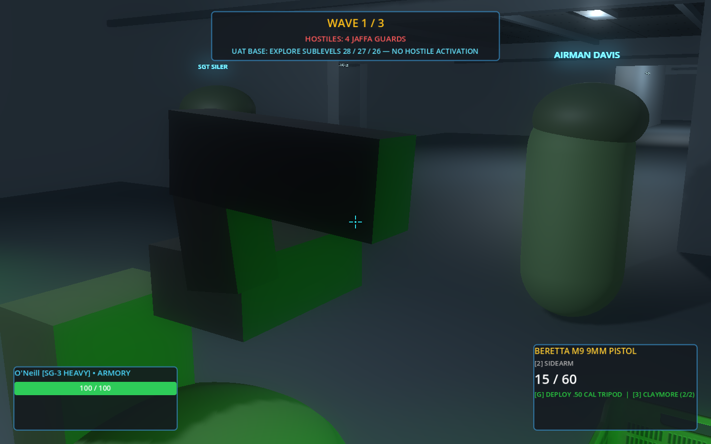
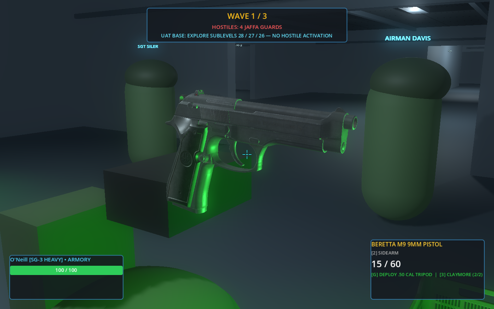
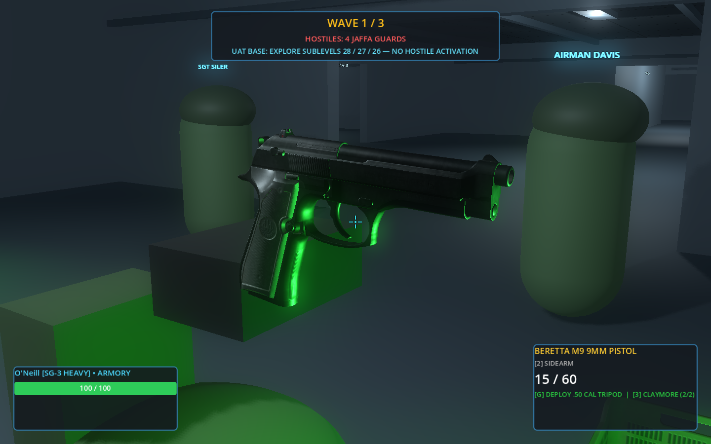
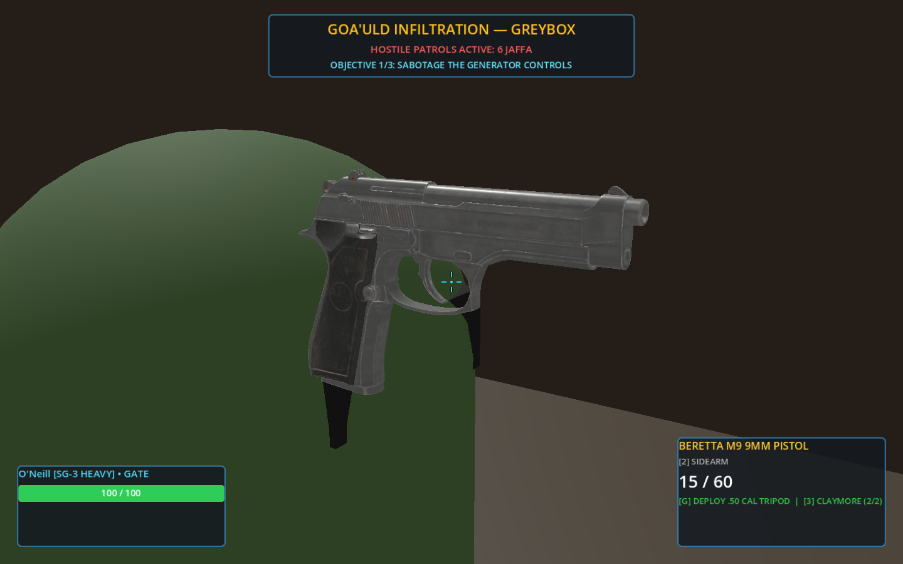
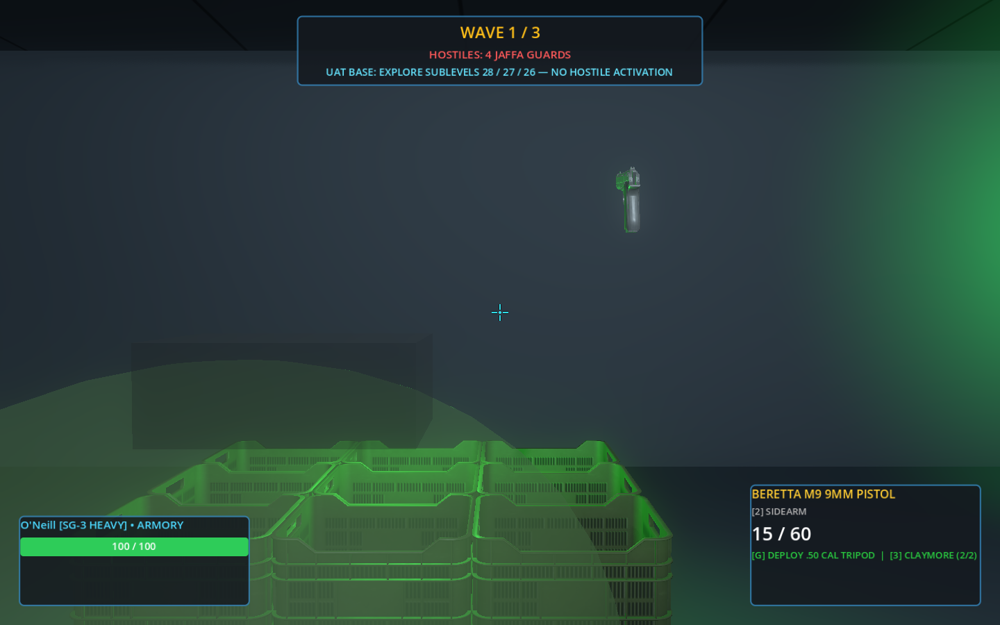

# AP-1d: Beretta M9 sidearm from a community model

Recorded 16 November 2026 on branch `feat/ap1d-m9-weapon-visual`, stacked on AP-1c. Its PR (#64) merged into the AP-1c branch instead of `main`, so the same commits were replayed onto `main` after #63 and CO-1 (#62) in `feat/ap1d-m9-onto-main`, which also restores the AP-1c crate hook that the #63 merge dropped. Godot 4.4.1, Forward+, NVIDIA GeForce RTX 3060. Evidence for owner art review, not acceptance.

## What changed

The `m9` sidearm (`WeaponM9`, every class's secondary and the weapon a downed operative uses) drew two boxes. It now draws "Beretta M9" by emran.bayati (CC BY 4.0). The weapon's id, damage, fire rate, magazine, spread, noise radius and `MuzzlePoint` `(0, 0.02, -0.18)` are unchanged; if the model cannot load, the boxes come back.

| Original | Imported |
|---|---|
|  |  |

## Acquisition

The owner downloaded the creator's original-format archive through a Sketchfab account (`beretta-m9.zip`, sha256 `17c2fc99…04b1ee`) after AP-1c reported the HTTP 401 blocker. It holds one FBX and five 4096² maps (albedo, normal, roughness, metallic, AO), all dated 23 April 2020, the model's publication date. There is no licence file in the archive; the evidence is the listing (API `license.slug = "by"`, CC BY 4.0) and the creator's statement that they modelled and textured it. Full hashes: [intake record](../assets/intake/beretta_m9.json).

## Conversion

Godot's ufbx loader read the FBX with no installed tools. It contains three meshes: `Gun` (8,609 triangles, 217 × 142 × 32 mm, the real pistol's size), `Magazine` (1,576, seated in the grip) and `Gun001`, a second magazine lying beside the pistol. The FBX binds no textures.

The new recipe-driven packer, `client/scripts/assets/pack_model_glb.gd`, kept `Gun` and `Magazine`, bound the five maps, downscaled them to 1024², packed occlusion, roughness and metallic into one ORM image and wrote a 1,070,592-byte GLB with JPEG images. The [recipe](../assets/intake/beretta_m9/recipe.json) reproduces it byte for byte (sha256 `17ce228a…7436a` on two runs). The intake tool reports `ok: true` with 10,185 triangles; the Khronos validator reports 0 errors and 0 warnings.

The normal map uses the OpenGL convention. Rendered under a light from above, the stamped "U.S. 9mm M9-P.BERETTA" markings and the takedown-lever groove read as engraved with it, and as embossed with the green channel flipped.

## Placement

The muzzle points along the model's −X. The bore centre was measured from the barrel crown's vertices at (−0.1255, 0.1303, 0.0) m, a ring about 13 mm across. `WeaponBase` turns the model −90° about Y and moves it so that point lands on the unchanged `MuzzlePoint`; `test_imported_m9_visual` measures the result within 3 mm. Weapons in this game hang at head height about 0.87 m in front of the operative, with no arms; the M9 is drawn where the boxes were.

## Material

The existing weapon rule from AP-1a stays: every imported weapon has metallic 0 at runtime (D-015). The GLB keeps the creator's metallic map. In SGC lighting the source metallic reads as dark blued steel and D-015 as grey steel; both stay readable, and the choice is the owner's.

| D-015 (in game) | Source metallic |
|---|---|
|  |  |

Captures come from `godot --path client --script res://tests/support/weapon_visual_review.gd -- --mission <sgc_uat | goauld_infiltration> --weapon m9`; the original is the same helper run on AP-1c. Offworld, in the Goa'uld compound, and aiming down sights in the SGC:

| Offworld | Aiming |
|---|---|
|  |  |

## Cost

Parsing the GLB, decoding its three 1024² JPEGs and generating mipmaps takes about 55–60 ms. Weapons are created when first drawn, so without a cache every peer paid that each time an operative first drew a sidearm. `WeaponBase.load_glb_model` now keeps each parsed weapon as a `PackedScene` on the tree root for the session: the first M9 takes about 59 ms, later ones about 0.1 ms, and all share one mesh and material set. The first draw in a session still pays the 59 ms once. Each M9 is 10,185 triangles.

## Exported build

Throwaway Linux preset outside the repository, stock 4.4.1 release template, 5.2 MB pack:

```
SMOKE file=res://assets/weapons/beretta_m9.glb res_exists=true bytes=1070592
SMOKE WeaponM9 imported=true triangles=10185 mipmapped=true muzzle=(0.0, 0.02, -0.18)
SMOKE crate=true
SMOKE RESULT PASS
```

## Tests

| Suite | What it covers |
|---|---|
| `test_imported_m9_visual` (new) | Stats and `MuzzlePoint` unchanged; the bore within 3 mm of the `MuzzlePoint`; real length, width and height; nothing in front of the muzzle; 10,185 triangles; no collision; metallic 0 and mipmapped textures; a second copy shares mesh and material and builds in under 20 ms; credits and the CC BY 4.0 text present; a missing model returns nothing. Fails if the −90° turn is removed |
| `test_stealth_takedowns_and_weapons` | The AP-1a weapons through the new cached loader |
| `test_imported_crate_visual` | AP-1c after moving mipmap generation into `RuntimeGLB` |

## Not established

- Owner art review, including D-015 matte against the source metallic finish.
- Attribution inside a distributed build. CC BY 4.0 needs the credit to reach people who receive the game; there is no in-game credits screen and `credits/` is outside `client/`, so an export does not include it yet.
- Trademark use. The model reproduces Beretta's grip medallion and slide markings; the CC BY grant covers the modeller's work only.
- The first-draw hitch (about 59 ms once per session per peer); the cache could be warmed while a mission loads.
- Hands and a grip pose: weapons float in front of the operative as before.
