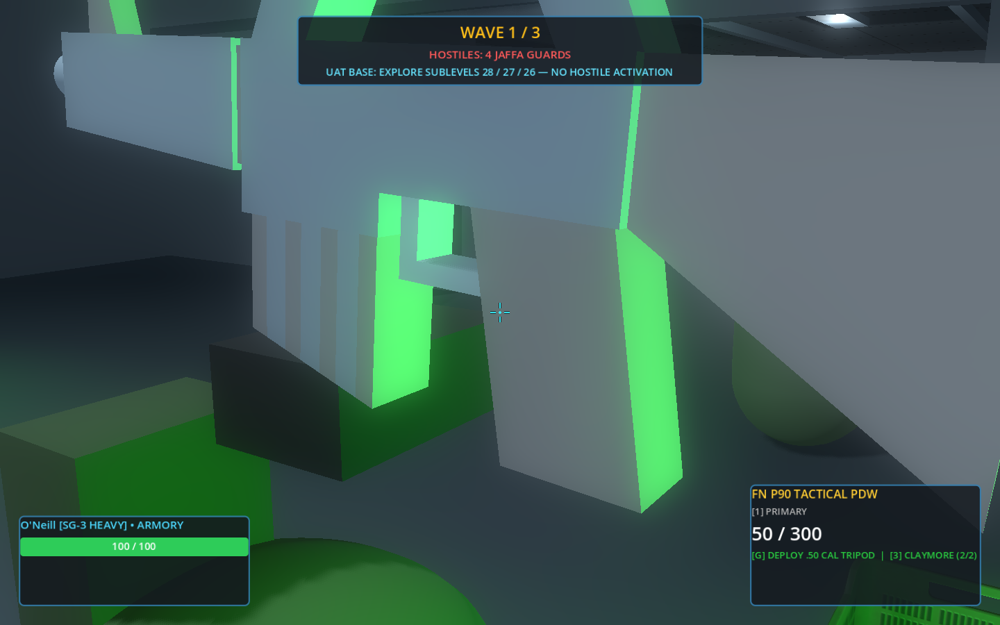
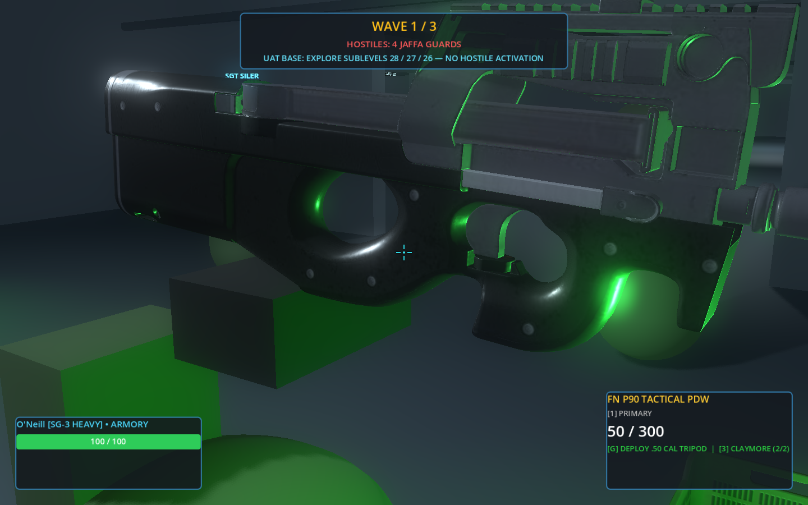
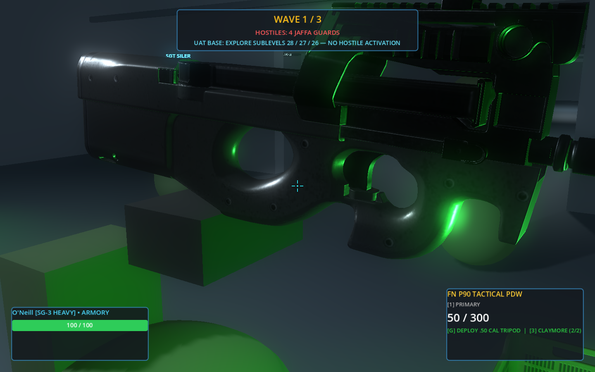
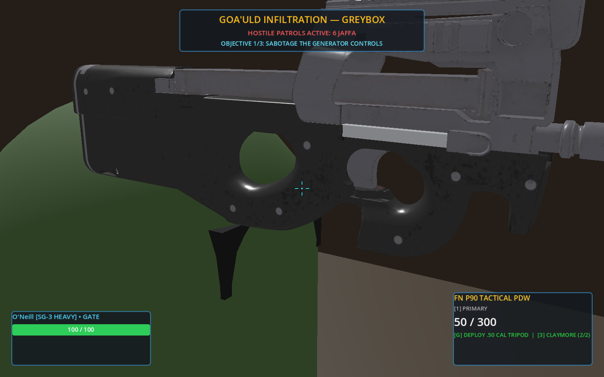
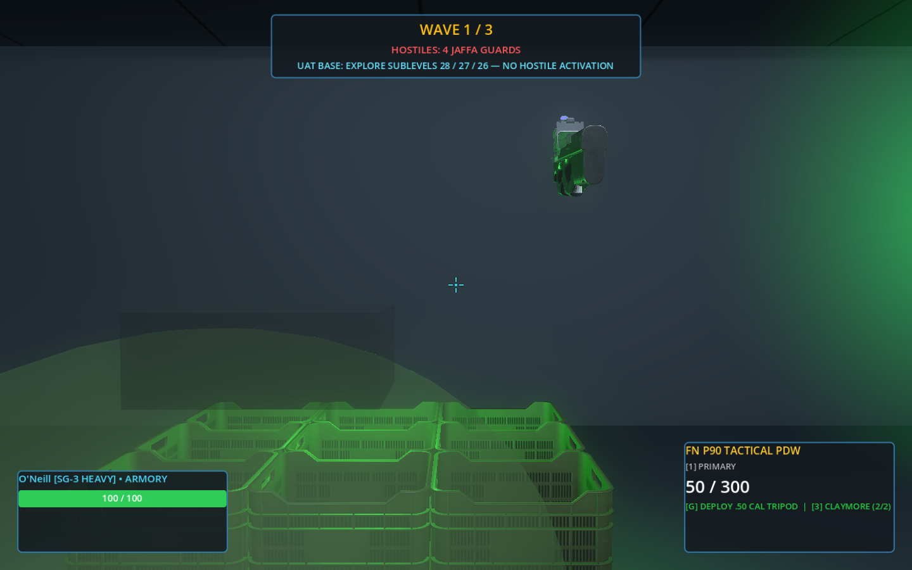

# AP-1e: FN P90 personal defense weapon from a community model

**Follow-up, 21 November 2026:** the distributed-credit gap recorded below is resolved by [Sprint 7’s generated offline credits/full-licence reader and clean export proof](2026-11-18-sprint7-mp5-intake.md). Original P90 measurements/captures remain historical evidence; owner art and later grip acceptance remain pending.

Recorded 16 November 2026 on branch `feat/ap1e-p90` from `origin/main`. Godot 4.4.1, Forward+, NVIDIA GeForce RTX 3060. Evidence for owner art review, not acceptance.

## What changed

The `p90` primary firearm (`WeaponP90`, the iconic SG team tactical weapon) drew Kenney's stylized 486-triangle stand-in (`p90_smg.glb`). It now draws "P90" by Rotuma (CC BY 4.0). The weapon's id, damage (22.0), fire rate (900 rpm), magazine (50), reserve (300), spread and `MuzzlePoint` `(0, 0.02, -0.30)` are unchanged; if the model cannot load, the procedural bullpup fallback is drawn.

| Original Kenney | Imported Rotuma P90 |
|---|---|
|  |  |

## Acquisition

The owner downloaded the creator's original-format archive through a Sketchfab account (`p90.zip`, sha256 `4f80c77614e744e57c6fde9d5dcc06fa23aeed673979ada7855d43002aea96a9`) into `~/Downloads/p90.zip`. It holds one FBX and six 4096² maps (albedo, normal, roughness, metallic, emissive, opacity), all dated 9 November 2024. There is no licence file in the archive; the evidence is the listing (API `license.slug = "by"`, CC BY 4.0) and the creator's portfolio description detailing Maya, Substance Painter, and Krita workflow. Full hashes: [intake record](../assets/intake/p90.json).

## Conversion

Godot's ufbx loader read the FBX without external tools. It contains one mesh (`P90`, 38,083 triangles) and an empty 0-track animation take (`Take 001`). The FBX binds no textures.

The recipe-driven packer, `client/scripts/assets/pack_model_glb.gd`, kept `P90`, bound albedo, normal (OpenGL), roughness and metallic maps, downscaled them to 1024², packed roughness and metallic into one ORM image and wrote a 2,006,024-byte GLB with JPEG images (quality 0.9). Per playbook notes, the magazine is kept opaque to avoid alpha sorting and shadow artifacts. The [recipe](../assets/intake/p90/recipe.json) reproduces it byte for byte (sha256 `926ab64ee651ee9b433bebed1a93566646fdb5152b8a9aabb14879e4354b4af4`). The intake tool reports `ok: true` with 38,083 triangles; the Khronos glTF validator reports 0 errors and 0 warnings.

## Placement

The model's muzzle faces `-Z`. Raw mesh vertices were in centimetres (50.05 cm length, 21.23 cm height, 6.85 cm width), matching the real FN P90. In the FBX, a node scale of 0.351126 was present; the game wrapper applies uniform scale `0.02847984` so that the weapon is real size in metres (0.5005 m length).

The bore centre was measured from the 46 barrel crown vertices at `(-0.002205, -0.448702, -8.765554)` in model space. `WeaponBase` applies `Transform3D(P90_MODEL_BASIS, muzzle_offset - P90_MODEL_BASIS * P90_MODEL_MUZZLE)`, placing the bore within 0.0001 mm of the unchanged `MuzzlePoint` `(0, 0.02, -0.30)`. `test_imported_p90_visual` verifies the bore sits on the muzzle within 3 mm and real length is 500.5 mm.

## Material

The existing weapon rule from AP-1a stays: every imported weapon has metallic 0 at runtime (D-015). The GLB keeps the creator's metallic map. In SGC lighting both the matte finish and source metallic finish were reviewed:

| D-015 (in game) | Source metallic |
|---|---|
|  |  |

Captures come from `godot --path client --script res://tests/support/weapon_visual_review.gd -- --mission <sgc_uat | goauld_infiltration> --weapon p90`. Offworld in the Goa'uld compound and aiming down sights in the SGC:

| Offworld | Aiming |
|---|---|
|  |  |

## Cost

Texture decoding and mipmap generation take ~50 ms on first load. Operatives share the parsed `PackedScene` cached on tree root meta `weapon_glb_cache`: later weapon instances take < 0.2 ms and share meshes and materials.

## Exported build

Tested with a throwaway Linux preset outside the repository using the stock 4.4.1 release template:

```
SMOKE file=res://assets/weapons/p90.glb res_exists=true bytes=2006024
SMOKE WeaponP90 imported=true triangles=38083 mipmapped=true muzzle=(0.0, 0.02, -0.3)
SMOKE crate=true m9=true
SMOKE RESULT PASS
```

## Tests

| Suite | What it covers |
|---|---|
| `test_imported_p90_visual` (new) | Stats and `MuzzlePoint` unchanged; bore within 3 mm of `MuzzlePoint`; real length 500.5 mm, width 68.5 mm, height 212 mm; nothing in front of muzzle; 38,083 triangles; no collision; metallic 0 and mipmapped textures; second copy shares mesh/material; credits present; missing model returns null |
| `test_stealth_takedowns_and_weapons` | Existing takedown and weapon ingestion tests pass |
| `test_imported_m9_visual` | M9 sidearm unaffected |
| `test_imported_crate_visual` | SGC armoury crate unaffected |

## Not established

- Owner art review, including D-015 matte finish vs source metallic finish.
- Distributed build credits screen (credits currently reside in `credits/ATTRIBUTIONS.md` outside `client/`).
- FN Herstal trademark rights: the model reproduces the P90 markings and silhouette; the CC BY 4.0 license covers the 3D artist's work only.
- Reload animation / magazine articulation: the magazine is static in this pass.
