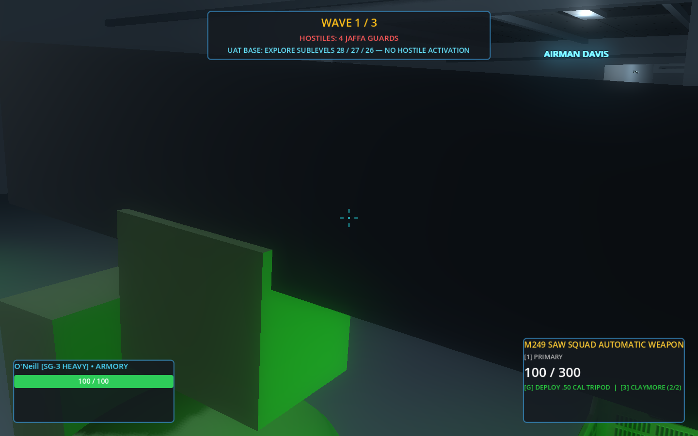
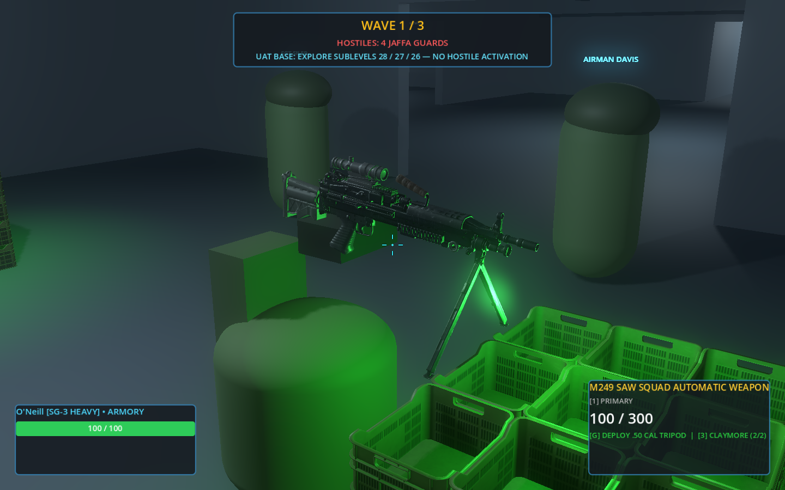
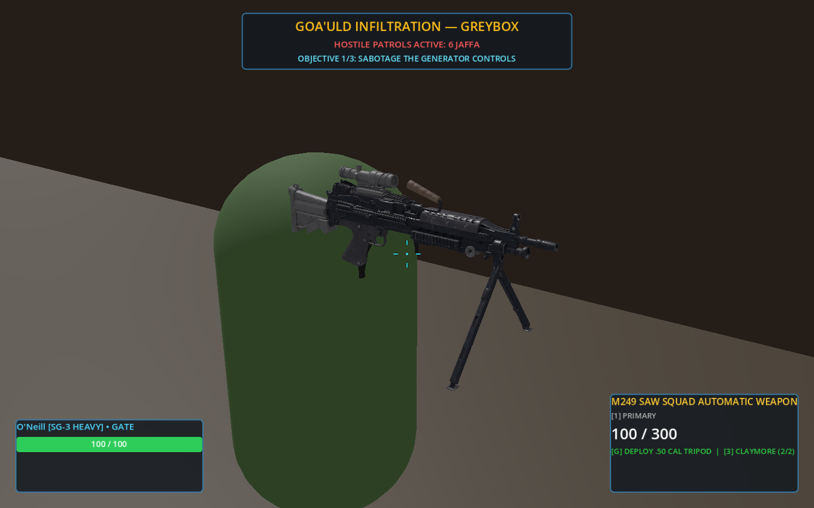
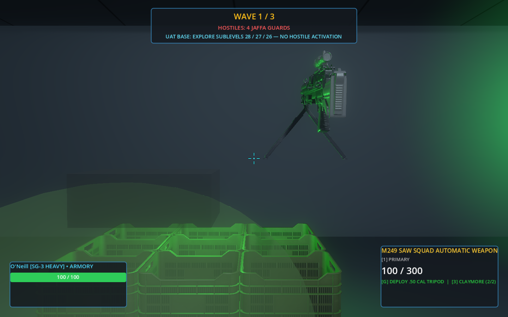

# AP-1f: M249 SAW community visual

**Follow-up, 21 November 2026:** the distributed-credit gap recorded below is resolved by [Sprint 7’s generated offline credits/full-licence reader and clean export proof](2026-11-18-sprint7-mp5-intake.md). The fused extended bipod and unfinished character handling remain open for the [Sprint 10 audit and later character slices](../plans/asset-vertical-slices.md); this note does not establish owner art acceptance.

Recorded 16 November 2026, branch `feat/ap1f-m249`, baseline `8366ccc`. Godot 4.4.1, Forward+, RTX 3060. Owner art review remains pending.

## Result

AK / skaf13's CC BY 4.0 **M249 light machine gun** replaces the three procedural receiver/drum/barrel meshes. It retains weapon ID `m249`, damage 34, 750 rpm, 100/300 ammunition, 3.6 s reload, spread, sound, authority and `MuzzlePoint (0, 0.03, -0.62)`. The original three meshes remain the load-failure fallback.

| Original | Imported |
|---|---|
|  |  |

## Acquisition and conversion

The existing owner download `~/Downloads/m249-light-machine-gun.zip` was copied to `/tmp/tdc-asset-intake/m249/`; both owner downloads were preserved. Its nested `source/model.zip` contains a COLLADA scene, not FBX. Neither ZIP contains a licence file; [captured listing evidence](../assets/intake/m249/listing-evidence.json) records CC BY 4.0 and the creator's Blender/Substance Painter authorship statement. Both archives were checked for absolute paths, traversal and symlinks before extraction. [Source hashes](../assets/intake/m249/source-hashes.json) cover every file.

The packer now accepts `.dae` scenes already imported by Godot in an isolated staging project, outside `client/`. Its existing recipe path binds the four outer 2048² maps and the nested AO map, downscales to 1024², packs ORM, and writes JPEG at quality 0.9. Source node `M249_low`, UVs and all 13,328 triangles are retained. [Recipe](../assets/intake/m249/recipe.json), [pack output](../assets/intake/m249/pack.log), [intake](../assets/intake/m249/intake-report.json), [Khronos validation](../assets/intake/m249/gltf-validator.json): 0 errors, 0 warnings. The 1,835,876-byte GLB is deterministic (repeat packing gives SHA-256 `d5e6a807aba10cb621293b18246ef60e8bbc0fec7c048487323764dc8311a0c7`).

Reproduce staging: copy the nested `model/model.dae` to `/tmp/tdc-asset-intake/m249/convert/model.dae`, create a minimal `project.godot` there, run `godot --headless --path /tmp/tdc-asset-intake/m249/convert --import`, then run this repository's `client/scripts/assets/pack_model_glb.gd` from that staging project with the absolute recipe path. COLLADA editor-import thumbnail errors under the dummy renderer do not occur in the runtime GLB.

## Measured placement and materials

The converted scene faces -X. Its barrel crown centroid is `(-481.81909, 113.9233, 0.00441)` in model space. The wrapper rotates -X to -Z, scales uniformly by 0.001 and translates that crown onto the unchanged gameplay muzzle. Resulting bounds: **0.467 × 0.501 × 0.963 m** (width includes the extended bipod). This is a measured visual scale, not certified manufacturer dimensions. The test independently decodes vertex positions and checks the crown within 3 mm, bounds, triangle count, collision absence and unchanged weapon parameters.

COLLADA also contains vivid per-part vertex colours. The GLB keeps them; the SAW's runtime material ignores them so the PBR albedo is shown correctly. Existing D-015 metallic 0 and mipmaps apply. The normal map was packed and rendered with both OpenGL and DirectX conventions under the same neutral overhead light. The difference is small and no legible engraved marking establishes the convention independently; OpenGL is retained pending human review. Both mission captures are available for art review. The review helper now fits its close camera to the weapon's measured bounds so the full SAW fits.

| Offworld | SGC aiming |
|---|---|
|  |  |

[Source metallic comparison](ap1f-captures/sgc-close-source-metallic.png).

## Verification

- `test_imported_m249_visual`, existing P90, M9 and crate suites: pass.
- Negative test in an isolated copy: move the measured crown 25 mm; the bore assertion fails at `(0, 0.005, -0.62)`. Original restored.
- Fallback in an isolated copy: remove the GLB and run the suite with `--expect-fallback`; original three meshes, stats and muzzle pass. File restored.
- Linux 4.4.1 release template, throwaway preset and clean project outside the repo: raw GLB loaded from PCK, `M249_EXPORT imported=true triangles=13328 muzzle=(0.0, 0.03, -0.62)`.
- Full Godot profile: 92 suites plus project import pass; Python tools: 47 tests pass. Logs and summaries are under `build/test-results/m249-full/` (local ignored evidence); hosted CI is reported separately below.
- Cost: first SAW build 62.439 ms, repeat 0.048 ms; 13,328 triangles per visible copy. Meshes and materials are shared across operatives.

## Limits

The bipod is fused into the single source mesh and remains extended. No reload, feed-cover or bipod articulation was invented. Check carrying/grip and silhouette in human playtesting; the game still uses procedural character bodies. No distributed credits screen exists yet; credits remain under the repository's `credits/`. Manufacturer trademarks are outside the artist's model licence. No human art acceptance is claimed.

## Hosted results

[PR #68](https://github.com/flaxos/Team-Discovery-Channel/pull/68), [Actions run 43866978568](https://github.com/flaxos/Team-Discovery-Channel/actions/runs/43866978568): alignment API/security/frontend, failure-reporting contract, Godot fast, Godot full and Godot multiplayer all passed on the first run. This is separate from the local full profile above. The PR remains draft for owner art review.

The documentation-only follow-up `2a23e21` also has all hosted checks green ([run 43868136857](https://github.com/flaxos/Team-Discovery-Channel/actions/runs/43868136857)). Its first multiplayer attempt hit the playbook's known post-PASS teardown race in `test_gate_travel_multiplayer` (departed peer's SGC `MultiplayerSynchronizer` missing after both travel assertions passed). The failed multiplayer job was retried once and passed; no gameplay teardown code changed. This retry is recorded in PR #68.
