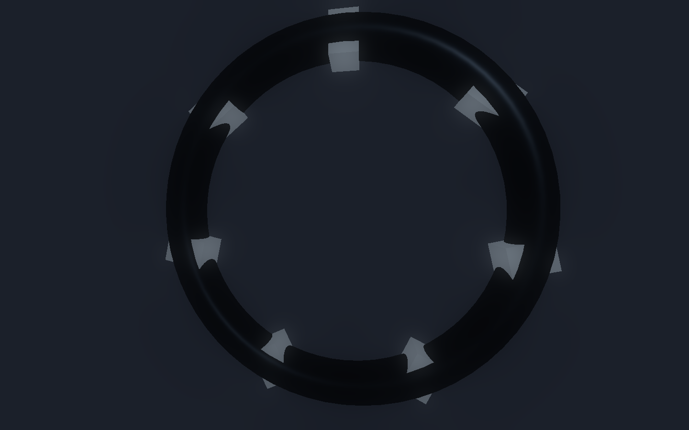
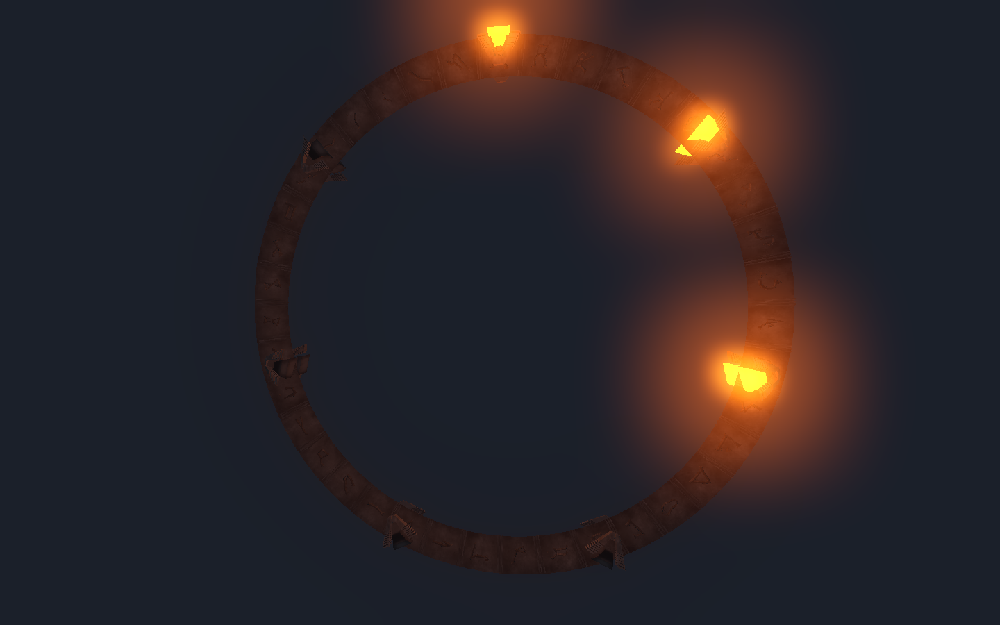
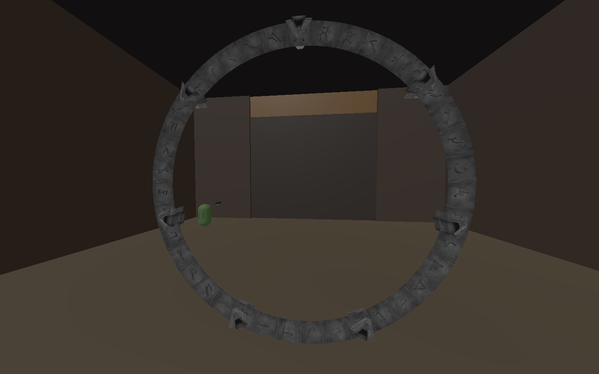
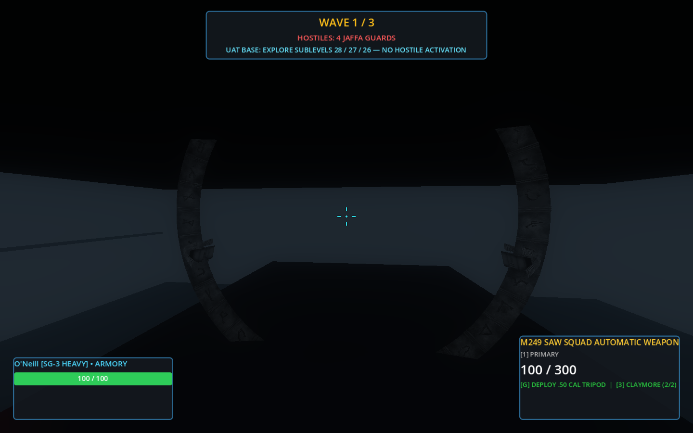

# AP-1g: community Stargate glyph ring and seven anchored chevrons

16 November 2026, baseline `8366ccc`, branch `feat/ap1g-stargate`. **Local preview; public redistribution pending an authorship-evidence decision.** The listing says CC BY 4.0 but has no description, and the archive has no licence/readme. Neither establishes that rossrobotics modelled the asset. The repository playbook explicitly requires that additional evidence; the owner has been asked whether to accept the listing with the gap recorded. No public draft PR or human art acceptance is claimed.

## Result and fit

The existing Stargate torus and box visuals are dressed with the imported glyph ring and seven copies of one source front/back chevron insert. This is a rigid visual proof, not the whole original nine-chevron model or an articulated gate.

The source body cannot match both the current 2.75 m clear aperture and the 3.35 m outer envelope under uniform scaling. Rather than changing gameplay dimensions, the recipe omits that body, the source frames and the nine-chevron arrangement. The glyph ring fits: measured source inner radius 0.06711667, wrapper scale 40.97343, resulting clear aperture radius 2.750 m and outer radius 3.148 m. Source +X becomes gate +Z, source -Z becomes +Y. Front/back chevron/light inserts at uniform scale 27.7 fit inside the existing 0.5 × 0.7 × 0.4 m CSG boxes, at their exact unchanged transforms. They use the source's own geometry and unlit housing albedo.

Combined bounds are `(-3.143868, -3.143868, -0.189900)` with size `(6.290327, 6.381565, 0.379798)` m, inside the previous prop envelope. The originals remain in the scene as the load/fitting fallback. No native LevelLayout, room attachment bound, collision, navigation, controller or gameplay anchor is changed.

## State and materials

`StargateRing._ready` attaches a visual-only child. Its light inserts read the existing replicated `locked_chevrons_count`; the next visual frame reflects dialing, snapshot/late join, reset and closure, including paths that emit no chevron signal. The original seven controls, horizon shader, kawoosh, extraction authorization, areas, light, DHD and iris systems stay in charge.

Maps are downscaled to 1024² and stored as JPEG quality 0.9. Ring albedo/metallic and chevron unlit albedo/metallic/roughness are bound explicitly. Height/bump maps are omitted: they are not verified tangent-space normal maps. The missing original `chevron_transparency.png` is not invented. Source-import texture-path warnings are isolated to FBX staging; the resulting GLB has no external dependencies. Runtime materials draw opaque, generate mipmaps and use metallic 0 for the current mission lighting. The seven front/back light pairs use the game's orange emission when locked. No spinning ring, moving chevrons or iris mesh is added.

## Provenance and format

The owner's existing `~/Downloads/stargate.zip` was copied to `/tmp/tdc-asset-intake/stargate_sg1/`, without moving or changing the original. It contains one FBX and thirteen maps. Entries were checked for traversal, absolute paths and symlinks; every source file is [hashed](../assets/intake/stargate_sg1/source-hashes.json). [Listing evidence](../assets/intake/stargate_sg1/listing-evidence.json), [intake](../assets/intake/stargate_sg1.json), [recipe](../assets/intake/stargate_sg1/recipe.json), [packer result](../assets/intake/stargate_sg1/pack-result.json).

The 1,206,304-byte GLB holds five template meshes, 6,297 triangles. Runtime repetition draws 12,057 triangles per gate, across 29 mesh instances; all inserts share their source meshes. Khronos validation: **0 errors, 0 warnings**. Infos include two degenerate source triangles in the glyph ring, unused tangents (height maps omitted) and `GODOT_single_root`.

## Verification

- `test_imported_stargate_visual`: unchanged gameplay transforms, shapes, masks, seven controls and anchor sizes; aperture and envelope; no collision/navigation; 29 meshes/12,057 triangles; mipmaps; snapshot lighting; seven actual locks, kawoosh, stabilization, reset and closure; cached mesh/material sharing; fallback; attribution.
- Negative check in an isolated copy: set ring scale to 39; the aperture assertion fails at 2.617550 m. Restore the source afterward.
- Missing-file check in an isolated copy: remove the GLB; original torus and seven boxes stay visible, with all areas and anchors unchanged. Restore the file afterward.
- Linux 4.4.1 release PCK with a throwaway preset outside the repository: `STARGATE_EXPORT imported=true anchors=7 lights=14 snapshot=5 horizon=true`; checks use explicit failure exits in the release template.
- Cost: first attachment 79.776 ms; repeat 1.616 ms; 12,057 triangles per visible gate. Session cache shares parsed meshes and materials.
- Full Godot profile: 92 suites plus project import pass (521.6 s); Python tools: 47 tests pass. Local logs are under `build/test-results/gate-full/`. No hosted gate run: this preview has not been published.
- Repeated packing produces the same SHA-256 `46f1b660ea0d77fc117907a48701b7be504e46f3570584aea7704841628baf64`.
- Combined Linux release smoke with the SAW also passes: `COMBINED_EXPORT saw=true stargate=true`.

## Limits

Authorship evidence and owner art review remain unresolved. This is a community fan model; a listing licence does not grant franchise rights. The imported ring has a narrower rim than the torus placeholder, while preserving the opening and envelope. Detailed outer housing, original nine-chevron placement, motion and iris art are deliberately outside this measured proof. The repository still has no in-game credits screen; distribution needs the attribution bundled separately.

## Mission captures

The ordinary SGC close view is partially blocked by existing architecture, for both the original and imported ring. The helper's `--isolate` option moves non-gate geometry to a camera-culled layer for art inspection, retaining mission lights and shadows. It does not change the production scene. The gate is dark while inactive in the SGC; the unchanged active horizon is very bright. These are recorded limits, not a lighting or map repair. The isolated and final offworld captures hide HUD overlays to expose the full prop; the ordinary SGC view retains its HUD.

| Original SGC, isolated art view | Imported SGC, three locks, isolated art view |
|---|---|
|  |  |

| Offworld, ordinary mission geometry | SGC, ordinary foreground occlusion |
|---|---|
|  |  |

[Active horizon, isolated SGC art view](ap1g-captures/sgc-active-isolated.png).
