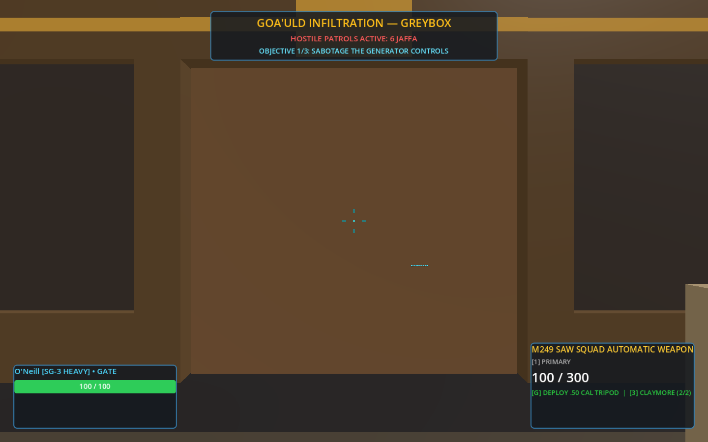
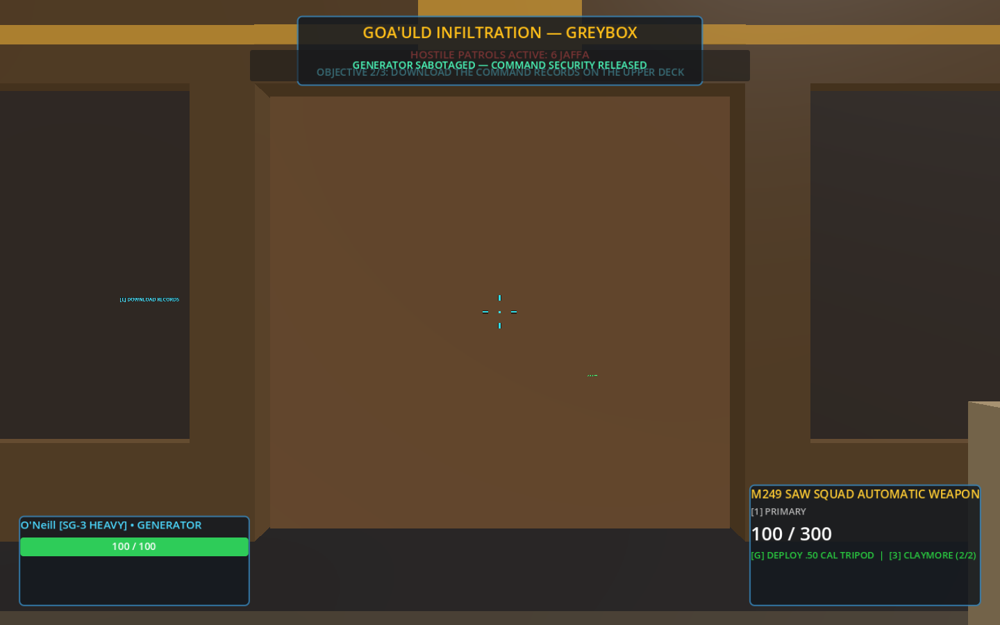

# EV-2 chunk 1 — generator-controlled command security

17 November 2026, baseline `dbe5646` (main after #69), existing checkout, branch `feat/ev2-objective-doors`.

## Player behavior

Command-room security now starts locked in Goa'uld Infiltration and its travel-mission variant. Completing generator sabotage releases the door for all peers, shows the shared notice, and advances the existing objective to the command records. The player opens the released door normally. Retry restores the initial lock. An empty event list leaves the extraction UAT mission unchanged.

| Before sabotage | After sabotage |
|---|---|
|  |  |

[Player opens the released door](ev2-1-captures/open.png). Captured in the real Forward+ mission with a close camera; sentries were stood down for the review fixture. These captures are evidence of the interaction, not human balance acceptance.

## Implementation

`MissionTrigger` is deliberately limited to objective completion releasing a unique `security_id`, plus a notice. `MissionEvents` sits beside `MissionObjectives` and `MissionAlert`; it only acts on the host and delegates to the existing door API. The native layout, geometry, navigation bake, player interaction validation and SGC Defense director are unchanged.

The validator checks IDs, exactly one target security door, non-extraction objective, duplicate bindings, and sequential reachability while unreleased mission gates are locked. A console behind its own release gate is rejected. Host locks are applied after structural navigation validation and before patrol startup; putting a permanent lock in the layout would correctly fail its all-regions-reachable contract.

Event progress is a monotonic fired-ID snapshot. Only live updates show notices. Target doors retain their own state snapshot RPC. Early requests wait for host initialization and receive initialized door/event state: the two-process tests verify initialized state after each peer’s independent navigation bake. Result finalization stops actions; repeat initialization cannot relock an already released stage.

An unfinished broader prototype was inspected read-only in the old `pilotfish` checkout. The original prototype, theme edits and body-drag edits remain untouched there. Stable security IDs and real listen/dedicated peer tests define the recovered chunk’s contract. This chunk implements only the next roadmap boundary with a production mission consumer and real listen/dedicated peer tests.

## Validation

- New single-process and two-process listen/dedicated suites pass.
- Existing quiet and loud infiltration playthroughs pass unchanged.
- Python tools: 47 tests pass.
- Full regression and hosted checks are reported in the PR after completion; no unrun human co-op or art acceptance is claimed.

## Remaining EV-2 work

Timers/countdown failure, alert/room triggers, enabling objectives and optional/parallel stages remain separate chunks. No timer duration, lockdown branch or narrative was invented without a designed mission need. Human UAT should walk the generator-to-command transition, try client interaction and late join, and confirm the pacing and the initial command lock are readable.
