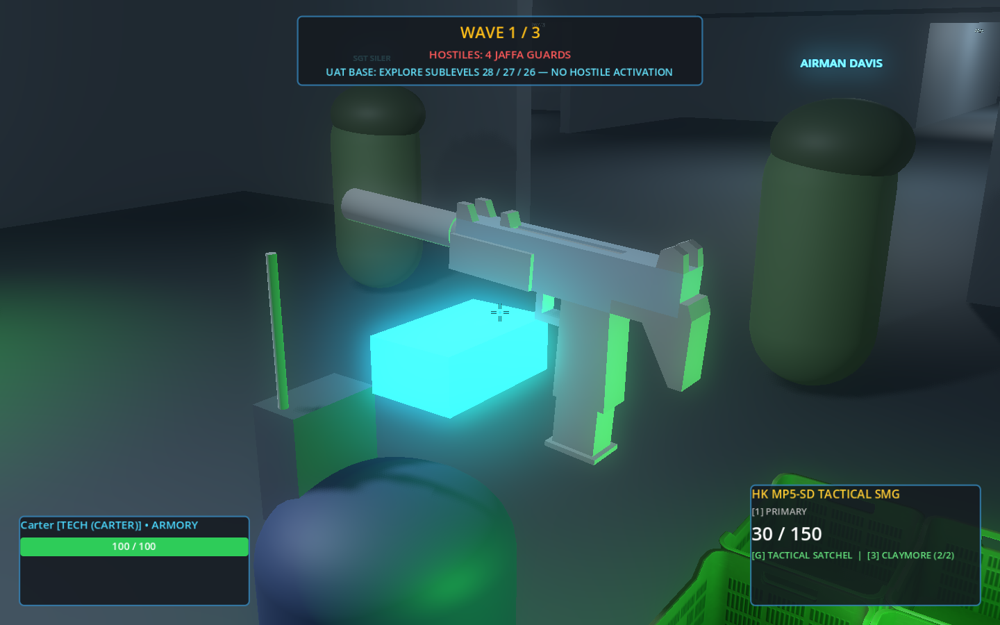
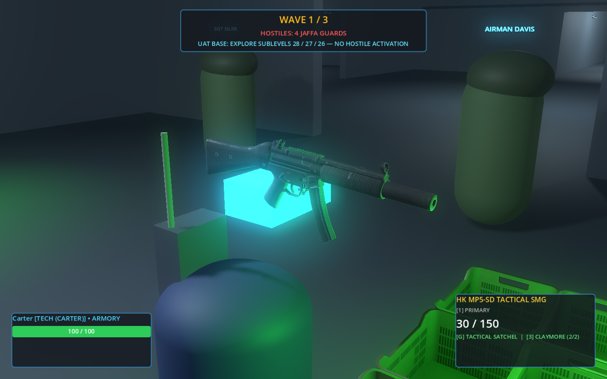

# Sprint 7: community MP5SD and distributed credits

Implementation recorded 18 November 2026 on `feat/sprint7-mp5-intake`; delivery status checked 21 November. [PR #79](https://github.com/flaxos/Team-Discovery-Channel/pull/79) merged into the planning branch on 18 November, then [PR #78](https://github.com/flaxos/Team-Discovery-Channel/pull/78) brought the combined work to main `1f634d1` on 20 November. Main’s source tree matches tested implementation `a778fb4`. **The MP5SD is integrated for review. Owner art acceptance remains pending.** The account-download blocker is resolved; Sprint 8 is not started automatically.

## Result

WillyG99’s textured MP5SD replaces the generic Kenney Uzi on Carter’s existing primary loadout. Weapon ID, damage **20**, **800 rpm**, **30/150** ammunition, **1.7 s** reload, **6 m** hearing radius, spread, authority and `MuzzlePoint (0, 0.01, -0.36)` remain unchanged. The original procedural SMG is the load-failure fallback; the retained Kenney file stays credited.

| Original stand-in, same Carter review setup | Imported MP5SD |
|---|---|
|  |  |

[SGC aiming](sprint7-captures/sgc-aim.png), [offworld encounter lighting](sprint7-captures/offworld-close.png), [source-metallic comparison](sprint7-captures/sgc-close-source-metallic.png), [distributed MP5SD credit](sprint7-captures/mp5-credit.png). Captures use the actual Carter role and existing missions, not a new camera mode or rig.

## Acquisition and conversion

[MP5SD (Silenced MP5), WillyG99](https://sketchfab.com/3d-models/mp5sd-silenced-mp5-2b96ccb2dc51496e93f41734663bcadf), CC BY 4.0. Creator describes their modelling/texturing workflow; public metadata confirms the grant and download availability. Owner supplied `~/Downloads/mp5sd-silenced-mp5.zip` (57,847,502 bytes, SHA-256 `a598f3e5149e744ff4c1147ebb85c472c255f77b296318c7403aff6dc379c8f1`). Its original is preserved. Archive members were checked for traversal, absolute paths and symlinks, then a copy was extracted outside `client/`. It contains FBX/maps without a separate licence or contrary terms; the creator listing remains the licence evidence.

[Intake](../assets/intake/mp5sd.json), [listing evidence](../assets/intake/mp5sd/listing-evidence.json), [all source hashes](../assets/intake/mp5sd/source-hashes.json), [recipe](../assets/intake/mp5sd/recipe.json), [pack result](../assets/intake/mp5sd/pack.log), [ready work order](../assets/intake/mp5sd/work-order.json), [validated intake report](../assets/intake/mp5sd/intake-report.json), [glTF validation](../assets/intake/mp5sd/gltf-validator.json).

The FBX has a **10,669-triangle gun body** and a separate **1,416-triangle red-dot sight**. The body is retained for the existing iron-sight weapon; the optional optic/lens is omitted. No new optic mechanics or animation were invented. Two material sets become six embedded **2048² lossless PNGs**, with labelled DirectX normals converted to OpenGL and AO/roughness/metallic packed into ORM. Source 4K maps remain in local intake. The unused alpha channel is uniformly 255; no general alpha/skin-packing support is claimed.

Material names alone gave the wrong pairing; actual UV/render comparison established:

| FBX material | Source map family | AO |
|---|---|---|
| `Material.002` — receiver/stock | `Material.001_*` | `MP5SD_AO.png` |
| `Material.001` — suppressor/parts | `Material_*` | No separately verified map; neutral factor |

Geometry and UVs, including unused source UV channels, are retained. Khronos validator: **0 errors, 0 warnings**; informational notices concern unused UVs and the engine extension. Repeat packing to a separate staged output produces identical bytes: **14,130,088 bytes**, SHA-256 `96214c25a3f56284af74d5c22acd847f7f81a57fd871f5fd033aa8afb0756b80`.

## Measured wrapper and cost

The suppressor points along source **+X**, unlike the M9/M249 examples. Its 22 front-ring vertices give crown centre `(32.410175, -4.766182, 0.012022)` in packed source coordinates. A uniform **0.01** wrapper scale maps +X to game -Z and translates that crown onto the unchanged muzzle. An independent vertex test measures the crown within **3 mm**, with no geometry ahead of the muzzle beyond tolerance.

True transformed bounds are approximately **0.05072 × 0.24454 × 0.69196 m**. These are measured visual proportions, not manufacturer-certified dimensions. The review camera now measures vertices instead of transforming an already enclosing AABB; the FBX’s nested rotation inflated that box.

[Measurement report](../assets/intake/mp5sd/measurements.json): first headless model parse/build **399.2 ms**, cached build **0.048 ms**. Operatives and worlds within each process share the cached mesh/materials/textures. Six decoded mipmapped images occupy **117.33 MiB**. This is an explicit **128 MiB** work-order exception to the provisional 64 MiB weapon target, retaining two 2K material sets for fidelity. It does not raise the default for other weapons. First-load cost remains a loading/optimization consideration; general LOD/cache review belongs to Sprint 10.

[Uncapped Forward+ samples](../assets/intake/mp5sd/frame-cost.json), RTX 3060, 1440×900, 60-frame steady views:

| Scene | Median frame | P95 |
|---|---|---|
| SGC original | 3.253 ms | 12.776 ms |
| SGC imported | 3.276 ms | 10.968 ms |
| Offworld imported | 1.413 ms | 8.873 ms |

These short scene samples are not causal FPS claims or a target-hardware guarantee. Cold parsing is measured separately. An initial sample was display-refresh limited to about 1 fps and is excluded; review helpers disable VSync. D-015 metallic zero remains the runtime rule; the GLB retains the metallic data and the comparison capture shows it. No global lighting/material change was made.

## Intake and credits delivered in this slice

`asset_work_order.py` and `asset_intake.py --work-order` validate the shared request, reject unresolved intake, record request/schema hashes and enforce declared geometry/material budgets. The **actual prepared MP5SD** consumes its ready request. Its hashed search record preserves selection-time observations; final archive and engine results are in the intake/verification records. `tools/requirements.txt` pins the validation dependency; CI installs it.

`sync_asset_credits.py` builds `asset_credits.tres` from the maintained manifest/licence texts. CI rejects stale output, missing model coverage or modification/licence notices. All **eight** shipped models are covered, including legacy files. The lobby’s offline reader exposes credits and complete CC BY/CC0 texts inside resource exports. The previous CC0 text was truncated; it is now the exact [official full text](https://creativecommons.org/publicdomain/zero/1.0/legalcode.txt), hash `a2010f343487d3f7618affe54f789f5487602331c0a8d03f49e9a7c547cf0499`. CC BY matches the [official text](https://creativecommons.org/licenses/by/4.0/legalcode.txt), hash `9ba9550ad48438d0836ddab3da480b3b69ffa0aac7b7878b5a0039e7ab429411`.

Gemini’s entry point follows the shared workflow/AGENTS.md instead of its stale blanket “never merge” instruction. The earlier planning PR’s hosted alert test exposed an empty marker read; that fixture now publishes complete closed marker files atomically. No alert gameplay changes.

## Verification

- `test_imported_mp5_visual`: independently decoded crown/bounds, unchanged stats/muzzle, visual-only hierarchy, two 2K material sets/mipmaps, shared cache, real firing and reload, exported attribution.
- Negative check: move the measured source crown by 1 unit (10 mm at wrapper scale); the independent bore assertion fails. Exact source restored.
- Missing-file check: temporarily move only the prepared model to ignored build storage; original two-mesh fallback, stats and muzzle pass. Exact model restored and its hash checked. No project copy was made.
- Four-operative listen and pawnless dedicated fixtures: each Carter replica has the actual `MP5SD_Obj`/10,669 triangles on split worlds, motion, retries, replacement late join during travel and second retry. No new replication payload is needed.
- Return fixture additionally uses Carter for the returning host and checks the rebuilt MP5SD on the server and client. The final full run passes this server/client return and retry scenario.
- Strict full local regression: **117/117 checks pass** (`build/test-results/sprint7-mp5-full-final/summary.json`). **60 Python tests pass** under the pinned tooling environment. Credits freshness and `git diff --check` pass. The first full run exposed an old mesh-local bounds assertion; it now checks metres in weapon space. A focused return run caught the stale host callsign expectation; both corrections pass in this final full run.
- Clean Linux release **25,100,832-byte PCK**, run from its export directory: `test_asset_credits: PASS models=8 licences=2`; `test_imported_mp5_visual: PASS`, 10,669 triangles, bore `(0,0.01,-0.36)`, real firing/reload and shared cache. No engine errors/leaks; temporary export preset removed in `finally`. Logs under `build/asset-review/sprint7-mp5-export/`. [Verification summary and PCK hash](../assets/intake/mp5sd/verification.json).
- Hosted implementation validation: **all five jobs pass** on `a778fb4b055d73fbef12e421189e5d76bf1715ed` in [run 44223594937](https://github.com/flaxos/Team-Discovery-Channel/actions/runs/44223594937), including **117/117 hosted full checks** and the multiplayer profile. The earlier infrastructure head’s green run is not reused. These recorded results do not certify later documentation edits.

## Coverage ledger and remaining acceptance

| Asset / group | Technical state | Owner art / responsible follow-up |
|---|---|---|
| MP5SD / Carter primary | Integrated; measured cosmetic wrapper and distributed credits | Pending; grip/character animation 23, general weapon audit 10 |
| M9 / P90 / M249 | Existing realistic imports retained | Pending; audit 10, grips 22–25; M249 fused bipod remains explicit |
| Staff / Zat | Existing procedural weapons | Source/import 8/9; grips 20/23/24 |
| M2 / C4 / claymore / smoke / shield | Existing gameplay presentations retained | 11/12; handling 25 |
| Crates / gate | Existing community imports retained and credited | Scene cost 15; gate/control 14/27; recorded gate evidence gap retained |
| Legacy Kenney weapons | Retained, packaged and credited | Not substituted for realistic imports |
| SGC regions / slots | Native map and current placeholders preserved | Discover/close slot ledger in 13–18 |
| Airman / Jaffa / playable bodies | Procedural controllers unchanged; no shared rig yet | 19–25 |
| Civilians | No presentation actor yet | 26 |
| Offworld / mothership | Sprint 6 corridor subset and current native geometry preserved | 27–34, integrated acceptance 35 |

Hands/grips and reload animation are not finished by this rigid import. Owner review covers source fidelity/proportions and matte-versus-metallic finish. No weapon-family completion, rig acceptance or human four-player playtest is claimed. Raw owner archives remain local intake files. Next implementation trigger: `Start sprint 8 from docs/plans/asset-vertical-slices.md`.
