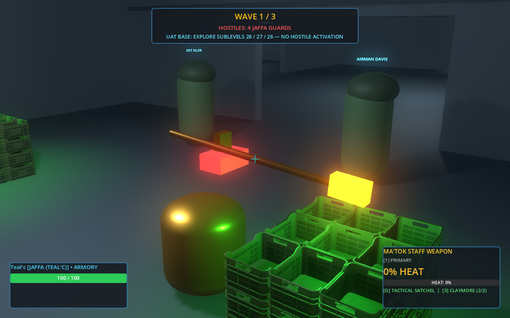
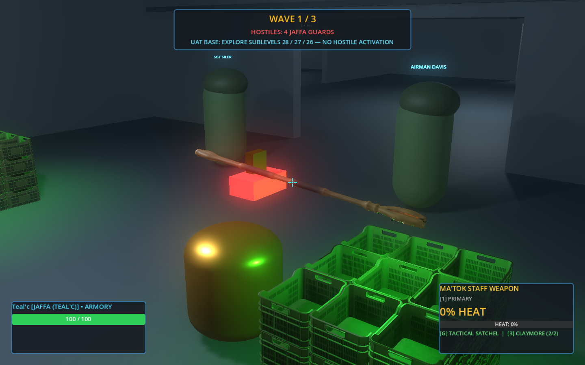

# Sprint 8 shared plasma staff

23 November 2026, based on main `af83a5c` (Sprint 7 and roadmap update #80). **One original textured staff is integrated for Teal’c, Jaffa Guard and Jaffa Shock Guard.** Owner art review remains pending. The in-game name and existing combat behavior are preserved.

| SGC before | SGC with the original staff |
|---|---|
|  |  |

See the [offworld baseline](sprint8-captures/offworld-tealc-baseline.png), [Teal’c holding the staff offworld](sprint8-captures/offworld-tealc-staff.png), [Jaffa staff close-up](sprint8-captures/offworld-jaffa-staff.png), [Teal’c firing](sprint8-captures/offworld-tealc-fire.png) and [source metallic comparison](sprint8-captures/sgc-source-metallic.png). The close-up uses the review camera in the actual mission. In the Jaffa view the current procedural bodies overlap part of the shaft. The worn bronze, dark contact zones and restrained amber vents distinguish the emitter and tail without the old glowing box. D-015’s matte runtime treatment remains in place while the GLB retains the original metallic map.

## Source and authoring

The owner supplied `~/Downloads/sg-staff-weapon.zip`. The original was left in place. A copy was checked and extracted outside `client/`. The only member was one **2,210-triangle binary STL**, with no UVs, texture files or creator note. The listing advertises CC BY 4.0 and one viewer texture. The original archive provides no usable map or further authorship evidence. The archive was rejected as game input. [Listing metadata](https://api.sketchfab.com/v3/models/c11ccfdb79874c748a14bfef83d643d2) and [archive hashes and decision](../assets/intake/staff/archive-evidence.json).

The other close candidate from [Ska-Ara](https://sketchfab.com/3d-models/inspired-by-stargate-sg-1-goa-uld-staff-weapon-973f843c19ca4496b8a38106f2a96414) uses CC BY-NC-SA 4.0. [omassyx’s plasma staff](https://sketchfab.com/3d-models/plasma-staff-omsx-03502d16564e40e3ac45a26ca55f407f) has downloads disabled, and [Shadow_Ghost’s staff](https://sketchfab.com/3d-models/plasma-staff-6ee00886152b4c23a6c8534a4f05c5f6) uses a different fantasy silhouette. The historical AP‑1b commit `e72ff28c` only attached a 384-triangle untextured stand-in to the player. All search decisions, including the conflicting terms on a printable statue, are in the [work order](../assets/intake/staff/work-order.json).

The documented original-art fallback was authored with [the reproducible profile and material tool](../../tools/author_staff_visual.py). It uses the project’s measured fit and its own geometry and material functions. No downloaded geometry or pixels entered the model. The output has **9,216 triangles, one material and four embedded 1024² lossless maps** for base colour, normal, ORM and emission. The normal and ORM share the same source UVs as the colour map. The model is credited as an original project asset in the lobby and release export.

To reproduce in the existing checkout using the Python, NumPy and Pillow versions in the work order:

```sh
python3 tools/author_staff_visual.py /tmp/tdc-asset-intake/staff/original build/asset-review/sprint8/rebuilt.glb
cmp build/asset-review/sprint8/rebuilt.glb client/assets/weapons/tri_vane_staff.glb
```

Regeneration and repacking both reproduced the same 2,656,000-byte GLB. [Pack hashes](../assets/intake/staff/pack.json), [GLB intake](../assets/intake/staff/intake-report.json) and [Khronos validation](../assets/intake/staff/gltf-validator.json) are recorded. Khronos reported zero errors or warnings. The intake consumed the ready work order and recorded its hash.

## Fit and runtime cost

| Consumer | Local frame | Earlier procedural length | Imported length | Existing muzzle Z |
|---|---|---:|---:|---:|
| Teal’c | `WeaponStaff` | 1.670 m | 1.644 m | −1.050 m |
| Jaffa Guard and Shock Guard | `StaffMount` | 2.000 m | 1.907 m | −1.100 m |

The wrapper aligns the circular emitter lip to the existing marker. NPCs use a uniform 1.16 scale to stay within their existing visual envelope. Independent vertex checks find each lip centre within 3 mm of its marker. Both shaft contacts are recorded in the player frame in the work order. Apply the same NPC transform to map them onto `StaffMount`. Animated grips and hand clearance in motion belong to Sprints 20 and 24. The model has a fixed recessed emitter and uses the existing plasma effects.

[Live baseline fit](../assets/intake/staff/baseline.json). Each process parses one model and shares the underlying mesh and material across its copies. The four mip chains total **16.0 MiB** decoded, within the 64 MiB cap. First build was roughly **60–65 ms** headless and a cached visual copy **under 0.1 ms** in the recorded runs. LOD review is scoped to Sprint 10.

| Short Forward+ sample, RTX 3060, 1440×900 | Median | P95 | Draw calls at sample end |
|---|---:|---:|---:|
| SGC before | 9.459 ms | 18.363 ms | 2713 |
| SGC with staff | 11.486 ms | 26.467 ms | 2711 |
| Offworld before | 2.163 ms | 20.157 ms | 29 |
| Offworld with staff | 2.935 ms | 20.649 ms | 28 |

These are 60-frame samples from live mission views. They include scene and camera variation, so use them as review context and measure a controlled dense encounter before setting a performance target.

## Verification

- The staff fixture checks both Jaffa variants and the player. It verifies the geometry against the markers, mesh and material sharing, maps and mipmaps, and real plasma bolts at the existing origins. The 10 mm alignment perturbation failed the emitter assertion. Removing the GLB exercised all three original fallback paths and plasma firing. Both files were restored before final checks.
- Four-player fixtures passed on listen and dedicated servers. Teal’c travels to the offworld site and retains the mounted asset on all replicas. The fixtures also cover delayed loading, retry and a replacement late join during travel.
- All 60 Python tests passed. The Linux release export (27,764,144-byte PCK) passed the staff fixture and the lobby credits test. There are nine packaged model entries and both full licence texts. The temporary export preset was restored.
- Full regression follows the existing [testing procedure](../TESTING.md). [Verification record](../assets/intake/staff/verification.json) and the sprint delivery PR track local and hosted results separately.

## Coverage

| Group | State | Remaining work |
|---|---|---|
| M9, P90, MP5SD and M249 | Previous textured imports retained | Sprint 10 review and Sprints 22–25 grips. M249 bipod is fused. |
| Shared staff | Textured rigid visual integrated, owner art review pending | Serpent Jaffa grip in 20, Teal’c grip in 24 and broader LOD review in 10. |
| Zat | Procedural visual | Sprint 9 source and integration. |
| Mounted/deployed kit | Existing presentation | Sprints 11–12. |
| SGC, Jaffa, Airman, team and civilians, offworld and mothership | Follow the authored scope and current placeholders in the ledger | Sprints 13–35. |

The next planned slice is [Sprint 9, Zat](../plans/asset-vertical-slices.md). Owner art acceptance remains open for the staff.
