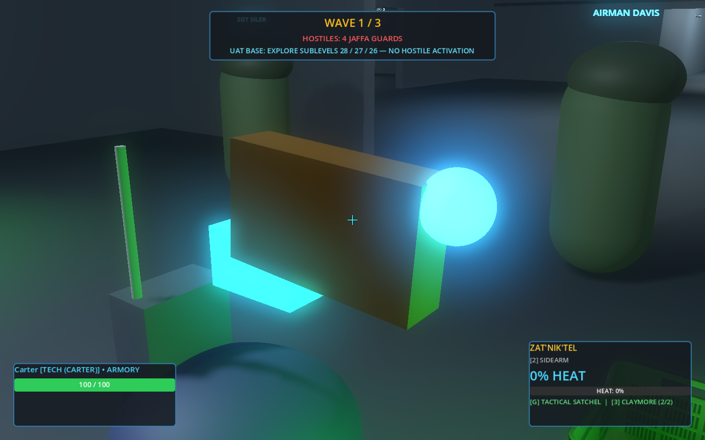
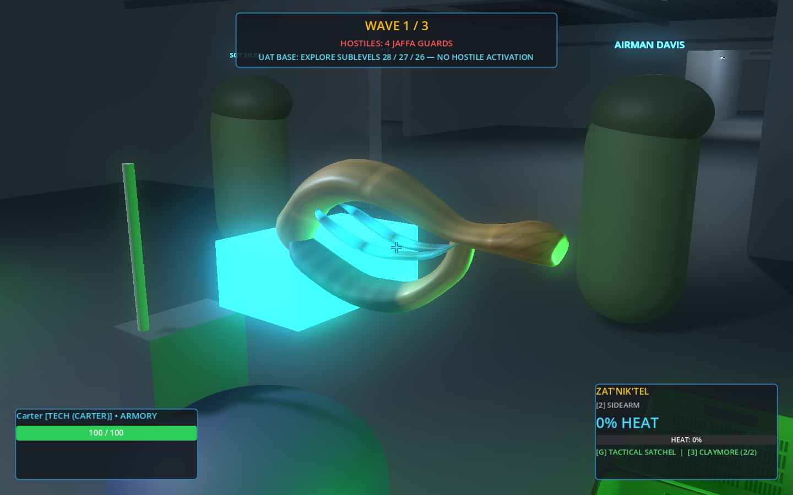

# Sprint 9 Zat visual

23 November 2026, based on main `9286691` after the shared staff landed in #81. Carter and Teal’c can equip the same original textured Zat sidearm. Owner art acceptance and animated grips remain open.

## Source decision

[BiggsProductions’ portfolio model](https://sketchfab.com/3d-models/zat-nik-tel-43d8bb5cdf6b4d05b564a0efea4fb672) is the older listing. The artist describes their modelling and paint work, and the listing has downloads disabled and no licence. A newer [fraeric123 listing](https://sketchfab.com/3d-models/stargate-zatniktel-a03581004d8040d7873e0335aaf09f52) advertises CC BY 4.0 and a download. Their previews show matching distinctive details and both list 8,286 vertices, 16,402 faces and one material. The later listing gives no authorship statement or upstream grant. The similarity is evidence of a likely relationship between the models, so the later grant was not used. [Dated primary metadata comparison](../assets/intake/zat/source-comparison.json).

The other search results were a CC BY-NC-SA chest and untextured cosplay STL files without an established redistributable runtime asset. The AP‑1b historical `zat_sidearm.glb` on `e72ff28c` has 300 triangles, three flat materials and zero image files. The team-authored fallback uses a distinctly open frame, paired cyan rails, sculpted bronze shoulders and an inset grip. It was built from the game’s own measurements. [Ready work order and search record](../assets/intake/zat/work-order.json).

## In-game fit

The new mesh is 0.3134 m long and contains 8,448 triangles. Its emitting rim is centered on the existing marker `(0, 0.05, −0.20)` in weapon-local space. Heat, the 4 m hearing radius, the 35 m shot range and the cyan trace all remain on the existing gameplay paths. The frame is rigid and uses the current idle and fire presentation. The work order records one contact point on the grip. Animated hand placement belongs to Sprints 23 and 24. [Measured procedural envelope](../assets/intake/zat/baseline.json).

The asset uses a single surface, four embedded 1K lossless maps (colour, tangent normal, ORM and emission), D-015 runtime finish and the existing shared model cache. Four decoded mip chains total 16.0 MiB per process. The headless targeted run measured roughly 61 ms cold and 0.047 ms for a cached copy. A procedural box and sphere remain the load fallback. Broader cost and LOD review belongs to Sprint 10.

Rebuild from the checkout with the Python, NumPy and Pillow versions in the work order:

```sh
python3 tools/author_zat_visual.py /tmp/tdc-asset-intake/zat/original build/asset-review/sprint9/rebuilt.glb
cmp build/asset-review/sprint9/rebuilt.glb client/assets/weapons/loop_frame_zat.glb
```

A repeat build produced the same 2,767,800-byte GLB. The lossless container pack uses `tools/gltf_to_glb.py`. No portfolio geometry or textures are inputs. The credits distinguish the visual as original project art. [Pack and map hashes](../assets/intake/zat/pack.json), [validated intake](../assets/intake/zat/intake-report.json) and [Khronos report](../assets/intake/zat/gltf-validator.json).

## Evidence

| Carter's SGC sidearm before | Original Zat visual |
|---|---|
|  |  |

The [offworld capture](sprint9-captures/offworld-zat-discharge.png) shows the existing cyan shot trace meeting the emitter. The [aim view](sprint9-captures/sgc-aim.png) shows the current procedural pose and missing hand rig. A [source-metallic comparison](sprint9-captures/sgc-source-metallic.png) records the alternate finish alongside the shipped D-015 treatment.

| Short Forward+ sample, RTX 3060, 1440×900 | Median | P95 | Draw calls at sample end |
|---|---:|---:|---:|
| SGC before | 9.489 ms | 23.207 ms | 2578 |
| SGC with Zat | 5.160 ms | 13.957 ms | 1881 |
| Offworld before | 1.826 ms | 18.920 ms | 30 |
| Offworld with Zat | 2.348 ms | 13.882 ms | 30 |

Each row covers 60 frames from a live scene. Differences in camera, draw calls and scene state confound a direct performance comparison. Sprint 10 measures all six weapons together.

- The focused fixture checks the actual emitter vertices against the gameplay muzzle, verifies bounds and shared resources and fires through the existing signal path. The quiet hit sequence runs with the new visual and confirms stun, dragging, subsequent kill and vaporization without alert escalation.
- The four-player fixtures retain primary weapon coverage and also equip the Zat on Carter and Teal’c, check the active slot on replicas and travel with Carter’s Zat while a replacement peer signs in. Retry resets to the primary loadout.
- Removing the GLB produces both original procedural pieces and a successful shot. Moving the visual 10 mm fails the independent emitter check. Both test mutations were restored.
- Clean Linux release pack (30,537,920 bytes) passed the Zat fixture and credits reader with ten model entries and both full licence texts. No original community archive data ships in the pack.
- glTF validation reports zero errors and warnings. All 60 Python tests passed. Local and hosted full validation are tracked on the delivery PR. [Verification record](../assets/intake/zat/verification.json).

## Coverage after this slice

| Group | State | Remaining work |
|---|---|---|
| M9, P90, MP5SD, M249 | Existing textured imports | Sprint 10 audit; four-class grip work through Sprint 25 |
| Staff | Original textured model merged in #81 | Owner art, pose clearance and grips in Sprints 20 and 24 |
| Zat | Original textured sidearm integrated for review | Owner art, Carter and Teal’c grips in Sprints 23 and 24 |
| M2 and field kit | Existing visuals | Sprints 11 and 12 |
| SGC, characters, offworld and mothership | Existing authored scope and placeholders | Sprints 13–35 |

The next planned slice is the [Sprint 10 held-weapon audit](../plans/asset-vertical-slices.md).
