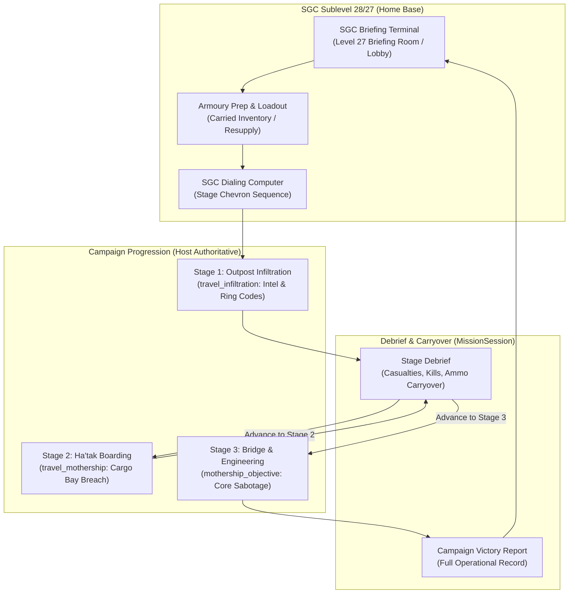

# Milestone CA-1 — Campaign Progression & Linked Mission Chains

Delivers **Milestone CA-1** from the authoritative [ROADMAP.md](../../ROADMAP.md) and [Master Development Plan](../plans/master-development-roadmap.md) (Workstream L: Campaign and Replayability).

CA-1 transitions **Team Discovery Channel** from disconnected standalone missions into a linked operational campaign system, connecting SGC Briefing Room preparations, multi-stage gate deployments, carried squad inventory across operations, and persistent mission debrief records conforming to [Decision D-007](../DECISIONS.md#d-007--network-authority-and-persistent-state).

---

## 1. Executive Summary

| Attribute | Specification |
|---|---|
| **Milestone** | CA-1 (Campaign Progression & Outcomes) |
| **Branch** | `feat/ca1-campaign-progression` |
| **Campaign Definition** | `operation_hatak_strike.tres` ("Operation Ha'tak Strike") |
| **Operational Stages** | 3 linked expeditionary stages (Outpost Intel $\rightarrow$ Mothership Cargo Bay Breach $\rightarrow$ Bridge & Reactor Sabotage) |
| **Squad Inventory Carryover** | Active & reserve ammunition, health, tactical plates, C4, claymores, and smoke grenades carried across stages via `MissionSession` |
| **SGC Briefing Terminal** | Interactive terminal (`SGCBriefingTerminal.tscn`) in Level 27 Briefing Room displaying live stage roadmap, target objectives, and 7-glyph gate address |
| **SGC Dialing Alignment** | `DHDDialer.gd` automatically aligns with the active stage's chevron sequence |
| **Persistence** | Host-authoritative disk persistence (`user://campaign_save.json`) with resume and reset |
| **Networking & Replication** | ENet RPC synchronization (`sync_campaign_state`) across listen and dedicated servers |

---

## 2. Operational Campaign Architecture: Operation Ha'tak Strike

### Stage Breakdown

1. **Stage 1: Outpost Infiltration & Intel Recovery (`travel_infiltration`)**:
   - **Mission**: Infiltrate Goa'uld offworld compound.
   - **Objectives**: Sabotage secondary naquadah generator to disable perimeter grids, then access the command terminal to download Ha'tak mothership telemetry and ring access codes.
   - **Gate Address**: `["UP", "RIGHT", "DOWN", "LEFT", "UP", "UP", "RIGHT"]`.
   - **Unlocked Intel**: Ha'tak Mothership Cargo Bay Gate Address & Ring Frequency.
2. **Stage 2: Mothership Cargo Bay & Ring Breach (`travel_mothership`)**:
   - **Mission**: Dial Ha'tak cargo bay Stargate.
   - **Objectives**: Breach security bulkheads, neutralize cargo patrols, and breach to upper decks via transport rings. Secure intermediate deck manifest.
   - **Gate Address**: `["RIGHT", "UP", "LEFT", "DOWN", "RIGHT", "UP", "DOWN"]`.
   - **Unlocked Intel**: Command Bridge Layout & Reactor Diagnostic Keys.
3. **Stage 3: Bridge & Hyperdrive Reactor Sabotage (`mothership_objective`)**:
   - **Mission**: Infiltrate upper decks of the Ha'tak mothership.
   - **Objectives**: Sabotage hyperdrive reactor core in Engineering, override bridge navigation helm, and execute a tactical withdrawal under red alarm to the Stargate for debrief at SGC.
   - **Gate Address**: `["UP", "UP", "LEFT", "RIGHT", "DOWN", "RIGHT", "LEFT"]`.
   - **Outcome**: Campaign Victory — All 3 operational stages completed!

---

## 3. Carried Squad Inventory & Health Model

Conforming to [Decision D-007](../DECISIONS.md#d-007--network-authority-and-persistent-state), operative state is captured at stage completion and reapplied upon spawning in the SGC for subsequent stages:
- **Weapons & Ammunition**: Current magazine count, reserve ammunition, and heat buildup are preserved. Operatives who conserve ammunition in Stage 1 begin Stage 2 with their remaining reserves unless resupplied at the SGC Armoury.
- **Health**: Operatives with sustained combat damage carry partial wounds into the next stage (clamped to a minimum of 25.0 HP so downing does not cause instant death on spawn).
- **Tactical Munitions**: C4 satchel charges, claymore mines, smoke grenades, and deployable shields are preserved.

---

## 4. Verification & Automated Test Evidence

Four dedicated test suites validate the implementation:

1. **`test_campaign_definition.gd`**:
   - Schema validation, stage indexing, chevron sequence verification, and error rejection on malformed stages.
   - **Result**: `PASS` (0 errors).
2. **`test_campaign_persistence.gd`**:
   - Tests `CampaignManager` lifecycle, stage completion recording, stage advancement, disk save (`user://test_campaign_save.json`), fresh instance reloading, and clean campaign reset.
   - **Result**: `PASS` (0 errors).
3. **`test_campaign_progression.gd`**:
   - End-to-end integration test running through the 3-stage campaign loop.
   - Validates SGC Briefing Terminal display updates, SGC dialer chevron alignment, stage debrief badges (`STAGE 1 SECURED`, `PROCEED TO NEXT STAGE`), squad carryover application upon SGC reload, and final `CAMPAIGN VICTORY` modal.
   - **Result**: `PASS` (0 errors).
4. **`test_campaign_multiplayer.gd`**:
   - Two-process ENet multiplayer test (Host + Client).
   - Validates initial state snapshot broadcast upon client connection, remote client stage synchronization, host stage advancement, and clean multi-peer session teardown.
   - **Result**: `PASS` (0 errors).
5. **Python & Regression Suites**:
   - `python3 tools/sync_asset_credits.py --check`: 27 assets verified.
   - `pytest tools/tests`: 60 passed in 25.61s.

---

## 5. Maintained Files & Touchpoints

- **New Assets & Scripts**:
  - `client/scripts/campaign/CampaignDefinition.gd`: Typed campaign resource schema.
  - `client/resources/campaigns/operation_hatak_strike.tres`: Canonical 3-stage campaign.
  - `client/scripts/campaign/CampaignManager.gd`: Autoloaded host-authoritative campaign director.
  - `client/scripts/props/SGCBriefingTerminal.gd`: Level 27 Briefing Room interactive terminal script.
  - `client/scenes/props/SGCBriefingTerminal.tscn`: Terminal visual, screen readout, and interaction area.
  - `client/tests/test_campaign_definition.gd`: Schema unit test.
  - `client/tests/test_campaign_persistence.gd`: Disk persistence & state test.
  - `client/tests/test_campaign_progression.gd`: End-to-end multi-stage integration test.
  - `client/tests/test_campaign_multiplayer.gd`: Multi-process replication test.
- **Modified Core Scripts**:
  - `client/project.godot`: Added `CampaignManager` autoload singleton.
  - `client/scripts/net/NetworkManager.gd`: Added `MISSION_CAMPAIGN_OPERATION` to `MISSIONS` dictionary.
  - `client/scripts/ui/Lobby.gd`: Added campaign mode selection, stage progress badge, and launcher binding.
  - `client/scripts/world/MainGameCoordinator.gd`: Dynamic site scene resolution for active campaign stages.
  - `client/scripts/world/GateRoom.gd`: Applied squad carryover to newly spawned operatives.
  - `client/scripts/world/MissionSession.gd`: Debrief campaign headers, stage badges, and squad state capture.
  - `client/scripts/props/DHDDialer.gd`: Pre-configured chevron sequence alignment with campaign stage.
  - `client/scripts/ui/HUD.gd`: Handled `"PROCEED TO NEXT STAGE"` button action and campaign finalization.
  - `client/scenes/world/Level27Complex.tscn`: Instantiated `SGCBriefingTerminal` in Level 27 Briefing Room.
