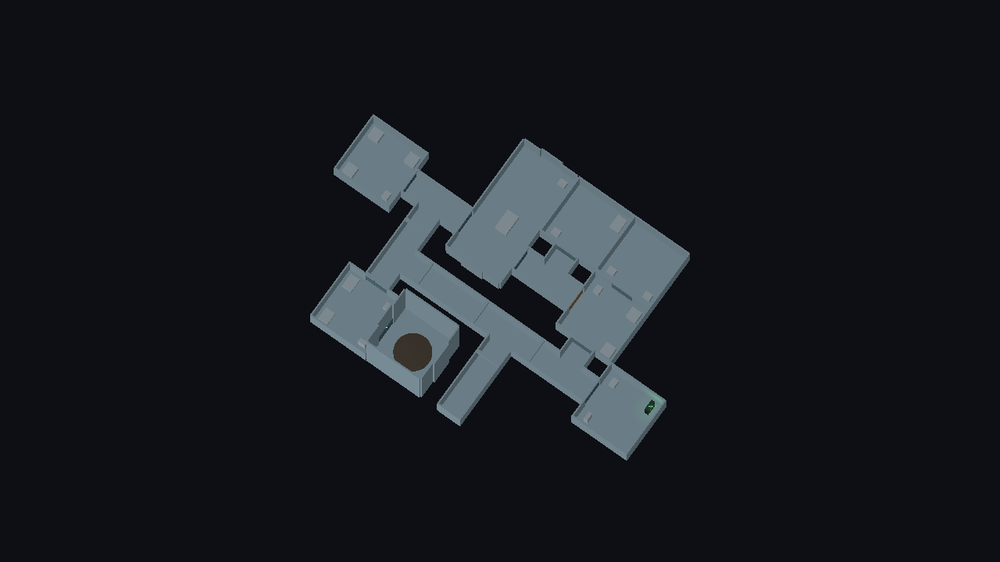
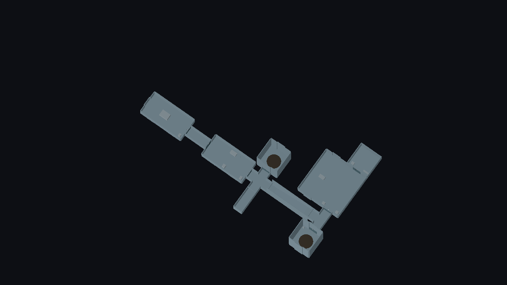
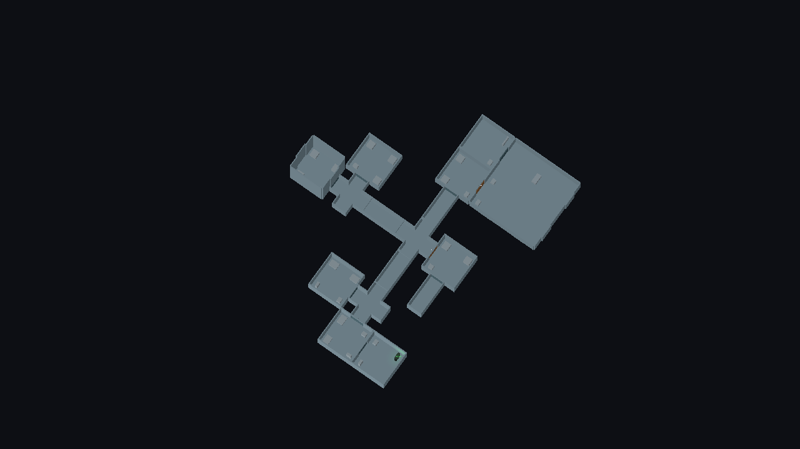
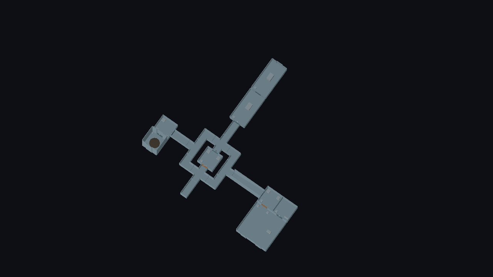

# AI level authoring 2.0 — friction study and benchmark

Scope: planning quality, deterministic layout operations and token efficiency for the shared authoring CLI. No prefabs, themes, gameplay systems or SGC code were added or changed. Layouts remain native `LevelLayout` `.tres` resources; plan requests are disposable.

## Stage 1: where the old workflow cost effort

Three briefs were authored with the tools as they were on `main`. All three validated on the first structural attempt, so the old workflow was already serviceable. The effort was in reasoning the agent had to do itself:

| Friction | Evidence in the baseline runs |
|---|---|
| Loops need hand-computed grid positions and rotations | The 15-room loop needed 15 coordinates and 11 non-zero quarter turns, worked out from the rotation convention |
| The rotation convention is only visible in detailed socket transforms | Two `catalogue --detail` lookups per brief to confirm which way sockets face and where multi-cell rooms have their origin |
| Sockets are named by their unrotated local direction | 14–16 socket names typed per tree-shaped map; a security door on a rotated corner needed its pre-rotation name |
| No way to confirm route requirements | "Two distinct routes" could only be asserted by the agent, not checked |
| Discovery is by text search over large records | 29.6 KB for the compact catalogue; no gameplay roles, cover or objective facts |
| Verbose responses | `validate` repeats the theme report for every room |
| Common clusters rebuilt room by room | Checkpoint-plus-command and barracks-plus-armoury were re-derived each time |

One unrelated failure occurred: saving to a `user://` subdirectory that did not exist.

## What changed

| Area | Change |
|---|---|
| Discovery | `catalogue --summary` (13.7 KB against 29.6 KB). `tactical` block on modules and presets separating authored intent, derived facts and inferred heuristics |
| Planning | `plan` command: rooms and links in, native layout out. Chooses modules, poses and sockets; closes loops; handles decks via ramp rooms; hangs composites as clusters. Placement uses the existing `LevelAssembler.snap` and `LevelLayoutValidator`; there is no second geometry solver |
| Topology | `topology` command and plan `requirements`: eleven connectivity checks, reported separately from structural validity |
| Composites | Six new building blocks; `composite` and `place` accept `attach` without socket names |
| Output | `validate --summary` / `build --summary` collapse per-room theme reports |

Existing commands, request fields and saved layouts are unchanged. Coordinate placement of composites still works.

## Benchmark

One CLI call is one invocation of `tools/level_authoring.py` during authoring. `prepare` is excluded from both columns. Discovery calls were shared across the three briefs in both runs and are counted once per run, on the first brief.

| | Goa'uld compound | | Asgard facility | | Tau'ri Alpha Site | |
|---|---|---|---|---|---|---|
| | Before | After | Before | After | Before | After |
| Rooms built | 15 | 15 | 8 | 11 | 8 | 16 |
| CLI calls to a fully validated (baked) map | 5 | 3 | 4 | 2 | 2 | 3 |
| of which discovery | 2 | 1 | 2 | 0 | 0 | 0 |
| Failed calls | 1 (missing output folder) | 0 | 0 | 0 | 0 | 1 (tool gap, see below) |
| Failed placements | 0 | 0 | 0 | 0 | 0 | 0 |
| Validation repairs | 0 | 0 | 0 | 0 | 0 | 0 |
| Coordinates written by the agent | 15 | 0 | 1 | 0 | 1 | 0 |
| Rotations worked out by the agent | 11 | 0 | 0 | 0 | 0 | 0 |
| Socket names chosen by the agent | 2 | 0 | 14 | 0 | 16 | 0 |
| Route requirements machine-checked | 0 | 6 of 6 pass | 0 | 5 of 5 pass | 0 | 6 of 6 pass |
| Implementation scripts read while authoring | 0 | 0 | 0 | 0 | 0 | 0 |
| Structural code changes needed | 0 | 0 | 0 | 0 | 0 | 0 |
| Request size (bytes) | 1505 | 1821 (includes requirements) | 1426 | 1666 | 1423 | 1347 |
| Planner search attempts | — | 1248 | — | 11 | — | 5 |

The "before" count ends with `validate`; the "after" count ends with `build`, which runs the same full validation and bake and also exports the scene. So the old workflow needs one more `build` call per map to reach the same point, and both then spend one `preview --capture` call.

**Agent token usage:** not recorded. No reliable per-layout meter is available in this session, and no estimate is substituted. The only measured proxy is response size: the discovery call fell from 29,570 to 13,679 bytes.

### Reading the numbers

- **Where the gain is real:** loops, route verification and clusters. The looped compound went from 26 hand-derived spatial values to none, and its "two distinct routes" requirement is now checked and reported with the actual routes. The Alpha Site doubled in size for a smaller request because ten of its rooms come from three composites.
- **Where the gain is modest:** tree-shaped maps. The old `attach` chain already avoided coordinates; the saving there is socket names and deck bindings.
- **The checks caught a real design error.** The first looped test plan hung the objective off a single approach room. The structure validated, but `distinct_routes` correctly reported one route, not two. The benchmark map gives the objective chamber two doors.
- **The "after" maps are larger** for the Asgard and Alpha briefs, so call counts are not like for like in the tool's disfavour.
- **Not a fresh-agent test.** The same agent that built the tools ran both passes, with the baseline run first. An independent agent starting from the guide is the missing measurement.

### The one failed call

The Alpha Site plan was first refused because its destination was a room inside a cluster, which the planner did not yet accept. That was a tool limitation, fixed in this branch (cluster rooms are valid destinations); the request itself was not changed. Two further planner weaknesses were found and fixed while authoring the 20-room example: rooms that host clusters now keep a doorway free for them, and loops with a short cross-link are searched from the cross-link outward.

## Demonstration maps

All four validate, bake and build through the shared pipeline. Their briefs and requirement lists are in `docs/maps/briefs/ai2_*.requirements.json`; `test_level_planning` re-checks them. Faction themes resolve to the neutral fallback because faction art does not exist.

| Layout | Brief | Rooms | Requirements |
|---|---|---|---|
| `ai2_goauld_security_compound.tres` | 15-room security compound, objective chamber, two routes to extraction | 15 | Two room-disjoint routes objective → extraction; a route avoiding the checkpoint; declared dead ends; roles |
| `ai2_asgard_research_facility.tres` | Two-deck research facility with command, medical and transport | 11 | Walking route entry → medical → command → upper rings; upper deck only via the ramp; roles |
| `ai2_tauri_alpha_site.tres` | Alpha Site with barracks, checkpoints, storage, defensible command | 16 | Command only via its antechamber; interior only via the gate checkpoint; three branches; roles |
| `ai2_goauld_compound_two_deck.tres` | 20 rooms, central checkpoint, two infiltration routes, generator objective, upper command deck, ring room | 20 | Two unlocked routes around the locked gate; generator reachable unlocked; command only via the ramp; roles |

The captures were inspected for overlaps, gaps and stranded rooms; none were seen. They use the standard roof cutaway. Human walk-through UAT has not been done.

## Known limitations

- **One shell per preset room.** The planner uses the smallest compatible module unless `size` or `module_id` says otherwise; it does not try alternatives on its own.
- **Bounded search.** Depth-first with a 4000-attempt default budget. Large or awkward loops can exhaust it; the diagnosis says so.
- **It does not repair graphs.** A loop that cannot close is reported, not fixed, and no adapter or ramp is inserted for you.
- **Clusters are placed after the main graph** and do not cause it to be rearranged. A cluster that does not fit is an error.
- **Compact layouts.** Rooms may end up wall to wall with capped, unlinked doorways. That is valid but a designer may want more spacing.
- **Positions carry floating-point noise** of about a micrometre from the shared snap, as existing `attach` placements do.
- **Topology is connectivity only.** Walking links, not ring transport; no distances, sightlines, cover or patrol coverage.
- **Tactical metadata is not play-tested.** Authored roles and sightlines are design intent; cover markers on bare modules are positions, not cover.
- **Editor integration:** planned layouts open in the modular editor like any other; the editor has no plan or topology panel.
